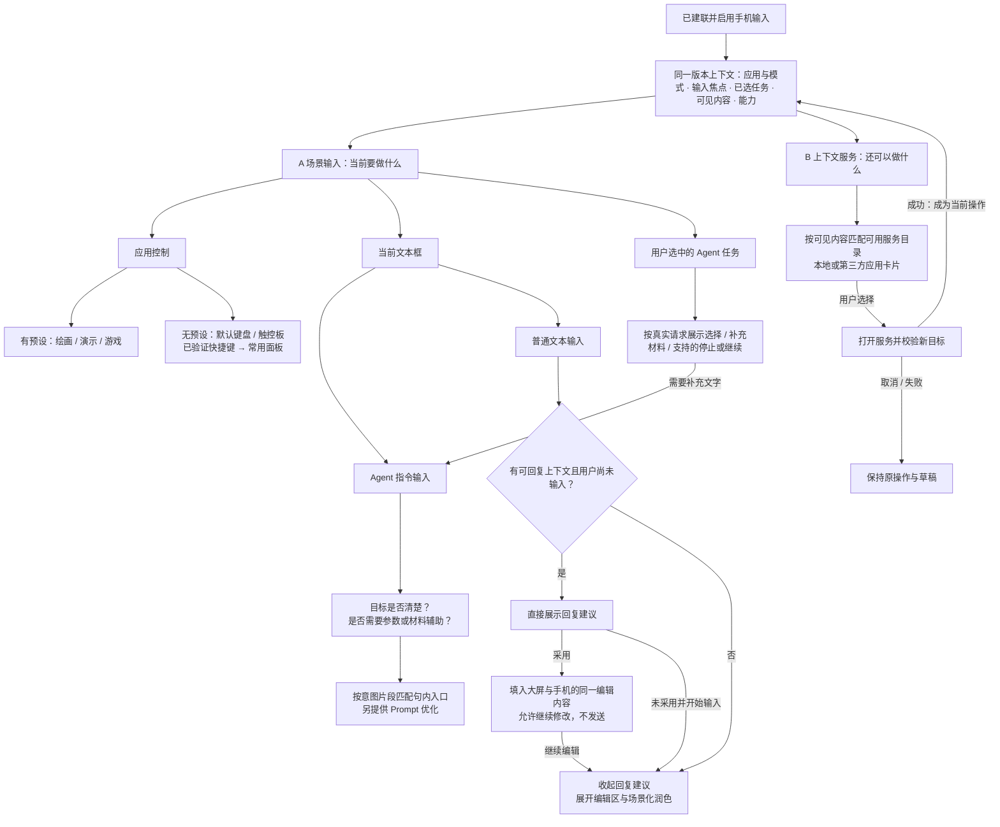

# Adaptive Input Design System

## Canonical color foundation — 2026-10-20

New designs default to Harmony blue `#0A59F7` with neutral translucent Liquid Glass. `Input / Theme` owns System and application accent modes; Material owns readable neutral text, transparent surfaces and light/dark treatment. Components inherit the owning frame's theme. Task status, parameter values and application logos remain independent. This supersedes the implicit WeChat default and hard-coded WorkBuddy theme inside generic docks. Contract and migration scope: [Liquid Glass color tokens](liquid-glass-color-tokens.md). The migration scope now includes historical application scenes, transitions and component masters across pages 0:1, 21:6225 and 2:2. GoPaint uses separate accent-fill and readable accent-foreground roles; ordinary dark-surface text/icons remain light.

## Generated shortcut panel · 12 slots — 2026-10-20

Design experiment only, in Figma `1903:88793`. Replaces the prior nine-slot placeholder capacity, without changing the runtime renderer. The main panel contains eleven registered actions and one fixed trailing More folder; no duplicate editing actions from the shared dock. More previews its first four actions and opens a popup with at most nine keys (3×3), no close icon; tap outside to dismiss. It supports a 450 ms hold to enter arrangement mode. Arrangement never executes an action. Do not display the generic Current document heading.

Insertion commits on drop: subsequent actions shift and the last action moves to the front of More. More itself never moves. Drag cancellation restores the previous order. Returning an action to More puts it first and backfills the last main slot from the previous overflow head. Keep a user's app/scene order; new generated actions enter More. Freeze generation updates during holds, dragging and arrangement. Figma uses scripted paths; arbitrary drag geometry, persistence and gesture arbitration remain development work.

Selected layout A uses 3×4 at 96 px; remove B/C comparison screens while retaining referenced components. Animate pickup, leaving the popup, neighbor displacement, release and the trailing key shrinking into More as consecutive states. Displacement before release is reversible preview only. Standard expanded trackpad uses 3×4 at 72 px; compact 390×700 uses seven actions plus More in 4×2 at 80 px. Temporarily hidden actions return to their prior positions when space recovers. If the overflow exceeds nine, paginate rather than add a fourth row; the current main flow contains six overflow actions. Preserve the 368 px shared expanded dock and its voice/mouse geometry. Component and prototype ledger: [12-slot design record](nine-key-layout-placeholder.md).

## Desktop / WorkBuddy trackpad parity — 2026-10-20

Supersedes the scene-specific voice and taller desktop exceptions below. Desktop default and WorkBuddy use the same expanded dock: 390 × 368, a 354 × 222 dot-grid surface, and the shared 56 px footer. Voice always shows the microphone plus 智慧语音 in trackpad mode; keyboard mode may retain its icon-only voice. Keep 96 + 8 + 146 + 8 + 96 footer geometry, centered joined mouse keys and application theme. Anchor the dock to the bottom, extend its glass through the native safe area, and preserve existing pointer/voice routing. Desktop has no unowned composer. Verification evidence is recorded separately from design and device claims.

## Trackpad bottom-row revision — 2026-10-19

Design override: the expanded trackpad ends with keyboard toggle, trackpad toggle, a joined left/right mouse-key group, and smart voice at the bottom-right. At 390 px phone width, the 354 px inner row has a 96 px mode area, 8 px gap, 146 px joined mouse group, 8 px gap, and 96 px voice area. Each mode control has a 44 px visual within a non-overlapping 48 px hit area. The mouse group uses one glass outline with a fine central divider; its independent left and right hit regions are 73 px each. All controls remain 56 px high. The mouse group is centered exactly under the gesture surface. Preserve the existing voice label or icon-only treatment of each scene, mouse actions, dotted surface and dock height. Apply to shared trackpad variants and the taller desktop-default trackpad; update prototype hit areas with the new mode/voice positions. This revision is Figma/design-only and does not claim a runtime layout update.

## Delivery

Editable design-only library in Figma file `ApFLno64NcMoA17MiPFfZh`, page `2:2`. The current scope uses one Liquid Glass skin, a System default and application themes, phone and fold-PC lower-screen layouts, component states, motion examples, and a future rendering contract. No application source, device protocol, real model connection or Code Connect implementation is included.

Page sections: foundations; actions and parameters; text and contextual controls; dedicated panels; game; phone recipes; fold-PC recipes; decision/rendering contract; transitions. Component masters and existing referenced sources occupy separate dependency sections. The main demo controllers and transition examples were aligned to the three-region hierarchy on 2026-10-14. The WorkBuddy section is updated in place under the dated revisions below.

The component registry is `samples/adaptive-component-registry.json`; four fictional input-plan examples are in `samples/adaptive-ui-plan-examples.json`. The exact Figma construction ledger and validation artifacts are under ignored `artifacts/adaptive-design-system/`. Construction scripts use the `figma-adaptive-` and `figma-three-region-` prefixes under `scripts/` and are not runtime application code.

## Foundations and interaction

- Skin and application theme are independent. Figma retains `Skin=Glass` as the stable implementation key, displayed as Liquid Glass; the `Adaptive / Application` collection chooses accent and soft background. Theme order: WeChat, Email, WorkBuddy, Word, Sheet, Presentation, Doubao, Mario.
- Existing Mobile Input palette primitives, Noto Sans SC fonts, icon components and Glass effect style are reused. New semantic colors alias primitives. New spacing, radii, sizes and feedback variables have scoped properties and CSS code syntax.
- Ordinary touch controls have 48 px targets; primary controls 56 px; hold-to-draw 168 px square. Phone alphabet keys are the documented dense-layout exception (32 px nominal width, at least 48 px high); wide keyboards distribute additional width rather than scale height. The three-row compact pen panel exposes the complete color row as one 152 × 48 target; its expanded palette offers five separate 48 × 48 targets.
- Selected and pressed are distinct. Selecting a pen does not imply drawing. Only the held drawing state uses deep red `#A52D20`; release or pointer exit restores its light state. Runtime implementations must also cancel on background, disconnect, app/target/slide change.
- Composer belongs to its target. Inline AI polish stays within it; sketch input uses a compact single line. Keyboard and trackpad are exclusive modes on phone and fold PC. Voice controls retain their position across the recommendation/recording/polish sequence.
- Phone reference size: 390 × 844. Fold-PC lower-screen reference: 1280 × 480 logical pixels, not a claim about a specific device. Header, contextual area and input panel adapt their layout separately. Native safe areas are supplied by the implementation; no OS clock or gesture bar is drawn.

## Future model-to-UI contract

The registry is a design handoff contract, not an implemented renderer API.

Context contains application, task, source/target ID and revision, input phase, device posture, capabilities and an interaction lock. The decision result chooses task, input mode, component/template IDs, relative priority and whether to preserve the layout. A separate generation step supplies text, formula or summary values only when required.

The local renderer owns drafts, theme lookup, layout constraints, continuous touch, voice capture, files, camera, pointer/IMU and game state. It accepts registered component IDs, legal states and declared properties/actions only. A target-version mismatch discards a result. Missing capabilities hide or disable the corresponding action with a usable alternative. Failed, refused or uncertain decisions preserve the current working input surface. Confidence thresholds must be calibrated on representative Chinese tasks before runtime use; the design does not invent a universal threshold.

Interaction locks take precedence over a new UI plan. During drawing, dragging or held game input, new adaptive results are queued. Stable recognition updates intent chips only; recording, dragging and drawing prevent automatic reflow. Tool expansion remains user-controlled. Deferred updates apply after release and target/version validation. Suggestions never execute third-party operations merely because a model selected their controls.

Suggested replies follow the current WeChat demo contract: explicit tap sends the selected suggestion, while the independently owned draft remains. Ordinary draft send remains its own action. Attachment and external-service actions require host implementations and do not imply a live integration.

## Decision and UI API mapping

2026-10-19: [Complete decision flow and explanations](jev-decision-flow.md) are synchronized with Notion Design Skill and PRD. The existing overview is followed by entry `148:882`, updated full flow `137:882`, and control generation `148:883`. Explicit entry enables a following input session; registered presets or the default keyboard/trackpad provide the base. Target clarity, input assistance and concrete control matching remain independent questions, with local capability enforcement.

Current clarification (2026-10-16, latest user correction): First-round questions classify input context, goal clarity, required input assistance, polish type and contextual service recommendation. Color/sketch are second-level control matches, not mandatory top-level questions. A clear goal can still benefit from parameter refinement or require materials. Send one observed state and independently worded questions; same-batch answers do not read one another. Known control types can map locally; uncertain semantic matches can use additional questions, batched up front when their evidence/candidates are already available. Local capability, target/version and interaction-lock enforcement remains mandatory. See [current question definitions and request examples](jev-decision-api-examples.md). This is a design contract, not verified integration.

- Jev: `state` plus typed `questions`; Choice routes task/mode, Noul decides whether an adaptive affordance is relevant, Score ranks candidate utility. It supplies decisions rather than copy or layout code. Official reference: https://docs.typesafe.ai/introduction/quickstart
- OpenAI Decisions: typed questions over text/images; adapter maps its result to the same internal decision contract. Do not assume vendor confidence values are interchangeable. https://developers.openai.com/api/docs/guides/decisions
- Structured Outputs: schema-constrained reply text, draft edits, formulas and task fields. Schema conformance does not guarantee semantic correctness. https://developers.openai.com/api/docs/guides/structured-outputs
- ChatKit: cards, lists, buttons, date inputs, forms and actions map to recommendation and parameter controls. The mapping column indicates a conceptual counterpart, not a drop-in implementation. https://developers.openai.com/api/docs/guides/chatkit-widgets
- MCP Apps: a custom Web component can be hosted in supported clients; continuous input/device functions remain the host's responsibility. https://developers.openai.com/plugins/build/chatgpt-ui

## Prototype and motion boundaries

Figma demonstrates component transitions, input switching, sample recording-to-polish, task switching, formula application feedback, tool selection, color selection and hold/release appearance. It does not capture audio, draw arbitrary paths, read screens, classify intent or operate devices. The slider and dial use discrete prototype samples; continuous drag and precise cancellation are runtime responsibilities.

Three transition families cover app theme, local generation and panel expansion. The normal previews use 320 / 180 / 320 ms total visual transition durations respectively; reduced-motion variants show the final arrangement without sweeps. WeChat's separate runtime reading contract remains 480 ms composer pulses → 2000 ms scan → recommendations at 110 ms intervals. These are protocol timings, not measured network latency.

## Verification

Validate component IDs, unique names, mode/alias bindings, all variant destinations and layout bounds; inspect rendered phone/PC and material boards. Allow out-of-bounds decorative light ellipses and the deliberately offscreen panel in the collapsed motion state, which are clipped by their parent. Runtime device, model accuracy, arbitrary text input and native accessibility testing are outside this Figma delivery.

## Three-region revision · 2026-10-14

- Top: current object and task state, plus the existing single app/connection row.
- Middle: contextual suggestions, canvas, camera, color/brush controls, task parameters and the sole composer. Text, transcription, attachments and inline AI polish share this editor. Its visible area grows when bottom tools are minimized.
- Bottom: a stable input dock containing editing tools, voice and mutually exclusive keyboard/trackpad. Expanded and minimized states preserve the target and middle-region draft. The minimized dock retains the two rows of editing tools, keyboard/trackpad selection and voice, without a duplicate draft summary. Sketch uses one compact composer in the adaptive region.
- The user owns expansion. The model can choose registered middle-region controls but cannot move fixed controls, erase drafts, override an active interaction lock or apply an old-target result.
- Presentation keeps notes and pen settings in the adaptive region and its dedicated tool row at the bottom. Game retains its fixed landscape buttons and suppresses adaptive content during play; no new text-input overlay is added.
- The material collection has exactly one mode, Liquid Glass. Existing Glass IDs remain stable; Mechanical instances were migrated before their variants were removed. Eight app theme modes remain independent.
- New reusable families: `target-header`, `adaptive-workspace`, `input-dock`. Their board is `1309:20534` on page `2:2`. Main demo frame IDs and incoming navigation destinations are preserved; collapse variants are components rather than extra overview screenshots.

Verified inventory: 51 registered families, 173 component variants, one material mode, eight app themes. Structural checks found no broken destinations across the four pages and no direct-child region overflow in the updated controllers. Render review covered the phone scenario board, reusable region board, Doubao sketch and WorkBuddy sketch, plus the PC arrangement. This is Figma structure and simulated interaction evidence; continuous touch, speech, model generation and device execution were not tested or implemented.

### Sole composer verification

The main demo and library were rechecked after moving the editor: 104 main controller variants (96 editors; presentation variants have none) and 50 library recipes (42 editors). No duplicate composer, bottom-region composer, direct dock-child overflow or broken prototype destination was found on either page. Render review included the region overview, WorkBuddy sketch and Email reply. That earlier revision used Expanded and Minimized variants; the current intent-input revision replaces them with Minimized, Keyboard and Trackpad. Compact text remains a composer property. These are editable design and structural checks, not runtime or device verification.

### Keyboard menu revision

The shared keyboard now includes Default, Symbols, SymbolsMore and Emoji variants. The 123 / Emoji / ABC controls switch content within the same 354 × 234 panel; backspace is visible in every mode. Space and voice keep their footer positions; the rightmost key inserts a newline. Send is inside the adaptive-region composer. The showcase at `274:10646` uses four component instances. Ten menu links resolve correctly and row bounds pass; the rendered emoji glyphs and backspace were reviewed. Actual character insertion, deletion and repeat-on-hold remain local renderer responsibilities.

### FC A/B reference alignment

The shared game component and existing FC demo states use red round buttons in a diagonal arrangement: B lower-left and A upper-right. Letter marks sit above the caps; a pale shared recessed cradle follows the diagonal. Existing touch sizes, fixed placement and press/release states are retained. The supplied controller photograph is the visual reference; unrelated controls are unchanged. Reviewed Figma renders: `271:4935` and `5:10639`.

### Context-derived action chips

Screen/message-derived next actions use a horizontal row of content-width Liquid Glass chips: icon and short action label, 48 px height, no trailing chevron. Longer sets scroll horizontally. The default three actions fit together at 336 px total width. Suggested replies keep their separate treatment. Main WeChat states, phone/fold-PC recipes and the region overview were updated without changing the single composer or bottom controls. Source cross-check: `apps/web/src/phone-wechat.tsx`, `phone-wechat-layout.css` and `interaction.css`; the current implementation already uses parallel action placement, while these Figma chips use inline icons and labels per the latest request. No runtime code was modified.

Service action chips use the destination application’s original color icon, resolved from the service mapping. Calendar, Gaode and Feishu reuse the same reviewed assets as the current development demo (`174:2874`–`174:2876`). Brand marks are not replaced by generic line icons or recolored to match the host theme. This rule applies to outgoing service entries; controls for an application’s own functions retain functional icons. Updated 62 registered service instances and all three app-action variants; reviewed `1309:20450`.

## Intent-input revision · 2026-10-14

This revision supersedes the earlier dock-state description. The current library has **57 registered families**, one Liquid Glass skin and eight app themes. The bottom dock states are Minimized, Keyboard and Trackpad. Minimized retains editing tools, the mutually exclusive input selector and voice. Clicking the active panel closes it. The sole draft-send action is a paper plane plus 发送 inside the middle-region composer; the keyboard return key inserts a newline.

New families: `agent-task-status`, `inline-color`, `color-refinement`, `layout-intent`, `parameter-composer`, `intent-recognition-sweep`. The intent board is `1368:22778`. Task-color variables alias existing semantic primitives independently of application themes and connection state. The registration contract now includes parameter source, last valid value, task/target ownership, confirmation and task state enums. This remains a design contract, with no new runtime API.

WorkBuddy section `109:5262` shows eight primary keyframes from red-theme dictation through precise color, sketch confirmation, inline checking and task completion. Existing materials, approval and object-editing branches remain. Recognition may update the middle while recording; fixed voice controls do not move. Dragging and drawing delay changes. A 550 ms cyan/lilac sweep provides recognition feedback; Settled supplies the reduced-motion state. Full details and counterexamples are in `docs/workbuddy-intent-keyframes.md`.

Structural validation covered 181 demo controller variants with 173 composers and 60 library recipe variants with 52 composers. There were no duplicate composers, missing/duplicate composer sends, send/text collisions, dock overflows or unresolved destinations in those checks. These counts include necessary interaction variants, not extra displayed storyboard frames. Visual review covered the nine-frame WorkBuddy sequence, intent component board, WeChat keyboard and inline polish. All speech, semantic recognition, arbitrary drawing and Agent execution remain simulated.

### Unified color input and task-tracking boundary

The color-refinement variants retain their component IDs and now share one 354 × 328 container: preset swatches, custom color field, hue slider and HEX. Picker is an interaction sample within that same layout, not a separate page. There is no open-picker or confirm-color action. Every valid edit immediately updates the same structured color parameter and its swatch; invalid or incomplete HEX preserves the last valid value. A valid direct color edit requires no second confirmation, while interpreted layout confirmation and final task submission remain explicit.

The composer contains only text/input parameters and editing actions. Phone Agent state is limited to task identity, a semantic dot, a short status and necessary stop/resume actions in top task tracking. PC owns execution steps, logs, detailed progress and artifact details. Materials, answers, approvals and pre-submit input review remain phone input activities. Running, stopped and completed phone views no longer duplicate PC execution/result cards.

Notion PRD FR07/AC07, FR10/AC10, W05/W05b/W06 and related flow prose were updated and read back on 2026-10-14. Legacy embedded color wireframes are explicitly marked as reference only. Structural validation checked 21 affected WorkBuddy variants: one composer each, no task state inside it, no old picker/confirm entry and no execution detail cards; all 126 referenced prototype destinations resolved. Render review covered unified color input and the execution-state phone screen. Figma demonstrates discrete color samples; continuous input, live data binding and actual Agent execution are not runtime verification.

### Sketch confirmation and inline attachment

`layout-intent` uses a top-right close action and a 48 × 48 confirmation check at the panel bottom-right. The empty state disables confirmation. Confirming inserts the raw sketch as an editable thumbnail into the sole composer; re-edit replaces the same attachment without losing text or color. Confirmation does not send. The library Confirmed variant shows this inserted result; WorkBuddy supports confirm → inline thumbnail → reopen, with keyboard/trackpad mode preserved. `parameter-composer/SketchAttached` is `1401:45573`; reusable `sketch-attachment` is `1401:45584`. The current Notion PRD section 5.3 was synchronized after its concurrent restructuring, with FR09/AC09 references preserved. These are editable Figma samples, not arbitrary drawing or live attachment implementation.

### Direct send and media control cleanup

Latest rule supersedes the earlier Review-first flow: WorkBuddy text, color and sketch are checked in the sole composer. Its Send directly submits; no separate Review screen or Submit Task button. The old Review frame ID is retained as DraftReady for editable input continuity. Material requests and actual approval branches remain. Bilibili places List left and groups Previous/Next right. Instructional copy is removed from product frames and retained only in specifications. MEDIA-01 and VUI-03 library examples are synchronized. No runtime implementation changed.

## Bilibili input-only revision (2026-10-14)

The latest design keeps one phone frame (`1358:12215`) and MEDIA-01 (`1357:21822`). Duplicate draft and coin-result frames (`1358:12415`, `1358:12518`) and the unreferenced MEDIA-02 phone feedback component (`1357:21853`) were removed. List stays left; Previous and Next remain grouped. The sole composer owns Send. Phone actions keep their labels; execution results, errors and account restrictions belong to PC. No phone confirmation page, success card or result toast is generated.

Application mode `Bilibili` (`1414:0`) uses action pink `#D93674` and soft pink `#FCE4EE`, with the original wordmark and a cool-white/pink glass surface. The input dock explicitly follows that mode. Brand color never changes danmaku content color.

“One-way input” defines the device UI roles. It does not remove receiver acknowledgement, deduplication, draft preservation on failure or the prohibition on blind retries. Figma is a design simulation, not a live Bilibili integration. Validation: final phone and library screenshots, no links to removed nodes on the inspected pages, no confirmation/result text in the remaining phone frame, Notion old frame embeds removed. No application code changed.

## Reachable sparse layouts and visible tasks (2026-10-14)

Historical layout: sparse adaptive controls were bottom-aligned with blank space above. This rule is superseded by the elastic composer rule below for WorkBuddy and the shared layout contract. Bilibili remains at its previously reviewed position until its next layout migration. Recording, dragging and drawing continue to lock automatic reflow.

Task navigation master `1332:24359` is now on the component-library page and contains two directly visible task cards with semantic state dots and labels, plus a 48 × 64 New Task entry. All 110 WorkBuddy variants use it. List-icon task gates and six obsolete local overlays were removed. Task-specific return variants retain the originating draft stage; New Task opens the existing draft state without execution. Stop/resume and pinned object controls remain available. Phone task states remain brief; details belong to PC.

Figma-only update; no runtime code changed. Visual review covers minimized input, keyboard, second-task materials and running states. Registered destinations and task navigation structure were inspected.

## WorkBuddy canvas cleanup (2026-10-14)

Removed 22 historical phone frames and three old result dialogs from the legacy WorkBuddy page, plus three redundant current showcases. Section `109:5262` now contains eight primary frames and four necessary branches. Current interactive components remain editable on maintenance page `296:15707`; their master IDs and prototype destinations are preserved. The newly discovered screenshot candidate section is retained. Current PRD links to removed duplicate displays now point to the surviving flow.

## Elastic adaptive composer (2026-10-14)

The sole composer fills all available middle-region space when there are no supplemental input controls. Color, materials and other input controls take their required space above it; the composer fills the remainder. Sketch preserves a compact 64 px composer to prioritize drawing. The top task tracking and bottom input dock retain their bounds. Send stays at the bottom-right inside the composer; attachments and inline color values remain input content. Long tools scroll within their allocated region.

Updated all 110 WorkBuddy controller variants and their existing main-screen instances. Registered editable layout family `flexible-composer-region` (`1435:46489`) on the library page, with TextOnly and WithTools variants. Running uses a 484 px composer and Completed uses 540 px in minimized-input mode; the color example uses a 336 px tools region and a 192 px composer. These are examples, not fixed runtime heights.

Validation: no visible adaptive child exceeds its region in 110 variants; 126 prototype destination IDs resolve. Render review covered Running, color input and the two library layouts. Notion PRD layout guidance was replaced with the current elastic rule. This is Figma/design-contract work; no runtime UI code changed.

## Bilibili remote playback revision (2026-10-14)

MEDIA-01 `1357:21822` now contains explicit Play/Pause, speed selection, target-player mute and volume minus/plus, followed by existing social actions and playlist navigation. No timeline, seek, scrub or time-skip controls. Playback state drives the next explicit action; phone result pages remain absent. Rate values and volume levels are discrete Figma samples, not platform capability claims.

Shared component sets: playback `1451:30334`, speed `1451:30362`, volume `1451:30439`. The single main frame `1358:12215` uses a 304 px media panel plus 256 px elastic composer, with a 12 px gap; fixed dock remains at y708. Controls use app theme variables and existing icons/glass effects. The 18 prototype state links resolve and interactive targets are at least48 px. Main and library renders were inspected; the speed label line-height overflow was corrected. Design Skill APP-BILI-02 and PRD were synchronized. No application runtime code changed.

### Volume parameter correction (2026-10-14)

Supersedes the previous volume minus/plus layout: MEDIA volume now reuses the parameter slider visual with a 48 px touch track, speaker mute and numeric value. Four existing volume component IDs remain, as discrete Figma samples. Main media height is320 px and the elastic composer is240 px; dock remains at y708. Continuous bounded parameters favor sliders; discrete rate options retain selection controls and playback remains an action button. Design Skill G22 and PRD synchronized; continuous runtime drag remains outside this design-only change.

## Bilibili display mode correction (2026-10-14)

The left navigation action switches the PC between fullscreen playback and list mode. Use the fullscreen icon and 全屏 label for entry; previous/next remain adjacent on the right. This supersedes the separate open-playlist action. The shared MEDIA-01 component and its phone instance are updated; no runtime behavior is implemented by this design edit.

## GoPaint parameter-first companion (2026-10-14)

Current frames: 1443:16044 (drawing controls), 1443:16163 (voice command listening), and 1472:16901 (editable text target focused on the primary device). Pure drawing/command mode has no composer. Preserve the shared default two-row dock (390x136 at y708), its editing tools and keyboard/pointing entries. All voice entries use 智慧语音. Parameters remain visible and stable while listening. Opening an input panel does not create an editable target.

GoPaint uses application mode 1459:0 and Liquid Glass Dark material mode 1471:0. Canvas #090A0C and primary #4D85FF are project design choices following the requested black/blue direction and the official dark toolbar/blue selection reference; they are not asserted official brand HEX values. Other applications retain their material modes. Artwork hue, saturation, value and presets remain independent of UI theme.

Voice commands and dictation are separate routes. G03 uses one Smart Voice button: click toggles, hold speaks, release ends recording. Ending recording does not submit or execute. New layer, liquify and smudge are command candidates; execution requires an explicit app action or an established command contract. Mixed toggle/hold details remain unresolved. Ambiguity needs clarification and destructive operations need confirmation. Bind commands to artwork/layer/version and validate capabilities. Cancel on target change/disconnect; never replay unresolved commands or infer success from animation.

Only after a valid editable text field is focused, add one compact 64 px text row above the fixed dock. Keep brush, brush-size and color controls visible in a 500 px parameter region; reclaim spacing or scrollable space rather than replacing controls with a tall composer. Do not show a persistent AI-polish row in this parameter-first scene. Speech then enters that text target and cannot invoke drawing commands. Text synchronizes to the focused primary-device field; Finish ends editing, without a second draft-send step. Blur restores painting controls and leaves text on its original target. Unknown focus protects unconfirmed input and blocks writes. A late transcript cannot move to another field or become a command. Selecting a layer or speaking alone does not open text input.

Design System sources: visual brush console 1466:31178, brush-size slider 1466:30573, color-wheel presets 1466:30744, voice-command dock 1471:46139 (Idle / Listening / Unavailable). Six visible tools remain pencil, watercolor, oil paint, airbrush, palette knife and eraser. Palette knife/native IDs require adapter validation; eraser preserves stored paint color. Size is a target-defined continuous parameter, with 12/32px as prototype samples. Color changes need no Done action. Preserve manual values and freeze layout while dragging.

No photo import or reference-window controller. Existing system tap-to-transfer is outside scope. Editable structure, Noto Sans SC text, theme scope, three key frames and prototype destinations were checked. Real ASR, arbitrary command resolution, continuous dragging, native text focus and cross-device writes remain runtime work. No application code changed.

Reference: https://consumer.huawei.com/cn/support/content/zh-cn16041995/ (official editor screenshot and tool semantics); https://consumer.huawei.com/cn/support/content/zh-cn16042020/ (color tools). Official local features do not establish a remote control API.

## Bottom-anchored input expansion (2026-10-14)

Default dock `1493:55578` now provides Minimized, Keyboard and Trackpad variants. Keyboard/trackpad open-close icons and the single 智慧语音 entry remain in the bottom row. A selected mode shows its panel above this row; selecting the other mode switches panels and selecting the active mode collapses it. No duplicate voice button appears inside the keyboard or trackpad.

On the 390 × 844 design baseline, both panels are 280 px high, keyboard rows use 56 px keys, and the bottom row remains at y776. The expanded dock is 428 px high at y416; minimized remains 136 px at y708. Target example `1304:10334` reduces its sole composer from 112 to 88 px and gives source context and recommendations independent scroll regions. Panel sizes are logical design baselines requiring target-device keyboard/safe-area calibration, not verified native measurements.

The three example states and the new library family have open/switch/collapse links; destination IDs resolve, each state has one voice entry, and footer positions match. The obsolete dock is retired; all designs use the current three-state input family `1493:55578`. The Notion Design Skill expansion rule and component registry were synchronized. Validation is Figma structure/render review only; no runtime app changes or device acceptance.

## Integrated panel last row correction (2026-10-14)

Supersedes the separate bottom footer above: `1493:55578` now integrates the mode controls and one 智慧语音 button into the keyboard/trackpad final row. Keyboard includes Space and Return in that row; ABC, symbols and emoji use the upper selection row. Trackpad includes two blank click buttons. Remove chevron badges and use app-theme selection feedback. Panels are 288 px high, letter keys 48 px, final row 56 px at global y776. The expanded dock is 368 px at y476, returning 60 px to the source context; composer remains 88 px. Minimized retains its existing two-row layout. Three-state open/switch/collapse destinations resolve; this is editable Figma simulation, not native verification. Notion Design Skill and registry reflect this correction.

## Transparent-glass atomic revision — agreed direction (2026-10-14)

The three flat concept images are rejected. Restore the originally approved transparent glass: visible background transmission, a fine bright edge, restrained refraction, and soft colored ambient light. Readable text surfaces stay denser. Reduce nested backing plates rather than removing glass itself. App theme and artwork color remain separate; preserve black/blue painting and matte game controls. Update canonical components in place and preserve referenced maintenance states. Horizontal/vertical sliders share semantic values and touch geometry, but vertical text stays upright. Pressing, selection, recording, focus and availability are independent states. This is Figma-only design work; document actual prototype coverage and remaining device/API gaps.

### Transparent-glass revision — implemented and checked

Updated 29 existing material families (80 existing variants), six referenced fixed-dock variants, capture/color/layout/media containers, and affected dark/Email/Word voice overrides. Added four material variables (`glass/control`, `glass/reading`, `glass/dock`, `glass/app-tint`) so paint alpha is part of the semantic color rather than an ineffective local override of an existing bound RGBA value. Reading remains denser than actions. Editing icons share one glass dock; nested opaque backing plates are removed. Main component identities, instance links and application-specific layouts remain editable.

Canonical page stays `2:2`; no page was created. Main library `277:15031` now contains categories `1512:25704` (19 atom entries), `1512:25705` (25 composition entries), and `1512:25706` (11 scenario/motion entries). Its inventory is 54 component sets / 212 components, including six existing icon masters. Four new components were added: three vertical Slider states and one Voice Recording state. Maintenance `1493:67375` remains on `296:15707` with 25 groups / 71 components intact. Integrated last-row geometry is the single current source for all layouts.

Slider `270:3678` has six variants: Horizontal/Vertical × Default/Adjusting/Disabled. Existing horizontal IDs and 280 × 64 bounds remain; the touch rail is now 280 × 48. Vertical components are 112 × 288 with a 48 × 200 touch rail, upright label/value/endpoints and value above the finger. Registry retains aliases from old Selected to Horizontal/Adjusting. Voice Recording is `1509:25682`, separate from transient Pressed and Recognizing. New variants are visual state definitions, not claims of interactive continuous dragging, ASR or device input. No error/restricted Slider variant is claimed; invalid/range handling remains a renderer contract.

Structural inspection covered 3,481 instances in the canonical master section and input-expansion example; all 127 referenced prototype destinations resolve. This is reference integrity, not a full manual interaction test. Existing links were retained. Render review covered action/voice/slider/composer/capture, WeChat three input modes, color refinement, Bilibili playback/text, GoPaint drawing/listening/text, Email default/edit, Word text/format and the matte FC controller. Readback and screenshots exposed and corrected horizontal Slider cached colors, deep-theme toolbar outlines, and inherited green Voice overrides in Email/Word. The remaining app-specific explicit overrides outside these samples were not exhaustively restyled. Native keyboard sizing, IMU, continuous drag and voice timing remain device/runtime acceptance work.

Evidence: `artifacts/design-system-glass-2026-10-14/` contains before/after PNGs where a baseline was available and the final inspected samples. This directory is ignored generated evidence. Notion Design Skill G15/G22 and section 2.3 were updated with targeted edits and read back. No application code, runtime protocol, PRD feature scope, Git commit or push was changed by this visual revision.

## Canvas cleanup — current page structure (2026-10-14)

Supersedes the separate maintenance-page arrangement above. Removed page `296:15707`; its referenced sources now live in section `1493:67375` on canonical page `2:2`. The file has three pages: current controllers/prototype, current transitions, and the Design System. Current prototype sources are grouped as components, not displayed as another WorkBuddy design version.

Removed 99 superseded/duplicate display items, 21 unreachable prototype variants and 22 unused legacy components. Seven redundant showcase sections and obsolete labels/empty containers were also removed. The latest three-mode input master `1493:55578` now sits within layout overview `1309:20534`; old standalone WeChat keyboard/trackpad display frames were removed. Current mode-switch paths remain through `1304:10334`. WorkBuddy retains 92 reachable variants; other applications retain 68, totaling 160 required prototype states. These are reachable state definitions, not 160 additional review screens.

After cleanup, all 360 distinct Figma reaction destinations resolve. IDs of retained components and current scene frames were preserved. Visual review covered the compacted library overview. The superseded task-list header and its registry entry were removed; the existing visible task-navigation master `1332:24359` now appears in the overview with separate task cards, status and New Task. Removed display links in Notion Design Skill were redirected to current component sources where present. Cleanup manifest and source redirect mapping: `artifacts/design-system-glass-2026-10-14/canvas-cleanup.json`. No application runtime changes were made.

## Removal of modification preview — 2026-10-14

Current user decision supersedes the early edit-preview component and WorkBuddy preview/application branch. Remove `271:4010` and its `diff` registry entry; generation scripts must not recreate it. Explicit polish updates the current text/valid selection directly, with undo. Object instructions are submitted from the sole composer; PC owns the detailed result. Do not generate a phone before/after card, Accept/Apply step, or separate modification-review screen. Capture-source previews and formula-range controls have separate purposes and are unchanged. This update covers Figma and design rules; prior runtime validation records remain historical evidence and do not imply that runtime migration has happened.

## Capture icon distinction — 2026-10-14

The final editing-toolbar action uses the shared `1438:45173` screen-capture icon: a monitor outline with capture corners (Google Material Design Icons `screenshot_monitor`, outlined, Apache-2.0). Select All keeps its selection-boundary icon `280:14601`; these actions must not share glyph geometry. The capture icon opens the existing screenshot/recording/camera selector. Update the shared icon source so all toolbar instances inherit it; retain 24 px art and 48 px touch targets.

## Dismissible auxiliary input — 2026-10-14

Generated auxiliary modules expose a 48 × 48 close action at top-right. When confirmation/adoption is required, place it at bottom-right in a reserved action area outside the scrolling/drawing content. Closing hides the module and yields middle-region space to the sole composer; it preserves task-owned text, parameters, attachments and unfinished raw strokes, without confirming, inserting or submitting anything. Sketch confirmation remains a separate check action.

Record dismissal against app/task/target identity, input revision and processed intent. The same intent result, unrelated typing, draft synchronization, reconnect or late inference cannot reopen the module. A new explicit need identified from a completed voice result or stable typed intent creates or updates a composer intent chip; only explicit chip activation opens the module. Deliberate editing of an existing parameter chip or sketch attachment also reopens its editor. Restore the same task values. Never reopen a different task's module. Respect active drag/drawing/recording locks and discard stale results.

Fixed input docks and persistent application tools are not generated modules. Closing required parameter input does not waive missing values or approval. Figma provides simulated visibility and a compact Open → Dismissed → Reopened example; real recognition and per-target persistence are runtime responsibilities.

Figma G24 specimen: `1543:38028`; flexible-region Dismissed/Reopened variants: `1543:37959` / `1543:37970`. The color, layout, missing-parameter, formula, sketch and camera module families have close controls; 35 existing adaptive hosts bind module visibility. The example expands the sole composer from 192 to 540 px without changing its text/HEX. Prototype visibility is illustrative; per-task suppression and real intent recognition remain implementation requirements.

## Inline auxiliary-intent chips — 2026-10-14

Latest user refinement supersedes automatic reopening in G24: stable text/final voice recognition exposes a large icon-led intent chip **inside the sole composer**. Explicit tap opens the corresponding auxiliary control; closing retains the chip and task-owned values/strokes. The whole text area remains an editor, not a reopen hotspot. Examples: pencil + 画个布局; camera + 拍照补充; document + 添加文档. Show the recognized value directly when it is visual: a color intent uses its actual color swatch + 调整颜色, not a generic sliders/palette icon or a verbatim long phrase. Preserve the original expression in text and binding metadata, bind text range and target revision, and invalidate stale/negated suggestions. A new recognized need creates/updates its chip without forcing an already-dismissed panel open. Active state marks the currently open control. Keep ≥48 px height and permit wrapping within the composer without covering Send. Choosing a tool does not send, upload or create a task.

Implemented: shared glass intent-chip family `1550:37707` (Available / Active / Disabled, editable label and swappable control icon), plus Canvas / Camera / Document × Ready / Open composition family `1552:38906`. Compact examples: `1552:38914`. The prior whole-composer reopen hotspot was removed from `1543:37964`; explicit chip taps now own opening. Existing color lifecycle `1543:38028` also uses the same chip. Examples simulate recognition and retained sample content; actual camera access, document selection and live draft persistence are not implemented in this design-only change.

### Recognized-value chip refinement
Color chips display the current color swatch followed by 调整颜色. The icon represents the recognized/edited value (for example #E03131), independently of the app accent and active state. Keep color value, HEX and picker in sync; preserve the original color phrase as input provenance. Generic controls without a visual value retain their distinct control icon and concise action.

## Auxiliary panel action placement — 2026-10-14
All intent-generated panel shells use top-right Close and, when applicable, bottom-right Confirm (minimum 48 × 48). Replace the prior top-right confirmation layout. Keep the panel outer size and fixed input dock stable; reduce the content viewport to reserve the confirmation area, rather than overlaying editable content. Close preserves chips, parameters and unfinished strokes. Confirm only adopts the local input; it does not submit the task. Live color/HEX and deterministic formatting remain immediate with no added confirmation step.

Placement migration checked: five sketch/layout variants and two missing-parameter variants were updated in place. Existing sketch and layout instances inherit the reserved confirmation footer. Component-library audit covered 19 confirmation controls, with no top-right remnants or broken referenced destinations; screenshots reviewed the layout canvas, chip/canvas composition and missing-parameter panel. This remains design/prototype evidence, not a runtime implementation change.

## Retired dock removal — 2026-10-14
Removed the obsolete prior-geometry dock set and its three variants after migrating 176 live source instances (174 library/prototype sources, two application-page sources) to `1493:55578`; nested app instances inherit their source updates. Expanded states use 368px and preserve bottom anchoring. Three legacy cross-page voice navigation links were invalid and removed; no recording/runtime capability is claimed for these design samples. Notion Design Skill links and the painting voice-dock registry now point to the current family. Current master and migrated application screenshots were inspected; no application code changed.

## Professional input: selected glass direction — 2026-10-14

User selected visual direction 1 for section `1348:21713`. Replace the repeated specification-card grid with one editable specimen: three continuous faders, a large six-key action deck, and a single inline-intent composer. Preserve translucent white material, cyan/lilac background refraction, fine bright borders and restrained teal selection feedback. The specimen is a component demonstration, not a new application or an added phone dashboard. Keep the application-theme layer independent of the material.

### Rotary controls refinement

Size is an independent component property, not a proportional scale applied to the complete control. L uses a 354 × 430 panel and 240 px dial; M uses 280 × 352 and 184 px; S uses 224 × 280 and 144 px. L suits a primary precise-control task, M suits a standard adaptive panel, and S suits supplementary or grouped parameters. Preserve 48 px secondary actions across all sizes. Compact variants reduce tick density and redundant context before reducing primary-value legibility; adapt numeric/timecode typography separately. Size changes preserve target, values, mode and gesture semantics; never change size during a held gesture. Select size from available space and task priority, not from phone/PC labels alone. These are logical design dimensions to validate on actual devices.

Implemented L/M/S as a separate Figma variant property in all three families: 24 size/state combinations total, with the existing L component IDs preserved. Review `1578:39517` now shows the nine primary size examples instead of another duplicate large-only board. M/S use 36/24 ticks and 48 px secondary controls; S removes redundant context. Prototype destinations are remapped within the same size. The final comparison screenshot and text bounds were checked; real-device ergonomics remain unverified.

Replace the unfinished plain-circle PRO-08/09/10 sources in place. Rotary controls need an editable graduated rim, clear index, layered translucent face, readable current value/unit and direct manipulation feedback. Use a full circular scale for a relative encoder, with no misleading absolute minimum/maximum or progress fill; a short highlighted trail may indicate a gesture delta. The modifier control explicitly distinguishes the primary parameter from a held secondary parameter; release/cancel restores the primary mode without resetting either value. Jog displays timecode and frame rate; Shuttle displays signed playback speed, a neutral center and release-to-zero behavior. Do not use the same generic circle for these different semantics. Topic selection remains a discrete topic control, not an audio/parameter encoder.

The large rotary area is at least 200 px across, secondary actions at least 48 px high. Labels and values are editable; pale glass, subtle rim lighting and app-accent highlights remain consistent with the chosen direction. Do not add decorative screws, fake pressure capability, helper paragraphs inside the controls, or a new runtime route. Prototype press, modifier and mode-switch states are illustrative; real rotational gestures, frame navigation and hardware integration require implementation and separate verification.

Implemented in review frame `1578:39517`: relative encoder `1578:39146` (Default/Adjusting/Disabled), rotary modifier `1578:39301` (Default/ModifierHeld), Jog/Shuttle `1578:39508` (Jog/ShuttleNeutral/ShuttleActive). All three original source IDs remain the default variants. Each dial has a 240 px touch surface, a 48-mark scale, optical rim and editable value/unit. Modifier and Shuttle press feedback use reversible press transitions. Eight variants passed structural text-bounds and destination checks; final screenshots cover the main composition and both mode families. The section ends before the existing media section, with other sections left in place. Numerical +/- hit regions reserve 48 × 52 px; the prototype does not claim working value-step arithmetic.

Retain unique professional input masters as a compact source shelf. Retire duplicate long-task/workflow displays whose semantics are already served by the current composer, parameter input and task navigation. Do not reintroduce a separate Review, execution receipt, run-preview or Apply screen. Detailed execution feedback belongs on the PC. Parameter controls declare unit, minimum, maximum and neutral; pan is centered, volume uses dB, expression uses 0–100. Selected and actively pressed keys remain distinct states. Large touch rails reserve at least 48 px width.

Preserved interaction constraints: freeze app/object/session binding from down through up/cancel; distinguish absolute values from relative deltas; group one continuous gesture as one undo step. Jog uses frame-relative displacement, shuttle uses signed speed and returns to neutral on release. Piano note on/off is pointer-owned; cancellation, background, disconnect and target changes release all held controls. Never replay stale note-on, shortcut or relative-delta events on reconnect. Desired values and observed values remain distinct in implementation; this Figma example does not simulate verified hardware receipts.

The color intent appears inside the sole composer as its actual swatch plus 调整颜色. Explicit tap opens its auxiliary panel, top-right Close dismisses it while preserving the chip/value. Color changes are immediate and require no Done action. Any adoption-required input retains bottom-right confirmation. Prototype transitions demonstrate discrete visual states only; continuous gesture handling, pressure, MIDI/DAW adapters and external execution are unimplemented.

Implemented specimen `1568:38677` in the original section. Removed the 19 repeated display wrappers and six duplicate long-task/workflow component sources; retained all 11 unique professional source identities after confirming no external live instances of the retired sources. Shared fader family `1568:38793` has Volume/Pan/Expression and Default/Adjusting; action-key family `1568:38898` separates momentary press from toggle selection. Action deck retains `1348:21973`; composer is `1568:38979`, and its explicit color chip opens `1571:38384`. Text, icons, glass layers and component instances remain editable.

Visual readback checked the final 1480 × 1080 specimen and source arrangement; structural audit found no overflowing text, no retired Review/Run-preview/specification cards, and no missing destinations in the section's 33 referenced reactions after the final toggle refinement. No remaining page-level links target the retired VUI/WF display cards. Final refinement puts mute/solo transitions on separate toggle variants, preserving glyph/label overrides. Design Skill references were updated and read back; obsolete WF card IDs are absent. PRD section links still resolve to the retained section; scope and runtime protocols are unchanged. Registered the four current families in the design-contract JSON. Screenshots and mutation scripts remain under ignored artifacts; no application implementation or device acceptance is claimed.

## Runtime convergence — 2026-10-14

Updated the existing attachment and WorkBuddy sources, plus contextual polish and native-account state families. Review section `1598:44263` contains editable instances and simulated transitions. Current app implementations, design IDs and separate browser/device evidence are indexed in [runtime-design-sync-2026-10-14.md](runtime-design-sync-2026-10-14.md). Confirmed sketch attachments precede body text and have an independent remove action; removing a sketch preserves text, colors and unrelated materials.

## WorkBuddy attention pulse · 2026-10-15

Needs-user-action states (missing materials, approval, clarification) use a bright amber task indicator (#F5B700), dark amber status text (#754B00), and a subtle amber status backing. A 12 px reserved indicator contains an 8 px solid core and a breathing halo. Pulse only the halo, never the task card, label, position or layout; use a roughly 1.8 s eased cycle. Keep the core visible throughout. Running, completed, draft and stopped states do not inherit this pulse. Stop attention when the task no longer requires user input, not merely when it is selected. Reduced-motion uses the static visible indicator. This revision targets editable Figma components and prototype reactions; it does not claim runtime or device animation verification.

## Material input design specification · 2026-10-15

The expanded [20-page design specification](https://www.figma.com/slides/ylIR7XjcoubXhUiTmEuNI6/Mobile-Input-Agent) adds intent-based file selection/upload, camera, target-window capture and cropping alongside live color and confirmed sketches. Stable intent or an explicit Agent material request recommends an entry; the user opens the tool. Material adoption and application submission remain separate.

Added three scoped component families on the existing DS page, using existing material/application/geometry variables and text styles:
- Material source `1634:40537`: File/Camera/Screen with Ready/Unavailable (6 variants).
- Material preview `1634:40566`: File/Photo/Screen/Crop (4 variants).
- Material attachment `1634:40616`: Selected/Adopted/Uploading/Transferred/Readable/Failed (6 variants).
- Review board `1634:40528` uses 13 editable instances. Sources remain separate from the review frame, within section `1634:40527`.

Close is top-right; adoption/crop confirmation is bottom-right; both reserve at least 48×48. Preview content scrolls independently; crop gestures start only in explicit crop mode. Owner identity includes App, task, target and input revision. Cancel preserves text; failed transfer exposes retry/remove or another source. Selection, adoption, transmission and target readability are distinct. No state claims real uploading, capture permissions or task execution. File uploader remains a design target; the current internal file browser does not imply OS import or cloud upload. Native camera pending sessions and screenshot/recording buffer invalidation retain their distinct existing lifecycle rules.

The registry now contains 79 records, all resolving to existing Figma nodes, including four historical Fold templates excluded from the current specification scope. No legacy source was deleted. PRD sections 2/4/5 and Design Skill G25 were updated and read back. Visual review passed for the material board; the 20-slide deck passed text bounds, text-overlap, image-fill and actual row-order checks. This is design verification only; runtime and device evidence remain separate. See [design-specification-slides.md](design-specification-slides.md) for the page and provenance index.

## WorkBuddy elastic input and Agent decisions · 2026-10-15

**运行规则已被同日后续用户纠正覆盖**：辅助入口位于文本框内，展开隐藏对应入口，关闭移除面板，不显示顶部摘要／最小化条；多个工具及键盘共同挤压中部。以下保留当时的设计交付记录，不能用作当前运行约束。当前范围与验收见 [推荐输入更新](workbuddy-elastic-input-update.md)，参考 `1286:6473`。Agent 决策与采集流程不受此次纠正影响。

Scope: editable Figma design, component registry and Notion rules only. No application source, communication protocol, microphone/capture adapter or runtime API is changed by this revision. Existing unrelated working-tree changes are preserved.

- Main storyboard: `109:5262`; reusable families: `1639:40612`. Color `1372:23874`, sketch `1286:3151`, expanded text `1642:41209`, Agent request `1286:3891`, supplementary voice/draft `1642:41368` / `1642:41551`, direct capture `1642:42150`.
- One expanded auxiliary tool. Color-only input must not invent a sketch. Existing multiple intentions retain 48 px summaries; sketch mode preserves latest sentence and Send in a compact composer. Full text, manual color, raw sketch and caret remain task-owned. Pending sketch confirmation keeps Send disabled, even after closing or switching tools. Do not show a persistent instruction sentence or reserve an explanation row; the confirmation control and Send state express availability. Color remains live with no Done step.
- Keyboard/trackpad collapse supplementary tools first. Agent supplementary keyboard/trackpad states are `1654:45393` / `1654:45741`; recording states retain their matching input panel rather than moving the voice control. A 390×700 sketch example (`1642:45284`, displayed at `1646:12996`) reduces the drawing viewport while keeping Close and Confirm outside that scrolling content.
- Agent request actions are a wrapping vertical list; only request-provided choices are rendered. Other supplement owns dictation and its explicit Send. Voice content, even the word “批准”, never authorizes. Defer keeps the yellow pulse and reopening path. Approve/reject/obsolete requests cannot execute twice; detailed outcomes remain on PC.
- Capture directly previews the current tablet application. Screenshot/recording/camera switch in a persistent footer; recording requires Start. Photo intent enters camera directly. Optional crop and explicit adoption do not submit. Task-origin and request-origin preview variants restore their respective inputs. The former choice-first entry component `1438:45176` is repurposed as the mode bar. Removed obsolete frames: `1428:31570`, `1428:31952`, `1428:32337`; current preview keeps `1439:45387`.
- Shared dock source states `1493:55579`, `1493:55590`, `1493:55602` have square bottom corners and extend to the canvas bottom. Buttons retain the design baseline safe-area margin. The requested ~20 px visual lowering is a runtime calibration target after eliminating extra inset; no blind 20 px displacement or runtime implementation is claimed. Presentation/game control positions remain unchanged.
- New registered families: dynamic-auxiliary-workspace, tool-summary, compact-task-composer, agent-decision-request, capture-direct-preview. Existing parameter, material and semantic task-status families are reused.
- Notion Design Skill and PRD were updated with the 2026-10-15 contract and current Figma links; superseded purpose-selection prose and removed-frame links were replaced.

Validation: visual review covered normal/compact sketch, color-only, expanded text, Agent request/recording, screenshot and expanded keyboard. Primary Close/Confirm/Send targets are at least 48 px, and primary actions remain above the dock. A targeted Figma audit resolved 142 prototype destinations with no missing nodes before the final minor interaction refinements. Editable snapshots and discrete prototype transitions are design evidence only; arbitrary drawing, live ASR/capture, execution and device safe areas still require runtime verification.

## Sentence-embedded parameter inputs — 2026-10-16

Design revision: stable confirmed task text exposes editable parameter controls at the original phrase position inside the sole composer. Color is the actual swatch plus the recognized color name; photo is an add-photo slot; layout is an empty canvas placeholder labelled 画一下. Do not duplicate these with a separate action-chip row. Unrecognized text stays ordinary editable text. This revision supersedes the prior color label 调整颜色 and hiding its entry while its panel is open for these revised examples.

The layout placeholder is empty until the user draws. Opening shows a blank drawing surface; original left/right layout wording remains context, never pre-populated guessed strokes. Close is top-right; explicit adoption is bottom-right. Close preserves unfinished strokes; confirmed content replaces the placeholder with an editable thumbnail at the same sentence position. Selecting a parameter, closing a panel or adopting a sketch never submits the task. Color updates immediately without Done. Parameters stay visible and selected while their editor is open.

Keep one composer, existing task cards and fixed dock. Tool bodies share available middle space; no automatic tool opening or reflow during recording, dragging or drawing. Latest design override (2026-10-16): a single auxiliary parameter widget may be open. Clicking another sentence parameter replaces the current widget; clicking the active parameter or top-right Close collapses it. Replacement preserves values and unfinished strokes and never adopts or submits. This replaces the former multiple-tool design rule; the existing runtime remains unchanged until separately implemented. Photo picking, arbitrary drawing and speech are simulated; no runtime changes.

Figma implementation: sentence-parameter family `1740:46458`, composer family `1740:46795`, library section `1740:46437`. Existing WorkBuddy mainline frames updated in place: `5:8435`, `1372:25427`, `1372:25571`, `1372:25846`, `15:5743`, `1286:6473`; photo-source entry reuses `1646:11696`. Photo-source buttons remain illustrative; the canvas click reveals example user strokes for prototype review. No real photo acquisition or freehand drawing is claimed.

### Compact inline parameters and exclusive widget — 2026-10-16

Parameter tags are 32 px high visually, aligned within text lines, with 48 px non-overlapping hit wrappers. They use a small value preview, short value/slot label, subtle glass edge and no large pill shadow. Ordinary action chips retain 48 px visual height and action labels. Inline color, photo and layout parameters remain visible while any widget is open, making direct replacement possible. No repeated external action row, top summaries or stacked parameter widgets.

The active widget is marked on its in-text tag. Closing or replacing it preserves task-owned content; color is live without Done, sketch adoption remains bottom-right. Explicit parameter selection is required to open a widget; recognition never opens or switches it. Keep the sole composer, fixed dock and submit semantics. Figma states model the interaction; this does not certify runtime persistence or editing.

### Elastic middle-region correction — 2026-10-16

The latest sentence-parameter family must fill its parent's available adaptive region. With no auxiliary widget, the sole composer fills it. With one widget, the editor retains a readable sentence viewport and fixed Send; the active widget uses the remaining height. The drawing surface grows inside its fixed tool and confirmation rows. Never hide sentence fragments or parameter tags to make a frame fit. Inline parameter visuals hug their labels, retain 48 px hit rows, and wrap instead of clipping. Longer prose scrolls inside the editor; all parameter entries in the reviewed example remain visible. Remove superseded overview/compact specimens from the main storyboard after redirecting incoming prototype references; keep distinct Agent and object-input branches.

### Inline reference parameter inventory — 2026-10-16

The canvas entry uses an editable canvas-and-pen icon; blank artwork remains inside the editor, not as an ambiguous plus icon on the tag. Extend the same compact parameter family with screenshot, screen recording, file selection and recognized file-path values. Photos retain the existing photo slot. All tags occupy the original phrase position and use the single active widget rule.

- Screenshot opens the current-source capture preview; adoption stores a reference at the original slot.
- Photo opens the appropriate camera/photo selection path; only adopted media becomes a material.
- Recording opens recording controls; selecting the slot never starts recording automatically. Start/stop remain explicit, adoption yields a thumbnail/duration.
- File selection opens file management. A recognized file path displays the file-type icon and basename; clicking permits replacement in file management. Preserve full path and task identity as binding data; recognizing a string does not certify an accessible or adopted file. Missing/inaccessible values offer reselection in the panel.
- A parameter stores or refines a value/material. An action chip invokes an operation or service. Neither choosing nor adopting a parameter sends a task.
- Future candidates, not implemented in this pass: date/time, size/count/range, style/tone, and explicit target/object selection. Create entries only for supported, stable intent; do not convert every noun into a control.

### Two-state inline parameters — 2026-10-16

The approved visual contract contains only Suggested (unfilled, suggested to complete) and Default (recognized value displayed). Editing replaces the visible value without introducing a third user-modified badge or style. This presentation rule does not discard protected task values or binding metadata. Extend the existing family with Scope, Format, Template, Size and Count, each in both states. Example pairs: 选择范围 / 第3–5页; 选择格式 / PPT; 选择模板 / 周报模板; 设置尺寸 / 16:9; 设置数量 / 3个. Keep the same compact glass geometry and explicit click-to-open, one-widget-at-a-time behavior. No new selection panel or runtime integration is implied by the library variants.

### Entry, session routing and control generation — 2026-10-19

Canonical current rules: [完整规则与解释](jev-decision-flow.md), synchronized to Notion Design Skill §7.1–7.6 and PRD §§4, 4.3, 5.1. This section replaces the older focus-first / shortcuts-only routing diagram and per-color question hierarchy.

- Explicit mobile-input entry enables an input session; device connection alone does not. Supported entry surfaces are the 手机输入 action, virtual keyboard/trackpad, and unambiguous adapted text-input regions. System bidirectional sharing takes priority over ambiguous screen touching; a mouse cursor or arbitrary game area is not an entry target.
- Once enabled, follow user-initiated current applications/operations. Release old continuous controls, preserve original task content, and revalidate new binding. Background requests do not steal focus. Disconnect/background/exit stops unsafe remote writes; resume revalidates, never replays.
- Closing phone Input Agent ends the phone input session; return through an explicit entry. Returning to the desktop/background or losing the connection pauses control and preserves owned content. Foreground return/reconnection revalidates scope and versions; unsynced/conflicting content requires explicit recovery. Closing the connection dialog only dismisses settings. Ending phone input does not cancel running large-screen Agent tasks. Native termination detection remains a platform validation item.
- Use a registered and available scenario preset, otherwise a default keyboard/trackpad plus current-app common actions. Preserve the user's selected input mode. A preset offers temporary text input when editing a title/layer name, then restores its prior controls.
- Application shortcut scope and text-field binding are separate. Missing text focus does not block supported application controls, and does not create an unowned composer. Existing protected unsynced content keeps its original ownership.
- Independent commands map to Button. Reliable same-quantity increment/decrement commands may map to a relative Dial/Stepper. Slider requires min/max/current plus real set-value and feedback capabilities; bounded Dial may serve fine adjustment. Bounds alone do not establish an absolute position. Undo/redo remain buttons.
- Jev can independently assess six semantic question families: field_purpose (only if unregistered), intent_clarity, input_assistance, per-candidate polish relevance, reply_mode and per-service relevance against the same initial state. Application controls, field purpose and selected task state are separate dimensions, not one mutually exclusive input_context. Evidence and registered candidates may permit widget_choice in that batch. Local deterministic mappings need no model call. The model cannot invent authorization, shortcut commands, actual values, endpoints or receipts; uncertain answers degrade only that enhancement.
- Agent text allows inline parameter/material help and optional prompt polish; ordinary text receives contextual polish. A replyable incoming context plus an untouched empty draft shows generated reply suggestions. Adoption updates the same bidirectional edit session on both screens without sending; starting independent input dismisses suggestions and shows the editor with scene polish. Late suggestions never overwrite a draft or reopen dismissed recommendations. Clearing text does not automatically reopen them within the same reply target. Explicitly selected real requests expose only their actual options. Whole-goal ambiguity does not suppress a clear local material need.
- Recommendations coexist with current input. Selection and successful opening bind the new service/task as current operation; failure/cancellation preserves the original. Suggested/Default parameter states, one auxiliary widget, manual priority, material adoption and explicit submission remain unchanged.

Editable pages: [入口](https://www.figma.com/slides/ylIR7XjcoubXhUiTmEuNI6/Mobile-Input-Agent?node-id=148-882) · [总流程](https://www.figma.com/slides/ylIR7XjcoubXhUiTmEuNI6/Mobile-Input-Agent?node-id=137-882) · [生成规则](https://www.figma.com/slides/ylIR7XjcoubXhUiTmEuNI6/Mobile-Input-Agent?node-id=148-883). Existing overview/demo at 99:883 is preserved. These are design rules, not evidence of runtime or platform integration.

# WorkBuddy task paths and PPT selection editing · 2026-10-19

Current WorkBuddy design is organized as application/task entry → create Roadmap PPT → edit the same PPT, with receipt aggregation as an independent task branch. See [task-path contract](workbuddy-task-paths-design.md). Figma section `109:5262` now includes paired large-screen/phone states; selected-text formatting uses `1794:47008`, link editing `1794:47009`, and paired journey variants `1799:51154`.

Phone formatting exposes AI edit, bold, italic, underline, strike and link with 48 px targets, plus optional color/size/alignment. Preserve target selection, distinguish mixed/unavailable, and do not offer inline code for PPT. Formatting is immediate and undoable; AI instructions require explicit Send. No phone Review, modification preview or Apply screen. Receipt materials are photo/document only. Removed screenshot-flow and compact-showcase links must not be recreated.

Application switching, task switching, file opening and target activation are distinct. Existing 1200 ms large-screen app cycling remains. Figma simulates interaction; phone selection synchronization, format readback, link editing and end-to-end AI editing remain development TODOs. No runtime code changed in this design delivery.

### Trackpad surface revision — 2026-10-19

The shared gesture surface uses a subtle editable dot grid over translucent glass so it reads as a touch surface rather than an empty composer. This supersedes the plain white surface treatment. Keep the 354 × 222 gesture area, 288 px panel and integrated bottom controls unchanged. No placeholder, caret, pointer illustration or helper text. Master: `1493:31242`; review: `1801:15147`. Figma visual rule only; runtime and device acceptance are separate.
