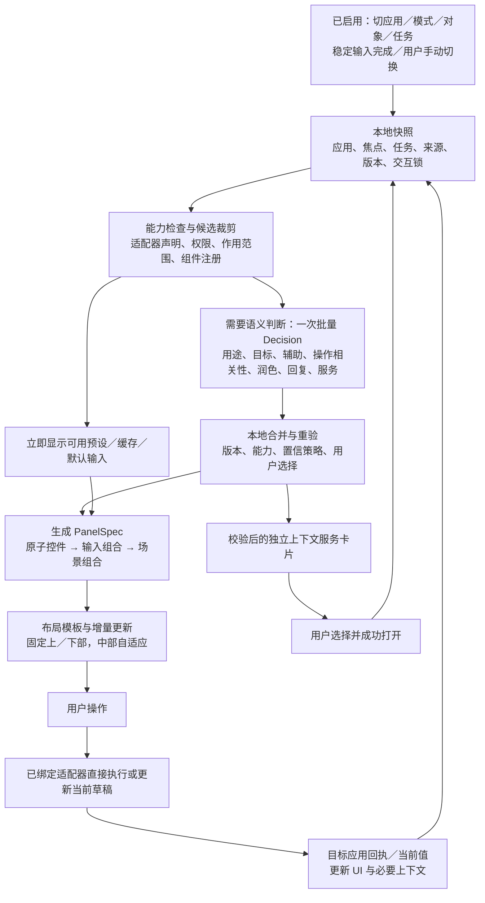

联合整理工作稿 · <mention-date start="2026-10-19"/>。本页用于产品与设计讨论；不代表商业验证或端侧模型已经接通。已确认的交互约定继续有效，新增范围、指标与排序策略标为建议。原始 PRD 与设计规则保留，避免把探索方案写成工程现状。

## 1. 当前判断：缺的是可扩展的面板生成闭环
当前已有四类场景、控件库和大量具体界面，也有预设优先及 Button／Dial／Slider 的规则。关键缺口是：**从哪里取得应用可执行能力、怎样选择当前有用的操作、怎样把答案编译成稳定面板、怎样用回执验证操作完成**。仅增加模型分类，无法补齐这四件事。

“按应用换面板”已有成熟对照。Stream Deck Smart Profiles 会随前台程序切换配置，并支持 Mobile；因此差异要验证在更少配置、理解当前对象与任务、材料和参数归属，以及适配成本上。[官方 Smart Profiles](https://www.elgato.com/us/en/explorer/products/stream-deck/smart-profiles-stream-deck/)

**建议的产品表述**：手机是大屏当前工作的输入面板。系统从当前应用真实可用的操作中，组合出顺手的键盘、快捷按钮与连续调节控件；用户表达任务时，再提供参数、材料和文字帮助。
“生成键盘”在本文指生成自适应输入面板，保留标准键盘作为基础模块，不动态改写字母键位，不承诺任意应用零适配。

## 2. 商业可行性：先验证谁得到什么价值
**商业定位已确认：面向设备厂商的系统输入能力，优先以折叠PC为产品载体。** 采购／集成方是设备厂商，使用者是大屏与手机用户。核心交付包括系统入口与会话、应用能力适配、场景决策、控件组合与渲染、执行反馈及恢复。独立付费App和SDK保留为后续路径，不作为本轮并列验证主线。方向确认不等于厂商采购意愿或商业可行性已经得到证明。
商业可行性目前未被证明，也不能据此直接断言没有市场。已有付费外设、竞品和 Survey 个案提供需求线索，不能证明用户愿为本产品付费。

<table header-row="true">
<tr><td>路径</td><td>买方与价值假设</td><td>最难的约束</td><td>需要的证据</td></tr>
<tr><td>设备厂商／系统输入能力（已确认主线；折叠PC优先）</td><td>设备厂商为无物理键盘的大屏使用、跨设备体验与设备差异化买单；用户少携带／少寻找输入器</td><td>系统权限、同账号连接、前台上下文、跨应用写入、OEM集成与长期适配成本</td><td>目标设备真实无键盘任务净收益；厂商对可交付范围与适配预算的明确反馈；付费试点或集成承诺</td></tr>
<tr><td>独立专业用户付费 App</td><td>用户为某个重复任务的净效率和更少配置付费</td><td>双端安装、手机占用、免费替代、OS限制、付费获客与支持成本</td><td>同一窄任务重复使用、真实付款／续用；每个支持应用的维护成本和毛利</td></tr>
<tr><td>第三方应用输入 SDK／插件（候选）</td><td>应用厂商为更快提供手机控制面与任务补参能力付费</td><td>必须证明接入比自行做手机界面更省；API与设计兼容要持续维护</td><td>合作方用能力声明接入一个新场景的工时、升级成本和采购意愿</td></tr>
</table>

首轮建议验证两个互补切片，四类场景仍保留：①无物理键盘时，WorkBuddy 任务表达＋颜色／布局／材料；②一个没有专门手机页面的专业应用，通过能力声明得到四个有用控件。前者验证用户价值，后者验证生成与适配的可扩展性。娱乐与普通润色可作为覆盖能力，不用它们替代商业证明。

净收益按完整任务计算：节省的寻找、配置和纠错成本，减去拿手机、解锁、建联、低头、等待和恢复成本。软件毛利另计模型／OCR／转写成本、适配器维护、客户支持、分发成本；不能只看单次推理价格。

## 3. 三条生成路径与明确的职责
<table header-row="true">
<tr><td>路径</td><td>什么时候用</td><td>怎样得到面板</td></tr>
<tr><td>预设场景面板</td><td>绘画、演示、游戏等已有验证预设</td><td>本地加载预设及用户配置；保留专业布局和手感。模型可以建议额外工具，不替换正在操作的预设</td></tr>
<tr><td>能力驱动默认面板</td><td>无预设，但应用有可信能力／快捷键声明</td><td>能力目录＋上下文决策＋确定的控件映射＋布局模板，组合当前操作。新应用可以增加适配器与声明而不另写整页手机 UI</td></tr>
<tr><td>通用输入兜底</td><td>应用未适配、上下文未知、模型失败或超时</td><td>保留平台确认可用的键盘／触控板。无可信可执行能力时不生成猜测的应用按钮；连接、权限或目标不可用时提供真实恢复入口</td></tr>
</table>

Desktop 已确认没有文本目标时默认触控板；应用有既有面板／模式则保留。新文本目标按场景配置进入输入状态，不能全局强开键盘。用户手动选择收起／键盘／触控板优先于模型推荐；未知焦点保护原内容。

## 4. 从事件到面板的完整流程


这里的图是数据依赖，不代表每个方框都要发一次模型请求。系统已知的应用、预设、已注册字段用途与真实任务状态直接走本地。连续转动、拖动、按住、逐帧和键入不逐次询问模型。

上下文建议主要在大屏侧从应用适配器、合法系统接口和用户明确选中内容获取；手机贡献输入状态和已采用材料。优先结构化事件；无结构化来源时，获授权的可访问性文本／选区可作补充。读屏／OCR是成本更高的候选识别路线，不能凭识别画面就获得执行能力。没有可靠来源则降低增强程度，不偷偷读取全历史。

## 5. 生成契约：四份数据各司其职
### 5.1 ContextSnapshot：知道当前正在做什么
至少含 sessionId、deviceId、appId／版本、mode、focus（known／none／unknown）、fieldPurpose、targetId、selectedTask／requestId、draftRevision、sourceRevision、selection、用户模式、交互锁。业务内容标明来源与可信级别；版本由本地／目标应用维护，不让模型生成。

### 5.2 CapabilityManifest：知道真实能做什么
每项能力登记 actionId、显示名称、语义、app／mode／scope、前置条件、真实适配器及版本、状态与反馈、输入类型、风险、可撤销性。数值能力还需 quantity、unit、current、min／max、step、setValue、relativeStep 和是否真的循环；缺失项明确为 unknown。
来源可以是应用插件、系统能力或经验证的快捷键包。没有插件也可先封装可信快捷键为按钮，但要记录键位、作用域、文本编辑冲突、版本和可观察反馈；不能从网页上一张快捷键图直接启用。
控件库的存在只证明能画出来；Manifest证明当前目标可以操作。两份目录必须分开。

### 5.3 DecisionResults：判断当前哪些帮助有用
模型回答语义分类和候选相关性。所有候选ID由本地提供。模型不能新增命令、权限、数值范围或任务审批项，也不直接输出任意可执行 UI 代码。未校准的高分不能当作能力证明。

### 5.4 PanelSpec：本地编译后的可渲染计划
至少含 snapshotKey、basePanel、inputMode、组件ID／版本、绑定能力、参数、槽位、稳定排序、显示原因和失败回退。它由本地编译器生成，不等同于 Jev 原始响应。
示意计划（产品自定义格式，非 TypeSafe API）：
```json
{
  "snapshotKey": "session-8/editor-2/clip-7/rev-41",
  "basePanel": "default.app-controls",
  "inputMode": "trackpad",
  "items": [
    {"slot": "primary.1", "component": "button", "actionId": "play_pause"},
    {"slot": "primary.2", "component": "button", "actionId": "split_selected_clip"},
    {"slot": "primary.3", "component": "dial.relative", "actionIds": ["previous_frame", "next_frame"]},
    {"slot": "primary.4", "component": "slider.absolute", "actionId": "set_preview_volume", "value": 60, "min": 0, "max": 100, "unit": "%"}
  ]
}
```
上述是带能力声明的虚构剪辑示例，不宣称现有剪辑软件已接入。缺少音量 current／setValue／反馈时移除绝对滑杆；只有增减音量命令时降级为相对步进。

## 6. Jev具体问什么、如何同批问
保留六类通用问题，并增加此前缺失的“可用操作相关性”。问题族与具体题目数量分开：一个候选一种评分，可批量展开。优先跳过已知和确定不适用项；候选已齐时，控件相关性也可与通用分类同批问，不按决策树深度串行调用。

<table header-row="true">
<tr><td>问题族</td><td>输入依据</td><td>答案例</td><td>本地如何使用</td></tr>
<tr><td>field_purpose：该文本用于什么？</td><td>未知用途的字段标签、所在容器与相关内容</td><td>agent_prompt／email_body／unknown</td><td>只补未知用途，不覆盖已注册事实</td></tr>
<tr><td>intent_clarity：用户目标清楚吗？</td><td>当前确认正文与选中对象</td><td>clear／unclear／conflicting／not_applicable</td><td>建议澄清，不把缺精确参数当成目标不清</td></tr>
<tr><td>input_assistance：需要哪类表达辅助？</td><td>用户正文或真实任务补充要求</td><td>parameter／material／both／none</td><td>决定辅助类别；具体入口还需要原句依据与合法候选</td></tr>
<tr><td>action_relevance(candidate)：哪项可用操作对当前任务有帮助？</td><td>操作语义、对象、模式、当前工作</td><td>各候选 Noul，或统一刻度 Score</td><td>选出小集合并保持稳定排序；不凭分数创造可执行能力</td></tr>
<tr><td>polish(candidate)：当前文字适合此润色吗？</td><td>非空正文＋用途＋已注册润色候选</td><td>更礼貌／Prompt更明确等分别评估</td><td>最多三个入口；点击后独立生成正文</td></tr>
<tr><td>reply_mode：适合提供哪类回复建议？</td><td>可回复来源＋空草稿＋尚未输入</td><td>acknowledge／user_decision／none</td><td>独立生成候选回复；采用同步两端，不自动发送</td></tr>
<tr><td>service_relevance(candidate)：内容是否适合该下一步服务？</td><td>授权可见内容＋可用服务目录</td><td>日程相关／导航不相关等各自评估</td><td>显示非抢占卡片；选择并成功打开才进入当前操作</td></tr>
</table>

Choice 用于一组选项中的单选；多个操作／工具／服务用逐候选 Noul 或统一含义的 Score，不把一个 Choice 当多选。Choice／Score 的 confidence 和 Noul 的概率含义不同；阈值需按问题和中文场景校准，不能把展示建议的阈值拿去自动审批。[Choice](https://docs.typesafe.ai/primitives/choice) · [置信度](https://docs.typesafe.ai/confidence)

**实际调用结构**：POST /v1/systemone，顶层 model、state、questions；答案在 answers 下按题目ID读取。同批每题独立读取同一 state，不能写“根据上一题结果”。本地拿齐结果后再处理依赖。[官方 API](https://docs.typesafe.ai/api) · [并行问题](https://docs.typesafe.ai/cookbooks/parallel_questions)

### 6.1 何时问、何时跳过
- 切应用／模式／选区／选中任务、稳定文本完成、真实请求变化：生成新快照。仅光标移动、每个按键、每帧手势不发决策请求。
- field_purpose 仅用于未注册字段；已知 Agent 输入直接使用系统标记。intent_clarity 与 input_assistance 可同批独立问。
- action_relevance 仅评估有能力声明、当前允许执行的候选；规则已能确定的固定操作直接呈现。
- polish 需非空可编辑文字；reply_mode 需可回复来源、空草稿且尚未输入；service 需授权来源和可用服务。
- 录音、拖动、绘制或触控期间锁定布局；结果可缓存，但恢复前重新核对版本。低置信、超时、缺失或单题失败只取消对应增强。
- 系统状态／目录版本变化时使相关缓存失效。旧回复、旧任务或旧目标的结果一律不跨目标采用。

### 6.2 一个能直接构造请求的例子
这是设计用的虚构剪辑适配器，已通过本地能力筛选；用户当前任务为“检查切点，不改音量”。只需问候选相关性，无需再问已知应用和字段用途。以下请求使用官方结构，state内字段为本产品自定义；未实际发送，不包含凭据：
```json
{
  "model": "jev-1.13.0",
  "state": {
    "snapshot_key": "session-8/editor-2/clip-7/rev-41",
    "application": {"id": "example-editor", "mode": "timeline"},
    "selection": {"clip_id": "clip-7", "at_cut": true},
    "confirmed_intent": "检查切点前后一帧的衔接，不改音量",
    "candidates": {
      "frame_step": {"meaning": "前后逐帧检查", "available": true},
      "preview_volume": {"meaning": "调整预览音量", "available": true}
    }
  },
  "questions": {
    "action_relevance_frame_step": {
      "type": "noul",
      "instructions": "候选frame_step是否直接帮助完成当前confirmed_intent？只判断任务相关性，不输出命令，不把可用等同于相关。",
      "criteria": {"true": "直接支持当前任务", "false": "无关、矛盾或证据不足"}
    },
    "action_relevance_preview_volume": {
      "type": "noul",
      "instructions": "候选preview_volume是否直接帮助完成当前confirmed_intent？尊重用户明确排除的操作。",
      "criteria": {"true": "直接支持当前任务", "false": "无关、用户明确排除或证据不足"}
    }
  }
}
```
预期读取 `answers.action_relevance_frame_step.noul` 与 `answers.action_relevance_preview_volume.noul`：前者应表现为相关，后者为不相关；不在文档伪造概率。模型不会返回“画一个Dial”。
本地编译：frame_step命中，且Manifest确认同一时间数量、同一作用域、前后相对步进可靠 → 使用已注册相对Dial；没有可回读当前位置就不画绝对进度。音量能力虽存在，本次不放入推荐主槽位，仍可从更多操作或固定偏好访问。若场景没有可信意图，仅展示规则常用项，不推断用户在进行切点检查。
`jev-1.13.0`是本示例固定的文档版本选择，不表示已完成本产品评测；替换本地模型时保持相同产品DecisionResults契约，供应商API适配单独处理。

## 7. 怎样把能力变成控件
<table header-row="true">
<tr><td>适配器确定的操作类型</td><td>本地默认控件</td><td>必须检查</td></tr>
<tr><td>一次动作或两个独立动作</td><td>Button／Toggle</td><td>撤销与重做仍是独立按钮；Toggle需有状态回读</td></tr>
<tr><td>同一数量的相对增减</td><td>Dial／Stepper</td><td>单位、作用域、方向、步长一致；无 current 不显示绝对位置</td></tr>
<tr><td>有界绝对数值</td><td>Slider＋可选精确值输入</td><td>min、max、current、setValue、真实反馈齐全；有界不循环</td></tr>
<tr><td>有限离散选择</td><td>分段按钮／选项列表</td><td>合法候选由能力或真实任务给出，当前选中值可核验</td></tr>
<tr><td>参数／材料表达</td><td>句内入口＋单个辅助工具</td><td>来源片段绑定当前任务；颜色实时更新，草图／照片显式采用，提交独立</td></tr>
<tr><td>持续控制</td><td>已验证触控板／手柄／按住控件</td><td>按下、释放、重复、超时与断联释放完整；实时事件绕过模型</td></tr>
</table>

本地按语义与能力优先确定控件形态；模型可在多个合法表示之间推荐，不把“看上去成对”当作可合并证据。精度与连续手感、空间大小决定 Dial／Stepper 的具体呈现。

**布局建议**：固定上部应用／任务与连接入口、固定底部模式／语音／编辑操作，中部按槽位显示内容。优先级为用户正在操作／明确固定 > 用户选中请求 > 当前编辑必要工具 > 场景常用操作 > 服务推荐。已有预设保持；默认面板先用四个主要槽位，更多操作按需展开，此数量为待测起点。排序使用稳定ID与轻量增量更新，不按每次分数全量洗牌。文本、录音、绘画、拖动和按住期间锁住相关区域；目标切换先释放，再更新。

## 8. 三个输入例子＋一个生成例子
<table header-row="true">
<tr><td>当前输入</td><td>本地事实与模型判断</td><td>最终界面</td></tr>
<tr><td>WorkBuddy：“做一份公司 Roadmap PPT，主色用红色，参考这张照片，布局我画给你”</td><td>本地已知 Agent composer／任务归属；模型预期 clear＋both，Prompt明确相关；具体入口有对应原句依据</td><td>沿用1286:6473单一编辑区，句内颜色／照片／布局入口；点开一个工具；收起或展开触控板只改变布局，内容保留</td></tr>
<tr><td>微信可见会议消息，回复框为空且尚未输入</td><td>本地知道回复目标／空草稿；模型判断回复类型与日程服务相关性</td><td>回复建议与日程服务可并存；采用回复不发送，开始自行输入就收起建议；选日程并打开成功后才变当前操作</td></tr>
<tr><td>邮件已写“你们还没给报价，今天赶紧发来”</td><td>本地email_body且非空；模型判断邮件语气更礼貌相关</td><td>显示场景润色；明确点击才改写绑定正文，允许撤销；无无关颜色／手绘入口</td></tr>
<tr><td>已适配剪辑应用，选中片段，任务为“把切点前后逐帧检查一下”</td><td>预设缺失；目录提供播放、分割、逐帧与可回读音量。模型对任务相关操作评分，本地按能力选Button／Dial／Slider</td><td>不新增整页手机设计，仅靠Manifest与既有组合模板得到四个主要控件；若音量与任务无关可排到更多操作，不能强凑四项推荐</td></tr>
</table>

这些是预期答案与设计示例，没有调用 Jev 得到实测分数。用户不是每次都要说目标；有结构化选区／模式即可直接给出规则常用面板，模型只在候选相关性有增益时介入。

## 9. 快的前提：先可用，再增强
“本地”分三层：①目标端获取上下文与能力，②本地规则／缓存／编译与手机渲染，③可选的本地推理后端。只有第三层通过实际设备测试，才能说全链路端侧离线。
Jev 当前官方公开的是托管 System One API。Jev 1.14 已列于模型文档，但稳定别名与 preview 指向不同版本；应固定经过评测的版本，不能随别名漂移。中文需自测。[模型说明](https://docs.typesafe.ai/models)
当前官方 Images／Box 为实验能力，不能直接把持续屏幕理解视作生产基线；采用结构化上下文优先，视觉路线单独评测。[图像能力说明](https://docs.typesafe.ai/images)

决策调用的数据边界：只发送当前问题必需的字段与来源片段；页面正文是待分析数据，不能作为修改系统规则的指令。真实聊天／文件／屏幕默认留在设备侧；托管评测优先用虚构或脱敏数据，任何真实内容出端须有明确授权范围，不能把建联许可当作模型出端许可。日志记录问题ID、版本、时延与错误类别，不记录原始正文或附件。

建议采用统一 DecisionProvider 接口，先支持 rules、hosted_jev、local_model 三种后端标记；后两者仅在实际接通后标记可用。部署到 PC 还是手机，比较冷启动、内存、耗电、中文准确率和上下文跨设备成本后决定。无外传授权时不自动转云端；云端失效则回本地基础面板。

事件去抖、复用候选目录、能力与模式缓存、同state批量问；候选够用时一次投机批量匹配，只有缺上下文才补一次。已知规则不要为了“AI化”重问。缓存key覆盖应用版本、模式、对象／任务、能力版本、编辑与来源版本；布局偏好可跨会话复用，敏感语义结果不跨任务误用。

建议验证预算（目标，不是实测）：系统已收到事件后基础面板 P95 ≤100ms；稳定上下文准备完成到语义增强可用 P95 ≤300ms；超出500ms本轮暂不自动更新，待下一有效事件重判。完整链路另报取上下文、OCR／ASR、推理、传输、渲染的P50／P95及冷／热启动，不能只报模型毫秒数。用户正在交互时，即使按时返回也等待解锁或放弃该次更新。

## 10. 验证顺序、成功条件与止损
以下是建议研究门槛，需与首轮基线一起确认。
1. 能力闭环：选三个应用切片，分别列出上下文读取、操作执行、回执与权限来源；没有真实可用能力的路径只做设计，不进入商业效率测试。
2. 生成复用：用一个没写过专用手机页面的应用，新增能力声明／适配后生成可用面板；记录适配和维护工时。若主要仍在逐页硬编码，收缩“生成”的承诺。
3. 模型增量价值：同一能力目录比较纯规则／缓存与规则＋决策模型。只在未编写过表述、对象变化和模糊场景上比较净收益；如果模型只增加延迟与错推荐，则留作可选增强。
4. 用户价值：现用方式、同能力PC入口、固定手机面板、生成手机面板四组，同任务交叉对照并包含学习／设置成本；报告个人差异、误触、视线切换、澄清轮次和总完成时间，不能只看点击率。
5. 商业验证（已按设备厂商主线收敛）：先与厂商确认系统入口、目标机型、可开放权限、应用适配分工、端侧模型供应方式及长期维护预算；再以真实设备任务净收益、持续使用和接入成本评估试点，形成采购／联合开发意向与明确验收范围。用户使用收益与厂商采购证据分别记录。独立App订阅转化暂不作为本轮门槛；没有买方与使用证据，不作收入预测。
6. 放行底线：错目标写入、隐式发送／审批、丢草稿、断联重放任一出现即阻断发布。建议以总任务时间中位数改善≥15%、错误不增加、至少多数参与者主动复用作为首轮继续投入信号；小样本结果只是方向，不是市场证明。
7. 止损：若原生PC入口优于手机，保留输入工作流价值但重新考虑载体；若适配成本无法回收，缩窄支持应用；若端侧后端达不到交互预算，保留快路径，不用云端自动回退冒充离线。

## 11. Claude × Codex 独立审阅与取舍
本次确实调用 Claude CLI，返回模型标识为 `claude-opus-5-5`。Claude 在禁用工具的独立会话中审阅所提供的两份 Notion 全文与规则材料，没有修改文档；Codex 核对当前项目约定和官方 API，负责取舍及回写。没有进行真实设备、API 推理或商业转化测试。

<table header-row="true">
<tr><td>问题位置／严重程度</td><td>Claude意见</td><td>Codex核实与处理</td><td>对用户的影响</td></tr>
<tr><td>商业定位／高</td><td>当前商业可行性不成立</td><td>不采纳确定性结论。现有证据不足以证明可行或不可行；新增买方、替代方案、净收益、适配成本与付费验证</td><td>避免把演示效果当购买意愿，也避免过早否定方向</td></tr>
<tr><td>生成机制／高</td><td>缺可信能力目录，模型无法生成可执行能力</td><td>采纳。补四份数据契约、组件映射和执行回执；目录由应用适配方维护并经集成验证</td><td>每个按钮都有可执行依据，滑杆不显示编造的当前值</td></tr>
<tr><td>模型价值／中高</td><td>先证明纯规则价值，再考虑Jev</td><td>部分采纳。保留规则基线，同时测试模型对当前对象与任务的操作筛选增益；不把模型限制为字段分类</td><td>减少手工配置，但不为每次点击增加模型等待</td></tr>
<tr><td>PRD §4、规则 §7.6.2／高</td><td>首次默认键盘与桌面触控板冲突</td><td>修正。桌面无文本目标默认触控板；场景已有模式及用户选择优先，不因新焦点全局强开键盘</td><td>默认输入有用，手动模式不被抢走</td></tr>
<tr><td>APP-WX-01、§7.3、§9／高</td><td>建议直发与采用后编辑冲突</td><td>统一为已确认的采用填入、两端同步、发送独立。原型是否仍直发另验，不把文档修改当实现完成</td><td>避免误发或默认承诺</td></tr>
<tr><td>APP-WB-01、DS-COLOR-01／中高</td><td>新识别自动切画板违反不抢占</td><td>修正为更新句内入口，用户点击才展开；一时一个工具，原文和值保留</td><td>语音和当前操作不被突然打断</td></tr>
<tr><td>G09/G12、采集与颜色旧描述／中</td><td>两键待定、默认用途选择、旧颜色chip文字互相冲突</td><td>明确触控板左右键、IMU另待决；材料沿原任务预览并采用；句内色点与当前值使用现行紧凑token规范</td><td>生成器有统一交互契约，减少重复确认</td></tr>
<tr><td>API不确定性／中</td><td>每个Choice加uncertain，不依赖confidence</td><td>部分不采纳。官方确认Choice/Score有confidence；按问题保留unknown/not_applicable等合适答案，低置信本地降级。Noul不伪造独立confidence</td><td>不确定只影响对应增强，不撤掉基础输入</td></tr>
<tr><td>§10供应商与数据出端／高</td><td>旧ChatGPT描述；托管调用的数据边界缺失</td><td>修正为现有显式Gemini润色；新增本地推理与托管评测边界、最少必要state、禁止静默云端回退</td><td>连接成功不等于可以把屏幕正文发送给模型服务</td></tr>
</table>

用户已确认商业主线：面向设备厂商的系统输入能力。四槽位起点、延迟预算和模型评估门槛仍为研究建议，未替代已确认交互规则。待确定：首家目标厂商与机型、首轮应用切片与预算、系统权限及应用适配分工、本地模型取得与部署方式。
