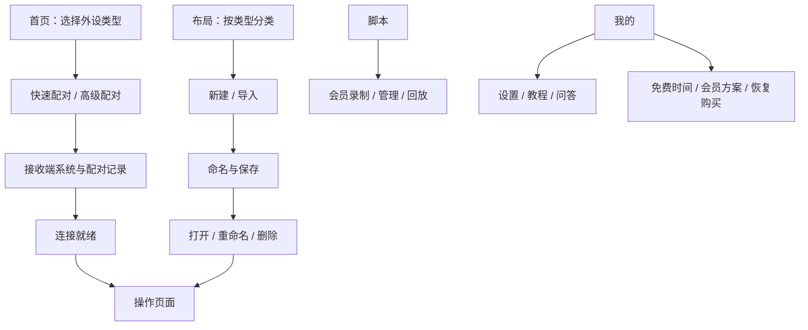
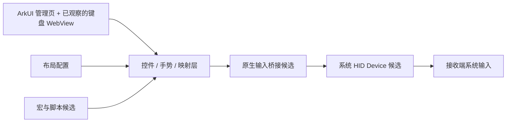

# 极客外设拆解与 Input Agent 能力迁移评估

> 2026-10-20 v1.5 主题版更新：原生手柄两种目标系统配置及键鼠手柄已有Mac描述符与实际HID报告，46项动作、362条报告。当前结论见[正式竞品报告](../survey/geek-peripherals/geek-peripherals-competitive-prd.md)第三篇（18-29章）。以下保留此前阶段性记录，不作为最新能力边界。

研究日期：2026-10-16。对象：用户 Mate 70 Air 上安装的极客外设 1.3.5。阶段：**第一轮真机黑盒拆解完成；内部实现与端到端控制尚未验证完整。**

2026-10-20 补充：真机已为 1.3.6，取得经典手柄布局 JSON 和两种模式的实际按键映射 UI；见 [游戏控制与 HID/MIDI/OSC 协议研究](gamepad-protocol-study.md)。以下旧版观察保留历史范围。

## 1. 结论与证据边界

极客外设把手机包装成不同类型的蓝牙输入设备，并提供布局管理、按键映射、操作界面和会员脚本入口。对 Input Agent 最值得研究的是 **HID 外设输出层**：它可能让现有手机控件控制接收端系统及第三方应用，而不必每个应用都接入我们的协议。

但这条链路本轮没有打通：Mac 一度显示手机已连接，极客外设仍等待连接或重连；空白测试页没有收到键盘文本。不能据此宣称它在这台 Mac 可用，也不能宣称 Input Agent 已具备相同能力。

| 证据类别 | 本轮结果 | 能支持的结论 |
|---|---|---|
| 真机界面与操作 | 四个主导航、7 类设备、配对页、布局创建/打开/清理、设置、问答、更新与收费页；57 组截图和 UI 树 | 当前版本可见功能、流程和局部真实行为 |
| 系统包元数据 | `bm dump` 成功 | 包名、版本、编译信息、声明权限与入口 |
| 安装包/源代码 | HAP 导出被系统拒绝；未获得文件 | 不能声称已反编译、提取内部算法或确定协议字节 |
| 接收端验证 | 用户指定 Mac；本机空白页面；连接未稳定，未收到测试文字 | 仅记录失败路径，不支持输入能力验收 |
| 产品说明 | 应用内 FAQ、更新记录、会员说明 | 厂商自述，不能替代功能实测 |
| 官方 API | OpenHarmony HID Device API 文档与类型定义 | 可设计独立实现路线；商用手机支持度仍待验证 |
| 自有项目源码 | 对照 Input Agent Web/Harmony/core | 识别现有能力和真正缺口；未改产品源码 |

本报告按“已观察 / 厂商说明 / 官方文档 / 推断 / 未验证”区分信息。**完整拆解仍缺：其余操作模式内部交互、脚本编辑与回放、协议报告、布局数据格式以及稳定接收端验收。**

## 2. 对象身份与运行环境

| 字段 | 读取结果 |
|---|---|
| 应用 | 极客外设 |
| Bundle | `com.xbin.peripheral` |
| 安装版本 | `1.3.5 / 1350000` |
| 分发/调试 | AppGallery release、非 debuggable |
| 包技术元数据 | Stage、ArkTS dynamic |
| 编译 SDK | `6.1.1.125` |
| API 字段原值 | target / compatible：`60100023` |
| Ability | `EntryAbility`；`./ets/entryability/EntryAbility.ets` |
| 设备 | HUAWEI Mate 70 Air、`SUP-AL90` |
| 系统内部 fullname | `OpenHarmony-7.0.0.105`；不直接当作面向消费者的 HarmonyOS 版本名 |
| 本机开发 SDK | 默认 HarmonyOS 6.0.2、API 22、`6.0.2.130` |

包元数据中的企业主体为广西贺州清息科技有限责任公司。原始包路径可见，但读取 `entry.hap` 返回 permission denied，未继续绕过访问控制。

**版本差异：**安装元数据是 1.3.5，应用内“更新记录”顶部标为 1.3.4。功能归因以安装版本和实拍时间为准，不用更新页标题覆盖系统事实。

## 3. 信息架构与用户路径

图中的连接就绪至操控是产品期望路径，本轮没有完成该端到端路径。通过临时键盘布局的“打开”可以进入操作 WebView；进入该页面本身不代表蓝牙已就绪。

### 首页：7 类设备

| 类型 | 实际观察 | 对 Input Agent 的意义 |
|---|---|---|
| 键鼠遥控器 | 抢先版；通用蓝牙设备；初始选中 | 通用控制入口候选；内部控件未完整展开 |
| 鼠标 | 通用蓝牙设备 | 相对移动、按钮、滚轮的独立输出面 |
| 触摸板 | 通用蓝牙设备 | 手势到鼠标动作的映射；多指语义待测 |
| 键盘 | 实际打开全屏键盘和触摸区域 | 实体按键语义与手机文本语义需要分开 |
| 手柄 | 首页提示部分系统限制 | 兼容性矩阵独立于键鼠；不应默认支持所有游戏 |
| 键鼠手柄 | 通用蓝牙设备；FAQ 描述自定义映射 | 游戏形态控件输出键鼠事件的备选路径 |
| 数位板 | 首页存在，通用蓝牙设备 | 压感、绝对坐标、倾角、主机兼容均未验证 |

首页支持设备徽标观察到安卓、鸿蒙、Windows，没有观察到 Mac 徽标。FAQ 的“几乎所有系统”是厂商泛化说明，不能作为 macOS 兼容保证。

### 配对与连接

- 首页“已配对”来自记录层，不能代替可发送状态；“选择设备→开始配对→进行操作”是步骤文案，点击步骤没有触发导航。
- 快速配对显示当前类型、接收端、等待/连接中状态。键盘允许 Windows / 其他系统选择；本轮为 Mac 选择“其他”。
- 高级配对包含模拟开关、设备名称、接收端系统、布局选择、扫描、连接方式、配对记录、自动连接、连接/移除、开始操控/断开连接。
- 高级页明确写 Windows 支持文字直发。具体编码、输入法或 Unicode 实现未取得证据。
- FAQ 指出手柄与键盘类型切换后，目标设备需要删除旧配对并重新配对；它也提示其他模拟应用可能占用资源。具体底层失败原因未定位。

对我们最直接的设计启发是分清 **已配对、系统链路连接、HID Profile 就绪、接收端收到输入** 四个层级，并给出对应恢复操作；不要只用一个绿色连接状态。

## 4. 输入、布局、自动化与商业机制

### 已打开的键盘操作页

UI 树显示 `resource:/RAWFILE/web_operate_keyboard.html`，说明这个操作页由本地 Web 资源承载。画面含大面积触摸区、“单指移动 / 双指滚动”提示、字母/数字/功能分区、QWERTY、数字行、Tab、大小写、Shift、Enter、Ctrl、Win、Alt、菜单与空格。

这证明该页面存在和控件可见。它不证明整个应用都是 Web，不证明双指滚动实测成功，也不揭示 Web 与原生桥接的函数名。

### 布局管理

| 项目 | 观察与限制 |
|---|---|
| 分类 | 横向设备类型筛选；创建页观察到手柄、键鼠手柄、键鼠遥控器、键盘、鼠标、触摸板 |
| 创建 | 布局名称、设备类型、布局模式；界面描述空白画布添加/移动/缩放 |
| 键盘样例 | 保存后列表实际显示“固定样式、8 组件”；打开进入键盘操作页；不能把通用创建说明推断为所有类型均自由编辑 |
| 管理 | 已观察打开、重命名、删除入口；创建与打开执行成功；删除的只有本轮自建临时项 |
| 导入 | 要求导入后的名称与粘贴布局数据；说明同名布局不会覆盖；没有导入样本，数据格式未验证 |
| 自定义/分享 | 更新说明提及按键映射；尚未提取可用布局 schema、导出数据、存储实现 |

临时布局已删除，最终键盘分类恢复为空；首页恢复初始的键鼠遥控器选择。未改原有布局内容。

### 脚本、宏与持续按压

- 脚本主导航在普通用户下显示会员专属，文案说明录制、管理、回放及会员过期保留已有脚本。没有进入编辑器或运行脚本。
- 更新记录 1.3.3 宣称新增键盘宏/手柄宏；1.3.4 宣称键盘长按连续发送、手柄及键鼠手柄连续发送开关。
- 1.3.1 说明新增方向盘组及参数、手柄映射、操作页布局切换，以及触摸板/键盘/键鼠手柄互切。
- 这些属于厂商说明。尚不清楚宏与脚本是否共用数据模型、是否包含时间轴、循环、停止条件、断连后的重放或组合键释放策略。

### 设置与付费边界

已观察外观跟随系统/深/浅、沉浸适配、防误触保护、操作页侧滑返回控制；FAQ 将按键震动与手机系统触感反馈联系起来。没有修改这些设置，也没有验证主机回传震动。

普通用户页面当时显示免费时间剩余 `8:25`；**这不是每日总额度**。会员页在本机本次加载显示月度 ¥8、年度 ¥36、永久早鸟 ¥58（展示原价 ¥68），均标注不自动续费；权益跟随购买时华为账号，提供恢复购买入口。只读取方案，没有购买、恢复或兑换操作。价格是此次观察快照。

## 5. 技术结构：已知与候选解释

### 权限

系统元数据声明：`ACCESS_BLUETOOTH`、`ACCELEROMETER`、`GYROSCOPE`、`DETECT_GESTURE`、`PRIVACY_WINDOW`、`VIBRATE`、`INTERNET`。

蓝牙声明与外设路径一致；传感器声明与方向盘等能力相容；隐私窗口/手势/震动声明与设置文案相容。**声明不等于已授权、实际调用或具体用途证明。** INTERNET 也不能单凭权限推定上传了什么内容。未抓取网络、访问账户数据或分析后端。

### 可独立实现的官方路径

[OpenHarmony HID 官方说明](https://github.com/openharmony/docs/blob/master/zh-cn/application-dev/reference/apis-connectivity-kit/js-apis-bluetooth-hid.md#hidcreatehiddeviceprofile23)定义 API 23+、Stage 模型的 HID Device，使用传统蓝牙。候选调用链：`createHidDeviceProfile → registerHidDevice → connect → sendReport`。注册需要 `ACCESS_BLUETOOTH`；同一时间只允许一个应用注册，需在前台，转后台后自动解除注册。报告布局由 HID 描述符决定。[官方接口类型](https://github.com/openharmony/interface_sdk-js/blob/master/api/@ohos.bluetooth.hid.d.ts)可用于核对签名。

本机默认 API 22 的 `@ohos.bluetooth.hid.d.ts` 只有 Host 角色，没有上述 Device 接口。**先取得匹配的官方 SDK 并做手机能力探测，再做接入决策。** OpenHarmony master 文档不能直接证明商用固件实现情况；应用 API 字段尾部 23 也不能单独证明它调用了哪一个具体接口。

### 候选架构（推断，非反编译结果）

缺失证据包括：HID 描述符、报告 ID 与字节布局、桥接白名单、传感器滤波、发送节流、宿主键位适配、布局序列化、脚本执行器、存储及会员校验。不能从页面名称补写这些实现事实。

## 6. Mac 验证记录

用户指定 Mac 为接收端。测试准备了仅绑定 `127.0.0.1:8767` 的本地空白网页，包含文本框、指针区域、滚动区域及页面事件记录；没有让外设操作用户文档或消息。

| 步骤 | 结果 |
|---|---|
| 打开临时键盘布局 | 成功显示操作 WebView |
| 测试页文本框获得焦点，手机点击 `a` | 页面仍为空，未看到相应键盘/文本输入事件 |
| 键盘模式选择“其他”接收端 | 快速配对持续连接中/等待连接 |
| Mac 系统蓝牙状态 | 一度显示手机 Connected，后又为 Not Connected |
| 高级配对主动连接 | 进入连接中，随后“已断开，等待重连” |
| 恢复键鼠遥控器模式，Mac 菜单 Connect | 手机仍等待连接 |
| 移动、左右键、双指滚动 | 未取得可用输入链路，未进行有效端到端验收 |

因此本轮结论是 **连接未打通，根因未定**。可能涉及已有配对对应的设备类型、Profile 注册或平台兼容性；没有证据选择其中一个作为确定原因。没有删除原有配对，也没有重置蓝牙。重新配对属于后续诊断动作，必须保留原配对信息和可恢复路径。

验证记录要同时包含手机发送动作、主机实际收到事件和可见结果。即便未来浏览器事件 `isTrusted=true`，也要结合独占测试时段判断来源，它不能单独证明来自某一台蓝牙设备。HID 的本地发送成功亦不代表目标应用已完成业务动作。

## 7. 与 Input Agent 现有实现逐项对照

以下是本轮源码阅读结果，不是重新完成的双设备验收。

| 能力 | 当前实现落点 | 边界 / 接入缺口 |
|---|---|---|
| 手机键盘与文本编辑 | `apps/web/src/input-dock.tsx`、`use-phone-editing.ts` | `editing.replace` 等语义编辑；不是硬件扫描码输出 |
| 指针 | `apps/web/src/input-pointer.tsx` | `elementFromPoint`、DOM click/contextmenu，仅自有页面 |
| 游戏控制 | `phone-game.tsx`、`tablet.tsx` | 本地按键集合与 iframe 消息；不是系统游戏手柄 |
| 姿态遥控 | `PresentationMotion.ets`、`phone-presentation.tsx` | 原生旋转传感器和既有校准可借鉴；接收端当前是自有演示场景 |
| 通信 | `NativeBridge.ets`、`DistributedLink.ets` | TCP/mDNS/PIN 及固定应用分布式链路；不是 HID；普通 TCP 不作加密保证 |
| 原生功能 | `NativeBridge.ets`、手机 `Index.ets` | 已有剪贴板、相机、语音等桥接；当前无 HID Device 输出桥 |
| 正确性保护 | `packages/core/model.ts`、`apps/web/src/runtime.ts` | 保留 app/target/revision/session 与 ACK + 状态回读；不能套用成 HID 目标应用确认 |
| 释放机制 | `phone-game.tsx`、`runtime.ts` | 既有失焦/心跳清理可借鉴；HID 还需要修饰键与鼠标按钮释放 |

**判断：**现有项目具备不错的输入界面、场景语义和原生外壳。新增系统外设输出层可以拓展控制范围；单纯换成蓝牙不会获得第三方应用的内容、选择区、业务结果和撤销语义。

## 8. 候选复刻能力与实施顺序

这里提出候选并给出验证门槛；用户尚未选择实施范围，本轮不修改产品行为。

| 顺序 | 候选能力 | 对用户的价值 | 主要门槛 |
|---|---|---|---|
| 0 | 独立 HID 键盘探针 | 尽快确认 Mate 70 Air 能否向 Mac 发送真实按键 | 匹配 SDK、商用固件能力、稳定配对 |
| 1 | 键鼠输出适配器 | 保留已有控件，扩大到系统与第三方应用 | 相对位移、滚轮、按钮 down/up、组合键与释放 |
| 2 | 目标系统与输入方式适配 | Mac/Windows 键位与中文输入行为可预期 | HID 键码不等于 Unicode 文本；输入法、焦点和修饰键矩阵 |
| 3 | 布局与按键映射 | 用户按场景搭自己的操作面 | 独立 schema、导入校验、版本迁移、手机尺寸适配 |
| 4 | 键鼠映射的游戏/演示控件 | 复用现有手柄、姿态控制 | 接收端可接受的按键、轴到事件变换与手感 |
| 5 | 可停止的宏 | 自动完成可重复输入步骤 | 明确停止、异常释放、目标变更暂停、结果不可误报 |
| 暂缓 | 原生游戏手柄、数位板、主机震动 | 专业或游戏场景 | 描述符、平台支持、反馈通道均缺直接证据 |

### 建议的独立接口边界

保留现有 `ReplicaBackend` 语义命令路径，另加候选 `HidBackend`。前者知道目标对象和业务状态；后者只发送主机输入。能力声明至少区分 `key`、`relativePointer`、`wheel`、`unicodeText`、`gamepad`，不支持的能力不能静默伪装成功。

HID 事件模型至少覆盖：`keyDown/keyUp`、modifier 集合、`pointerDelta`、`buttonDown/buttonUp`、`wheel`、`releaseAll`、连接 epoch。重连后不自动重放旧的按住状态。用户看到“已发送”与“已完成”的条件必须分别定义。

宏使用我们自己的可检查动作格式，不加载第三方可执行代码。每次运行能看见目标和进度、随时停止；目标变更、失焦、超时与断连都触发停止策略。语义操作优先走已有目标校验链路。

### 最小探针的验收门槛

1. 使用官方 API 23+ 对应 SDK 编译独立测试应用；记录版本和实际注册错误码。测试时先退出极客外设，避免争用注册。
2. 手机在前台，连接用户指定 Mac；记录 Profile 就绪，而不只看系统蓝牙列表。
3. 空白页面实际收到 `rea`，验证 down/up 成对；不通过 Mac 自动化代输文字冒充手机成功。
4. 然后验证相对移动、左右键、滚轮及释放；每项保留手机动作与主机结果。
5. 验证后台、锁屏、断连、重连、停止按住键后的行为；不允许残留修饰键或持续拖动。
6. 中文/emoji、长文本、游戏手柄、数位板分别列新验收项，不能用英文键盘成功代替。

## 9. 证据索引与继续研究条件

原始证据仅保存在 Git 忽略目录 `reference/private/geek-peripherals/`，未加入产品包。截图、UI 树可能含设备名和地址，仅供本地研究。

| 证据范围 | 路径 / 捕获编号 |
|---|---|
| 包身份/权限 | `metadata/bundle-dump.txt` |
| 首页/教程 | `captures/01-*`—`04-*`、`34-home-lower.*` |
| 布局创建、键盘、清理 | `05-*`—`15-*` |
| 脚本/我的/设置 | `16-*`—`19-*` |
| 配对及 Mac 失败路径 | `20-*`—`33-*` |
| FAQ | `36-*`—`42-*` |
| 更新记录与关于 | `44-*`、`45-*`、`47-*` |
| 会员价格 | `49-*`—`51-*` |
| 导入及最终恢复 | `53-*`—`57-*` |
| 本地浏览索引 | `analysis/evidence-index.html` |
| 文件摘要 | `analysis/evidence-manifest.json` |
| 可复现采集/空白测试工具 | `analysis/inspect-device.py`、`analysis/input-test-server.py` |

后续补齐完整拆解需要：可合法取得的该版本 HAP 或开发者材料；用户可用的会员脚本页面；稳定的接收端连接；适配官方 SDK 的独立设备验证。不能取得源包时仍可做行为复刻，但应始终将实现标为我们自己的设计。

本轮交付是拆解与选型依据。没有制作“完整复刻已运行”的证明，没有改动 Input Agent 现有产品源代码，没有 commit/push。

## 10. 后续独立验证：HID 键盘探针

2026-10-16 新增独立包 `com.hmilab.hidprobe`，已在 Mate 70 Air 安装运行，并观察到 HID Device 注册回调 `true`。Mac 接收尚未通过：检查发现主机 `bluetoothd` 连续崩溃，崩溃记录早于独立探针首次运行。尚未确定根因，不能将其归因于极客外设；前述失败路径也不能单独证明手机缺乏 HID 能力。

源码、签名构建、测试结果及后续验收步骤见 [独立 HID 探针验证记录](hid-probe-validation.md)。探针只验证公开 API，未复用第三方代码；真实输入、鼠标和滚动仍未验收。

后续更新：用户确认在 Mac 其他应用输入框收到 `rea`；复查时蓝牙服务已运行，手机日志出现 Profile 状态 `2` 和完整发送帧。基础字符输入已有用户实测确认，接收端逐键事件、停止恢复、鼠标与滚动仍需分别验收。

接收端补充：两轮各 9 个事件确认 R/E/A 的按下与松开完整、无 repeat。实际文本为 `insertCompositionText` 类型的 `re a`，未发空格键。键盘链路通过；精确文本提交、发送中断、后台恢复、鼠标和滚动尚未完成实机验收。详见独立探针验证记录。
