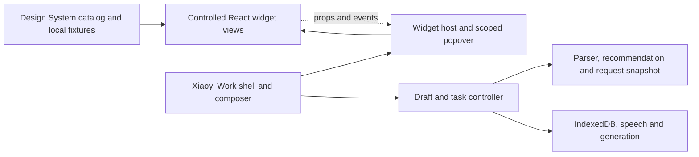

# Xiaoyi Work UI handoff for Gemini

Work in `codex/workbuddy-web-demo` in the standalone worktree. The library and the desktop demo render the same widget views. Use the library to check a change in isolation, then check it in the composer and results page. The shared desktop baseline comes from the existing Xiaoyi Work demo at `931d603`.

```bash
npm ci
npm run dev:workbuddy-demo
```

- Open the [widget library](http://127.0.0.1:5198/widget-library.html). Each example has a direct link such as [Color in English](http://127.0.0.1:5198/widget-library.html?widget=color&language=en).
- Use the state selector, Reset, and Try two instances to exercise the selected view. File input uses local files. Scan and screen capture can use the browser picker or a labeled sample image. The polish example uses local text and supports Stop and Restore original.
- Open the [complete demo](http://127.0.0.1:5198/) for shell and composer changes. The [English setup guide](workbuddy-demo-README.en.md) covers optional model credentials and deployment. UI work can use the library without credentials.

## Files to edit for a UI task

| Target | File |
| --- | --- |
| Shell, sidebar, settings, home | `apps/web/src/workbuddy-demo-shell.tsx`, `apps/web/src/workbuddy-demo.css` |
| Composer layout, toolbar and attachments | `apps/web/src/workbuddy-demo-composer.tsx`, `apps/web/src/workbuddy-demo-material-views.tsx` |
| Results and artifact editing layout | `apps/web/src/workbuddy-demo-results.tsx`, `apps/web/src/workbuddy-demo-results.css` |
| Shared desktop widget appearance | `packages/input-controls/src/desktop-controls.css`, `desktop-visual.css` in the same directory |
| Inline chip | `packages/input-controls/src/inline-chip.tsx` and the chip selectors in desktop styles |
| Panel frame | `packages/input-controls/src/auxiliary-panel.tsx` and the desktop panel selectors |
| Gallery layout and fixtures | `apps/web/src/workbuddy-demo-library.css`, `apps/design-system/src/xiaoyi-controls-preview.tsx` |

Each widget has an export in `packages/input-controls/src/index.ts`. Use the file below for widget-specific layout. Scope CSS to `.input-controls-theme` and the widget's class or `data-kind`. Keep the original colors on artwork, thumbnails and user-selected swatches. For a change to a shared choice or capture layout, check every widget listed in that row.

| URL `widget` | View file under `packages/input-controls/src/` |
| --- | --- |
| `duration`, `color` | `duration-widget.tsx`, `color-widget.tsx` |
| `font`, `palette`, `document` | `font-widget.tsx`, `palette-widget.tsx`, `document-widget.tsx`, with `choice-widget.tsx` for shared choices |
| `expert`, `skills`, `connectors`, `formats` | Their matching `*-widget.tsx` files and `choice-widget.tsx` |
| `photo`, `sketch` | `image-widget.tsx`, `sketch-widget.tsx` |
| `scanner`, `capture` | `scanner-widget.tsx`, `capture-widget.tsx`, with `capture-panel.tsx` for shared media UI |
| `polish` | `polish-widget.tsx` |

## Preserve these interfaces

- `WidgetProvider` supplies translation, asset base and optional portal root for each host. `desktop.css` styles independent hosts. The app uses the same desktop visual layers on top of its existing shell and base styles.
- Components receive current values, choices or material state through props. Keep callback signatures and timing, control IDs, focus and keyboard support, labels, `aria-pressed`, disabled and loading states.
- The chip renderer is shared between the standalone React preview and the editor. Preserve `data-source`, `data-parameter-id`, the separate Open and Remove buttons, and the selection-preservation callback. The editor owns caret, composition, and clipboard behavior.
- The application adapter owns draft identity, parsed bindings, recommendation timing, attachment confirmation and persistence. Capture owns browser media acquisition and cleanup. Send and model requests remain explicit application actions. For visual work, edit the view markup and styling while preserving these paths.
- Keep existing mobile and native views on their current imports. `apps/design-system/src/xiaoyi-controls.ts` is the additive catalog adapter for a future mainline integration. A future mobile host can supply its own theme, capabilities and adapters.

## Embed in another host

Import the desired view and `WidgetProvider` from `packages/input-controls/src/index.ts`, and load `packages/input-controls/src/desktop.css` once. Wrap each surface in `.input-controls-theme` and provide the language, translation function, and asset base. Supply an instance-local portal root for dialogs. For example, a controlled duration view can be mounted inside any desktop host:

```tsx
<WidgetProvider language="en" translate={translate} assetBase="/static">
  <div className="input-controls-theme">
    <AuxiliaryPanel title="Duration" onClose={close}>
      <DurationWidget value={minutes} onChange={setMinutes} onDone={close} />
    </AuxiliaryPanel>
  </div>
</WidgetProvider>
```

The auxiliary frame is available separately from widget content. The Xiaoyi widget host adds the chip-anchored popover when used in the composer.

The desktop skin uses assets under `apps/web/public`. Serve `assets/xiaoyi-work/`, `assets/figma/sentence-parameters/`, and `reference-assets/workbuddy-widgets/` from the location resolved by `assetBase`. Keep the paths and reviewed artwork when copying the source library to another application. The standalone build and source packager already include these directories. A future mainline catalog should resolve the preview URLs relative to its own hosted entry.

## Review before returning a patch

Compare at the same viewport and content in Chinese and English. Exercise focus, Escape, wrapping, scrolling and the relevant action states. Check two examples when changing a shared UI. Keep the branch's approved desktop layout unless the UI brief explicitly changes it.

```bash
npm run check
npm run test:workbuddy-demo -- --grep 'specimens|deep links|choice widgets|local previews|polish fixture'
npm run test:workbuddy-demo
npm run build:workbuddy-demo
```

Include the affected widget links, changed files and before/after screenshots in the handoff. Call out any requested UI change that would need a callback, permission or data contract change so Codex can review it separately.


