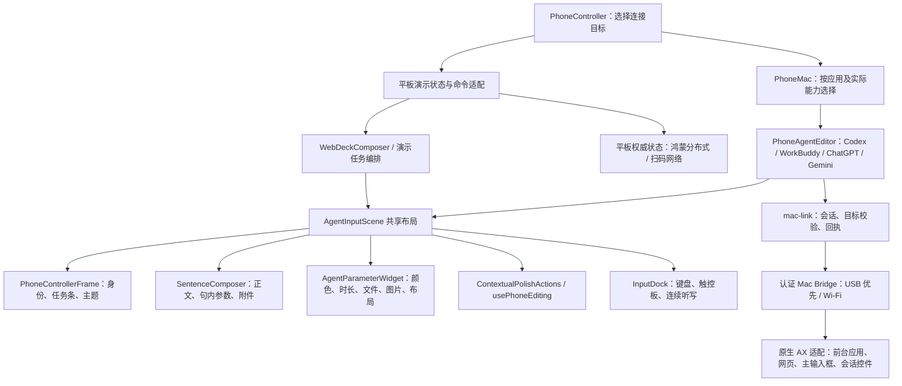

# 通用 Agent 输入面板与真实会话适配 · 2026-11-04

本轮完成共用手机输入面板、通用 Mac 操作协议与按真实辅助功能控件开放的适配器。**共享 UI 已实现，真实目标的所有能力并未全部打通**。本日后续附件验收见 [真实附件接入记录](agent-attachments-2026-11-04.md)；无法区分的会话不伪装成功。未提交真实 Agent 任务、未调用模型执行测试、未修改 Figma、未 Git push。

## 当前代码架构

图示中的渲染布局与控件共享；演示与真实目标仍保留各自的草稿/材料存储、回执和执行编排。并未把真实应用记录合入演示状态。WPS、游戏、放映与绘画的专用业务控制继续存在。

### 主要实现

- `packages/core/agent-controller.ts`：登记四类 Agent、兼容旧 WorkBuddy capability、隔离真实设备/会话草稿归属。
- `apps/web/src/phone-agent-editor.tsx`：单一真实 Agent 编辑器；原 `phone-live-workbuddy.tsx` 仅兼容导出。Codex 不再另走普通 textarea 面板。
- `phone-control-adapter.ts`、`phone-controller-frame.tsx`：真实任务条、新建/切换能力、未知状态保护、独立主题。Codex/ChatGPT 中性，WorkBuddy 青绿，Gemini 蓝色。共享麦克风图形跟随语义颜色。
- `live-workbuddy.ts` 是兼容保留的解析文件名，五类规则同时服务上述 Agent 与演示 WorkBuddy。生成图像需求保持正文；参考/添加/选择图片显示图片入口。
- `scripts/mac-bridge/{agent.swift,protocol.mjs,server.mjs}`：`agent-task / agent-attach / agent-submit / agent-stop`；旧 WorkBuddy 命令保留限制。Chrome 只登记 HTTPS ChatGPT/Gemini 对话路径，地址栏、本地原型、登录页、其他网站不成为编辑器。
- `mac-link.ts`：接收桥接身份，旧目标回执不替换当前快照。任务、输入目标和连接身份分开处理。

## 真实能力覆盖及边界

| 目标 | 共用输入及参数 | 会话条/新建/切换 | 附件采用/发送 | 本轮真实证据 |
|---|---|---|---|---|
| 平板演示 WorkBuddy | 共用布局、五类 Widget、既有生成链路 | 平板权威任务列表 | 既有完整字节、明确发送链路保留 | 两端维护安装；本轮未再次生成 |
| Mac WorkBuddy | 单一 PhoneAgentEditor | 已有 AX 侧栏接入，复核标签后按控件执行 | 保留真实字节上传和原生附件回读，新增附件来源证明 | 源码/模拟回归；未发送真实任务 |
| Mac Codex | 同一编辑器；只绑定 `Work with Codex` / `Do anything`，不绑定临时 `Reply…` | 只读到可见会话；去掉可识别的置顶别名。无法核实当前项或同名条目时不猜身份/状态 | 文件、图片、草图已在真实未发送草稿中上传并回读；提交仍要求实际发送按钮及全部附件证明 | 原生只读看到主输入框、可见列表及当前项；未发送 |
| Chrome ChatGPT | 登记已观察的主编辑器（含当前 Work 首页） | 当前准备页面未暴露历史列表/新建入口，相关操作不可用 | 文件、图片、草图已真实上传并回读；真实发送未执行 | 真实 AX 主编辑器结构已读取；未写入或提交 |
| Chrome Gemini | 登记 `Enter a prompt for Gemini`；识别空编辑器提示文字 | 原生只读看到 30 个可见对话链接及 New chat；URL 标识区分会话 | 文件、图片、草图已真实上传并回读；真实发送待用户验收 | 原生读到当前主页、编辑器及历史链接；未发送 |

列表只反映可可靠读取的当前可见条目，不代表全部历史。原生应用没有稳定 URL/标识时使用桥接期内的 AX 元素句柄及标签复核；辅助进程重启后的完整历史草稿自动关联尚未验收。无法确认当前会话时撤销编辑/提交能力；明确新建后须读到新的空白界面才建立新会话归属。

后续附件接入复用同一手机面板与完整字节传输。已验证 Codex、ChatGPT、Gemini 的实际上传和附件回读；未核对的附件仍阻止提交。真实模型执行与手机端完整端到端验收，不由浏览器模拟或原生适配器检查替代。

## 状态与安全核对

- 五种控件使用同一语法；七入口脚本：`讲十分钟，背景灰色，字体黑色，主题红色，参考我的文件，添加产品图片，布局我画一下。`
- `生成一个小孩图像` 不生成图库入口；`参考一个小孩图像` 会生成入口。否定表达、手动参数优先、原任务材料归属保留。
- 主输入框读取与真实 OS 键盘焦点分开：键盘/粘贴操作前设置并回读焦点，失败拒绝。旧 Codex shortcut-submit 不能绕过通用发送核对。
- 发送具有同步锁，发送期间不能改写附件快照。选择器返回、任务切换、重连均不触发提交。
- 未知提交写入所属草稿记录；输入框重建、切任务返回不解除保护。提供用户核对电脑后明确清空的恢复操作；不自动重放。
- 文件缓存绑定 session/window/target；目标变化重新传输。原生附件路径规范化并限于本项目私有材料目录；同名现有附件不能冒充本次已验证材料。
- 原生提交必须同时看到编辑器清空和新增消息证据。短消息或无法证明的回读保持 unknown，不能自动重试。
- Claude CLI 仅审查所提供源码，禁用工具。已复核并修复焦点、未知回执、并发选择/发送、旧 shortcut-submit、材料缓存、路径及标签校验等问题。未采用“标题+出现次序等同稳定会话身份”的建议。评审输出保存在忽略的证据目录，不含凭据。

## 本地验证

- `npm run check`：通过。
- `npm test`：226 项通过。
- `npm run test:mac`：24 项通过，包含原生 URL 策略编译验证、通用命令与重复未知提交。
- `swiftc` 编译最终原生辅助程序：通过。
- 相关浏览器覆盖：四 Agent 同构面板/主题、390×844 与 390×700、键盘/触控板、七入口、本地图片确认、跨任务材料、旧回执、未知提交持续保护；既有微信和设置/成果 prompt 用例回归通过。首次某次自动关闭连接弹层造成测试点击竞态，已按实际自动关闭行为调整测试并重跑通过。
- 生产 Web 和两端签名 HAP：通过。Vite 的现有大 chunk 提示仍存在。
- 本轮未新增真实模型或润色 API 调用，没有安装浏览器扩展或读取隐藏接口。

## 安装与证据

最终包信息以 `artifacts/generic-agent/packages.json` 为准；该目录被 Git 忽略。两端 `1.4.0`，同一 Web snapshot，保留演示代次 `1793741702534`。覆盖安装，无卸载/清存储；两端系统 `installTime` 与升级前相同，`updateTime` 更新。配对和原生凭据未修改。

- SUP-AL90 手机：安装/启动成功。
- MRDI-W10 平板：安装/启动成功；截图可见原有微信会话仍在。
- Mac Companion：维护更新完成，USB 映射 ready。启动/连接状态进一步记录在本节尾部。
- 浏览器截图、测试日志、原生只读检查、安装日志、私有 AX 树和包哈希在 `artifacts/generic-agent/`。私有 AX 树与真机画面不得进入源码备份。

未验证：四个真实目标的模型发送/停止结果、手机选择材料到真实网页上传的完整物理链路、同名会话真实切换、真实语音/剪贴板、此版本拔 USB 后的重连行为。既有 USB/轮换测试只代表回归自动化，不能替代本轮物理验收。

### 最终安装及连接核对

- 构建时间戳：`1793816558181`；Web 资源摘要：`02d2675cd471fc5ab15d3cd3c7416caaa96b4ad0c2e2f52feed76ceed0d654f2`，两端一致。
- 手机 HAP SHA-256：`4a2b9759fe353ffbdeb605de77c85e71b829a36036fc6b7085f146590d399433`。
- 平板 HAP SHA-256：`8b9f9c63d6cf03aec0360ead9e785aa4c41aff2ce94f7958b13aff07fc7b3d55`。
- 手机安装后曾因 Mac 状态辅助进程退出而无法恢复状态。只重启本项目 Companion 后，原信任配对恢复，手机显示“Mac 已连接 · USB”；没有重新配对或清理存储。退出的精确触发原因未获得日志证明，不能宣称已修复所有状态读取超时。
- 手机点击已有 Codex 应用入口后，真实手机显示 Codex 中性主题、实际会话条、新建入口、共享 Composer 和 InputDock；只激活应用，没有新建/切换真实会话或发送内容。截图：忽略目录中的 `phone-codex-connected.jpeg`。
- 平板保留已有微信会话。两端安装成功不等于所有真实应用端到端验收；仍以本记录的能力边界和未验证项目为准。

### 后续附件维护版本

手机与 Mac Companion 已按附件接入代码维护更新；平板本轮无协议改动，保留此前安装。最新手机包哈希、升级与验收结果以 [附件接入记录](agent-attachments-2026-11-04.md) 为准，上方两端包信息是此前共享面板版本。
