# 组件 × 功能 · 图文总表

[Notion 图文总表](https://app.notion.com/p/401194db24c381e68476eda28b455f48)

88项组件与101项功能，按已有componentId关联。71张Figma原图；17张受Figma MCP额度限制待补。

[打开可搜索图文总表](component-functions.html) · [CSV](component-functions.csv) · [结构化数据](component-functions.json)

一行一种组件；没有独立功能绑定时保留组件，不凭空补动作。原始组件表和功能表继续保留。

| 预览 | 编号 | 组件 | 功能 | 应用与执行 | 实现状态 | 缺口 |
| --- | --- | --- | --- | --- | --- | --- |
| 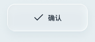 | C01 | 操作按钮 | 保存文档 [document.save]；重置演示 [demo.reset]；搜索 [desktop.search]；多任务 [desktop.tasks]；Esc [desktop.escape]；新建/回复邮件 [mail.compose]；更新汇报数据 [sheet.refresh]；笔记橡皮 [notes.eraser]；撤销笔记笔迹 [notes.undo] | document.save：WorkBuddy 本地 Office → wb-fb-save；demo.reset：连接面板 → demo-reset；desktop.search：本地桌面 → desktop-action {value:search}；desktop.tasks：本地桌面 → desktop-action {value:tasks}；desktop.escape：本地桌面 → desktop-action {value:escape}；mail.compose：Mail副本 → mail-compose；sheet.refresh：本地 Sheet → report-refresh；notes.eraser：本地 Notes → eraser；notes.undo：本地 Notes → undo-stroke | 场景实现 | GAP-01 / GAP-02 / GAP-08 / GAP-10 |
|  | C02 | 图标按钮 | 返回 [navigation.back]；打开应用 [app.open] | navigation.back：各层级 → back；app.open：九应用入口 → open | 场景实现 | GAP-01 / GAP-02 / GAP-08 / GAP-10 |
| 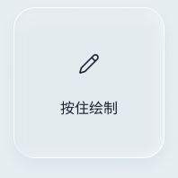 | C03 | 按住操作 | 姿态指向 [presentation.point]；按住绘制 [presentation.draw] | presentation.point：WPS 本地演示副本 → present-start → present-point → present-stop；presentation.draw：WPS 本地演示副本 → present-draw | 场景实现；姿态需原生 | GAP-01 / GAP-02 / GAP-08 / GAP-10 |
|  | C04 | 选择标签 | 无独立功能绑定；可能由组合组件承载 | 待按组合/场景补齐关联 | 场景实现 | GAP-01 / GAP-02 |
|  | C05 | 开关 | 无独立功能绑定；可能由组合组件承载 | 待按组合/场景补齐关联 | 场景实现 | GAP-01 / GAP-02 |
| 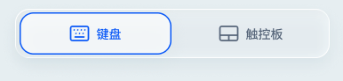 | C06 | 输入模式分段选择 | 无独立功能绑定；可能由组合组件承载 | 待按组合/场景补齐关联 | 场景实现 | GAP-01 / GAP-02 |
|  | C07 | 智慧语音 | 智慧语音 [voice.dictate]；语音快捷命令 [voice.command] | voice.dictate：适配文本目标 → startRecognition；voice.command：本地桌面/绘画专用场景 → editing.completion → 本地规则 | 场景实现；原生语音桥接 | GAP-01 / GAP-02 / GAP-05 / GAP-08 / GAP-10 |
|  | C08 | 字符按键 | 无独立功能绑定；可能由组合组件承载 | 待按组合/场景补齐关联 | 场景实现 | GAP-01 / GAP-02 |
|  | C09 | 附件条目 | 无独立功能绑定；可能由组合组件承载 | 待按组合/场景补齐关联 | 部分场景实现；能力取决于采集方式 | GAP-01 / GAP-02 / GAP-10 |
| 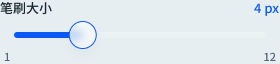 | C10 | 滑杆 | 演示音量 [presentation.volume]；笔记笔宽 [notes.brush] | presentation.volume：WPS 本地演示副本 → present-volume；notes.brush：本地 Notes → brush | 场景实现；本地选区格式 | GAP-01 / GAP-02 / GAP-08 / GAP-10 |
| 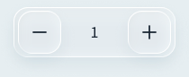 | C11 | 步进器 | 字号 [format.size] | format.size：WorkBuddy 本地幻灯片标题/正文选区 → wb-object-style {style,revision} | 场景实现；本地选区格式 | GAP-01 / GAP-02 / GAP-08 |
|  | C12 | 颜色点 | 笔记颜色 [notes.color] | notes.color：本地 Notes → color | 场景实现；本地选区格式 | GAP-01 / GAP-02 / GAP-08 / GAP-10 |
|  | C13 | 日期时间 | 无独立功能绑定；可能由组合组件承载 | 待按组合/场景补齐关联 | 通用母版未映射；相似控件不能证明完整契约 | GAP-01 / GAP-09 |
|  | C14 | 选项行 | 无独立功能绑定；可能由组合组件承载 | 待按组合/场景补齐关联 | 通用母版未映射；相似控件不能证明完整契约 | GAP-01 / GAP-09 |
| 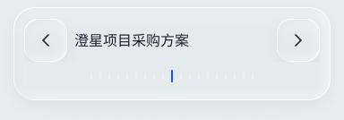 | C15 | 话题切换 | 无独立功能绑定；可能由组合组件承载 | 待按组合/场景补齐关联 | 设计已登记；未找到专用运行时映射 | GAP-01 / GAP-09 |
|  | C16 | 状态反馈 | 无独立功能绑定；可能由组合组件承载 | 待按组合/场景补齐关联 | 场景实现 | GAP-01 / GAP-02 |
| 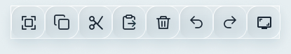 | C17 | 编辑工具栏 | 全选 [edit.select-all]；复制 [edit.copy]；剪切 [edit.cut]；粘贴 [edit.paste]；删除选中内容 [edit.delete]；撤销 [edit.undo]；重做 [edit.redo] | edit.select-all：普通文本；WorkBuddy 选区需单独适配 → editing.edit('all')；选区 copy/cut → clipboardWrite；replace → wb-object-replace；历史 → wb-fb-undo/redo；edit.copy：普通文本；WorkBuddy 选区需单独适配 → editing.edit('copy')；选区 copy/cut → clipboardWrite；replace → wb-object-replace；历史 → wb-fb-undo/redo；edit.cut：普通文本；WorkBuddy 选区需单独适配 → editing.edit('cut')；选区 copy/cut → clipboardWrite；replace → wb-object-replace；历史 → wb-fb-undo/redo；edit.paste：普通文本；WorkBuddy 选区需单独适配 → editing.edit('paste')；选区 copy/cut → clipboardWrite；replace → wb-object-replace；历史 → wb-fb-undo/redo；edit.delete：普通文本；WorkBuddy 选区需单独适配 → editing.edit('delete')；选区 copy/cut → clipboardWrite；replace → wb-object-replace；历史 → wb-fb-undo/redo；edit.undo：普通文本；WorkBuddy 选区需单独适配 → editing.edit('undo')；选区 copy/cut → clipboardWrite；replace → wb-object-replace；历史 → wb-fb-undo/redo；edit.redo：普通文本；WorkBuddy 选区需单独适配 → editing.edit('redo')；选区 copy/cut → clipboardWrite；replace → wb-object-replace；历史 → wb-fb-undo/redo | 场景实现 | GAP-01 / GAP-02 / GAP-08 |
| 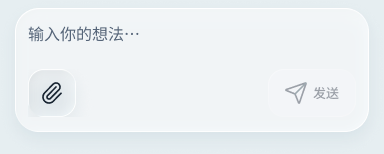 | C18 | 文本编辑器 | 文字输入 [input.text]；AI润色 [text.polish]；发送消息 [chat.send]；发送邮件 [mail.send]；提交聊天输入 [chat.local-submit] | input.text：适配文本目标 → edit-sync；text.polish：适配文本目标 → requestPolish；chat.send：微信 → chat-submit；mail.send：Mail 副本 → mail-send；chat.local-submit：Doubao 本地副本 → chat-send | 场景实现 | GAP-01 / GAP-02 / GAP-08 / GAP-10 |
|  | C19 | 紧凑编辑器 | 无独立功能绑定；可能由组合组件承载 | 待按组合/场景补齐关联 | 场景实现 | GAP-01 / GAP-02 |
|  | C20 | 来源引用 | 无独立功能绑定；可能由组合组件承载 | 待按组合/场景补齐关联 | 场景实现 | GAP-01 / GAP-02 |
| 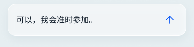 | C21 | 建议回复 | 采用建议回复 [reply.adopt] | reply.adopt：微信/邮件 → chat-reply / mail-adopt | 场景实现；注册动作名称与当前语义冲突 | GAP-04 |
|  | C22 | 应用动作标签 | 打开推荐服务 [service.open] | service.open：微信推荐动作 → setService(a) → ServicePage | 场景实现 | GAP-01 / GAP-02 / GAP-08 / GAP-10 |
|  | C23 | 任务卡片 | 无独立功能绑定；可能由组合组件承载 | 待按组合/场景补齐关联 | 本地任务/批准场景实现 | GAP-01 / GAP-02 / GAP-08 |
| 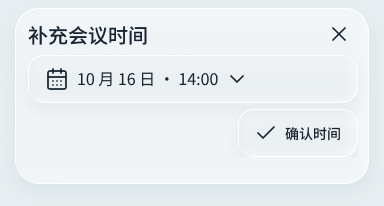 | C24 | 缺参表单 | 无独立功能绑定；可能由组合组件承载 | 待按组合/场景补齐关联 | 通用母版未映射；相似控件不能证明完整契约 | GAP-01 / GAP-09 |
| 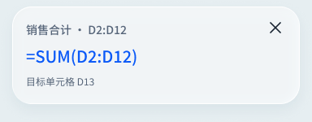 | C25 | 公式预览 | 无独立功能绑定；可能由组合组件承载 | 待按组合/场景补齐关联 | 部分对应；未逐项证明设计态/公式执行 | GAP-01 / GAP-09 |
| 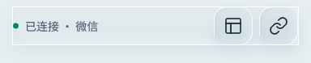 | C26 | 应用与连接状态行 | 切换应用 [app.switch]；连接设置 [connection.open]；启用手机输入 [input.activate] | app.switch：九个演示应用 → switch-step → switch-commit；connection.open：手机/平板 → ConnectionButton；input.activate：适配字段/桌面入口 → input-session-request | 场景实现 | GAP-01 / GAP-02 / GAP-08 / GAP-10 |
| 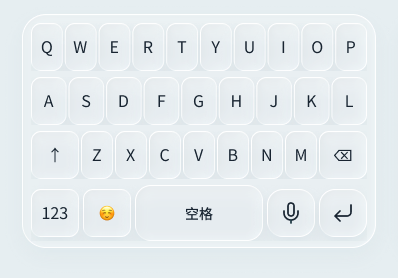 | C27 | 键盘面板 | 系统中文输入 [input.mode.system] | input.mode.system：适配文本目标 → setSystem(true) | 场景实现 | GAP-01 / GAP-02 / GAP-10 |
| 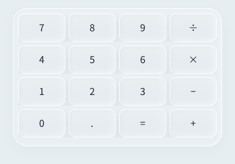 | C28 | 数字与公式键盘 | 无独立功能绑定；可能由组合组件承载 | 待按组合/场景补齐关联 | 部分对应；未逐项证明设计态/公式执行 | GAP-01 / GAP-09 |
| 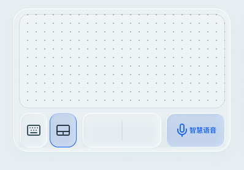 | C29 | 触控板 | 移动指针 [pointer.move]；左键点击 [pointer.left]；双击 [pointer.double]；右键点击 [pointer.right]；按住左键 [pointer.down]；释放左键 [pointer.up]；滚动 [pointer.scroll]；取消指针手势 [pointer.cancel] | pointer.move：当前本地模拟应用 → input-pointer {action:move}；pointer.left：当前本地模拟应用 → input-pointer {action:left}；pointer.double：当前本地模拟应用 → input-pointer {action:double}；pointer.right：当前本地模拟应用 → input-pointer {action:right}；pointer.down：当前本地模拟应用 → input-pointer {action:down}；pointer.up：当前本地模拟应用 → input-pointer {action:up}；pointer.scroll：当前本地模拟应用 → input-pointer {action:scroll}；pointer.cancel：当前本地模拟应用 → input-pointer {action:cancel} | 场景实现 | GAP-01 / GAP-02 / GAP-08 / GAP-10 |
| 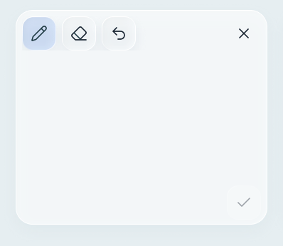 | C30 | 草图画布 | 绘制布局草图 [sketch.edit] | sketch.edit：WorkBuddy 指令 → wb-input {action:sketch} | 有对应场景；旧母版需按句内参数规则迁移 | GAP-01 / GAP-02 / GAP-05 / GAP-08 / GAP-10 |
| 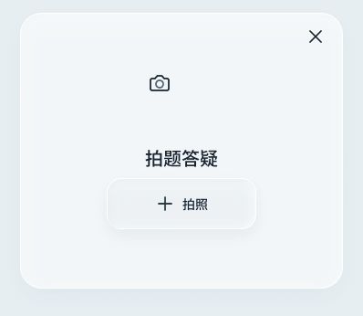 | C31 | 相机输入 | 无独立功能绑定；可能由组合组件承载 | 待按组合/场景补齐关联 | 部分场景实现；能力取决于采集方式 | GAP-01 / GAP-02 / GAP-10 |
| 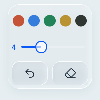 | C32 | 画笔设置 | 笔色/笔宽 [presentation.style]；撤销本页笔迹 [presentation.undo]；清空本页笔迹 [presentation.clear] | presentation.style：WPS 本地演示副本 → present-style；presentation.undo：WPS 本地演示副本 → present-undo；presentation.clear：WPS 本地演示副本 → present-clear | 场景实现；姿态需原生 | GAP-01 / GAP-02 / GAP-08 / GAP-10 |
| 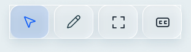 | C33 | 演示工具栏 | 切换幻灯片 [presentation.slide]；开始/退出放映 [presentation.fullscreen]；激光/画笔 [presentation.mode]；实时字幕 [presentation.captions] | presentation.slide：WPS 本地演示副本 → slide；presentation.fullscreen：WPS 本地演示副本 → present；presentation.mode：WPS 本地演示副本 → present-mode；presentation.captions：WPS 本地演示副本 → present-captions | 场景实现；姿态需原生 | GAP-01 / GAP-02 / GAP-08 / GAP-10 |
| 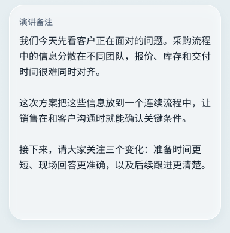 | C34 | 演讲者备注 | 无独立功能绑定；可能由组合组件承载 | 待按组合/场景补齐关联 | 场景实现；姿态需原生 | GAP-01 / GAP-10 |
| 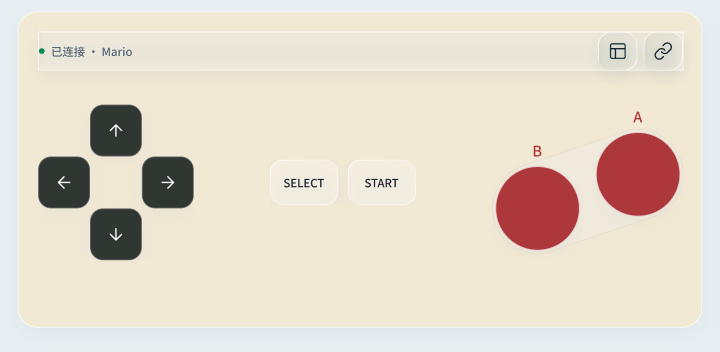 | C35 | 游戏控制器 | 游戏按键 [game.keys]；暂停游戏 [game.pause]；重新开始 [game.reset] | game.keys：Mario 本地游戏 → game-keys；game.pause：Mario 本地游戏 → game-pause；game.reset：Mario 本地游戏 → game-reset | 本地游戏场景实现 | GAP-01 / GAP-02 / GAP-10 |
| 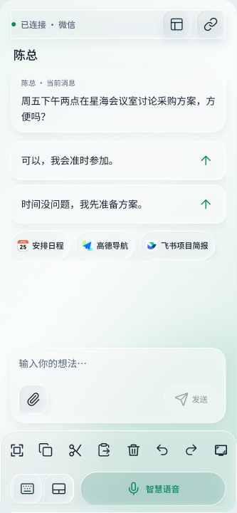 | C36 | 微信手机场景 | 无独立功能绑定；可能由组合组件承载 | 待按组合/场景补齐关联 | 场景实现 | GAP-01 / GAP-02 |
| 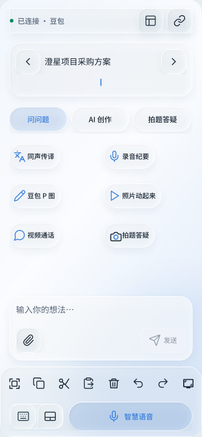 | C37 | 豆包手机场景 | 无独立功能绑定；可能由组合组件承载 | 待按组合/场景补齐关联 | 部分对应；未逐项证明设计态/公式执行 | GAP-01 / GAP-09 |
| 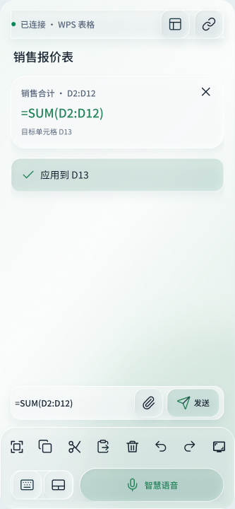 | C38 | 表格手机场景 | 无独立功能绑定；可能由组合组件承载 | 待按组合/场景补齐关联 | 部分对应；未逐项证明设计态/公式执行 | GAP-01 / GAP-09 |
| 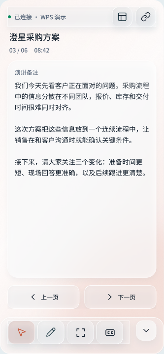 | C39 | 演示手机场景 | 无独立功能绑定；可能由组合组件承载 | 待按组合/场景补齐关联 | 场景实现；姿态需原生 | GAP-01 / GAP-10 |
| 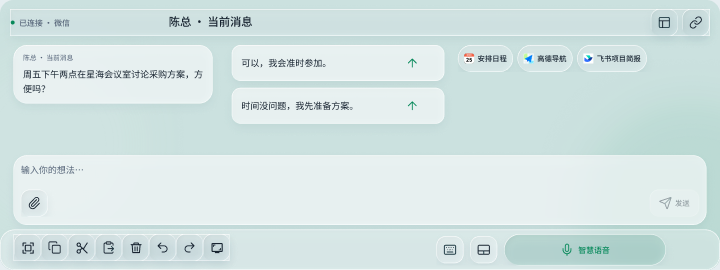 | C40 | 微信历史Fold场景 | 无独立功能绑定；可能由组合组件承载 | 待按组合/场景补齐关联 | 历史 Fold PC 方案；不进入当前生成白名单 | GAP-06 |
| 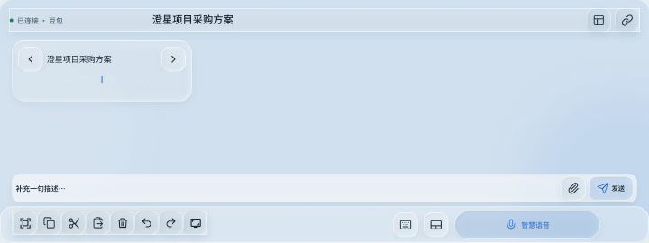 | C41 | 豆包历史Fold场景 | 无独立功能绑定；可能由组合组件承载 | 待按组合/场景补齐关联 | 历史 Fold PC 方案；不进入当前生成白名单 | GAP-06 |
| 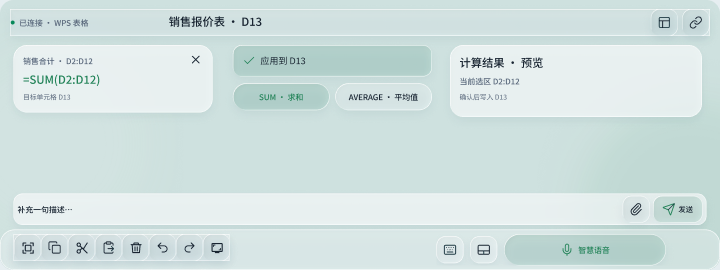 | C42 | 表格历史Fold场景 | 无独立功能绑定；可能由组合组件承载 | 待按组合/场景补齐关联 | 历史 Fold PC 方案；不进入当前生成白名单 | GAP-06 |
| 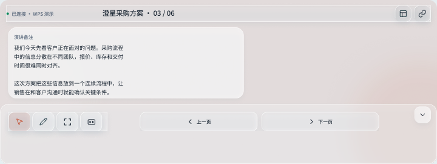 | C43 | 演示历史Fold场景 | 无独立功能绑定；可能由组合组件承载 | 待按组合/场景补齐关联 | 历史 Fold PC 方案；不进入当前生成白名单 | GAP-06 |
| 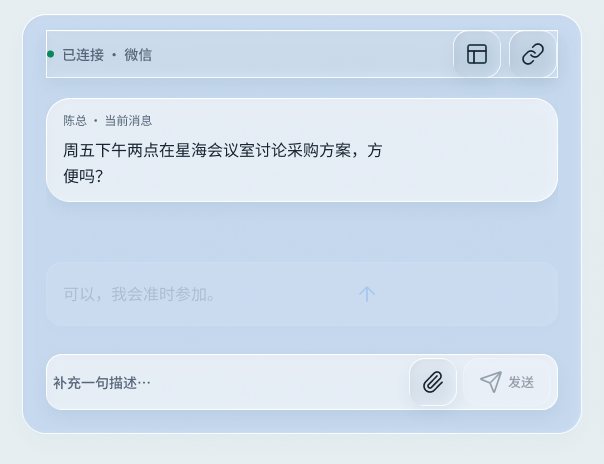 | C44 | 应用切换动效 | 无独立功能绑定；可能由组合组件承载 | 待按组合/场景补齐关联 | 动效设计样例；非通用运行时生成器 | GAP-01 / GAP-09 |
|  | C45 | 上下文切换动效 | 无独立功能绑定；可能由组合组件承载 | 待按组合/场景补齐关联 | 动效设计样例；非通用运行时生成器 | GAP-01 / GAP-09 |
| 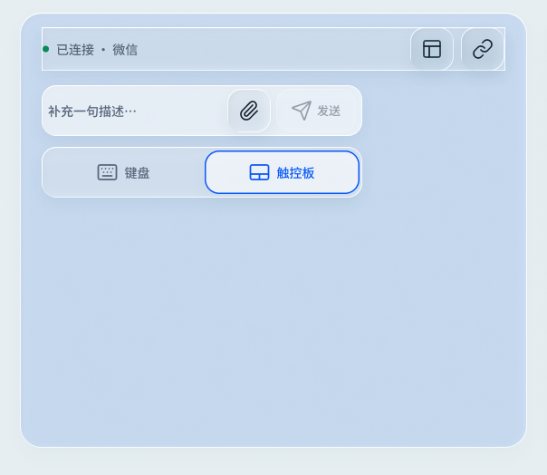 | C46 | 面板切换动效 | 无独立功能绑定；可能由组合组件承载 | 待按组合/场景补齐关联 | 动效设计样例；非通用运行时生成器 | GAP-01 / GAP-09 |
| 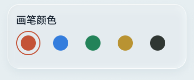 | C47 | 展开画笔调色板 | 无独立功能绑定；可能由组合组件承载 | 待按组合/场景补齐关联 | 场景实现；姿态需原生 | GAP-01 / GAP-10 |
| 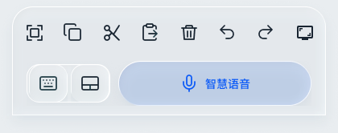 | C48 | 共享输入底栏 | 展开键盘 [input.mode.keyboard]；展开触控板 [input.mode.trackpad] | input.mode.keyboard：适配文本目标 → setMode(keyboard)；input.mode.trackpad：适配文本目标 → setMode(trackpad) | 场景实现 | GAP-01 / GAP-02 / GAP-10 |
|  | C49 | 上下文工作区 | 无独立功能绑定；可能由组合组件承载 | 待按组合/场景补齐关联 | 有对应场景；旧母版需按句内参数规则迁移 | GAP-01 / GAP-05 |
|  | C50 | Agent任务状态 | 无独立功能绑定；可能由组合组件承载 | 待按组合/场景补齐关联 | 有对应场景；旧母版需按句内参数规则迁移 | GAP-01 / GAP-05 |
| 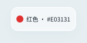 | C51 | 行内颜色参数 | 无独立功能绑定；可能由组合组件承载 | 待按组合/场景补齐关联 | 有对应场景；旧母版需按句内参数规则迁移 | GAP-01 / GAP-05 |
| 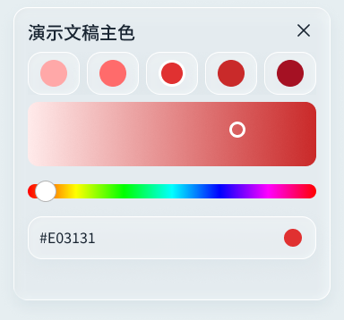 | C52 | 颜色微调 | 文字颜色 [format.color]；调整颜色 [parameter.color] | format.color：WorkBuddy 本地幻灯片标题/正文选区 → wb-object-style {style,revision}；parameter.color：WorkBuddy 指令 → wb-input {action:color} | 有对应场景；旧母版需按句内参数规则迁移 | GAP-01 / GAP-02 / GAP-05 / GAP-08 / GAP-10 |
| 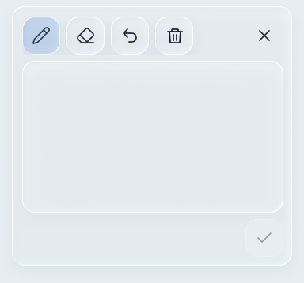 | C53 | 布局意图画布 | 无独立功能绑定；可能由组合组件承载 | 待按组合/场景补齐关联 | 有对应场景；旧母版需按句内参数规则迁移 | GAP-01 / GAP-05 |
| 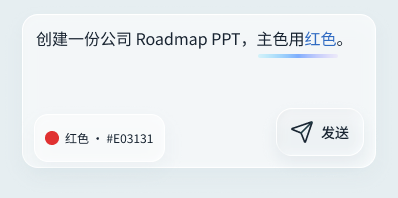 | C54 | 参数编辑器 | 无独立功能绑定；可能由组合组件承载 | 待按组合/场景补齐关联 | 有对应场景；旧母版需按句内参数规则迁移 | GAP-01 / GAP-05 |
|  | C55 | 意图识别扫描动效 | 无独立功能绑定；可能由组合组件承载 | 待按组合/场景补齐关联 | 有对应场景；旧母版需按句内参数规则迁移 | GAP-01 / GAP-05 |
|  | C56 | 草图附件 | 确认草图 [sketch.adopt]；移除草图 [sketch.remove] | sketch.adopt：WorkBuddy 指令 → wb-input {action:sketch-confirm}；sketch.remove：WorkBuddy 指令 → wb-input {action:sketch-remove} | 有对应场景；旧母版需按句内参数规则迁移 | GAP-01 / GAP-02 / GAP-05 / GAP-08 / GAP-10 |
| 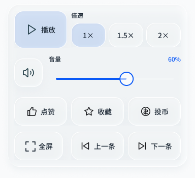 | C57 | 媒体控制组合 | 播放/暂停 [media.play]；播放倍速 [media.speed]；音量 [media.volume]；静音 [media.mute]；播放位置 [media.seek]；上一条/下一条 [media.next]；点赞 [media.like]；收藏 [media.favorite]；投币 [media.coin]；全屏 [media.view]；发送弹幕/评论 [media.send] | media.play：Bilibili 本地副本 → bili-play；media.speed：Bilibili 本地副本 → bili-speed；media.volume：Bilibili 本地副本 → bili-volume；media.mute：Bilibili 本地副本 → bili-mute；media.seek：Bilibili 本地副本 → bili-seek；media.next：Bilibili 本地副本 → bili-next；media.like：Bilibili 本地副本 → bili-like；media.favorite：Bilibili 本地副本 → bili-favorite；media.coin：Bilibili 本地副本 → bili-coin；media.view：Bilibili 本地副本 → bili-view；media.send：Bilibili 本地副本 → bili-send | 场景实现 | GAP-01 / GAP-02 / GAP-08 |
|  | C58 | 可见任务导航 | 新建任务输入 [task.new]；选择任务 [task.select] | task.new：WorkBuddy → wb-input-task {action:new}；task.select：WorkBuddy → wb-input-task {id} | 有对应场景；旧母版需按句内参数规则迁移 | GAP-01 / GAP-02 / GAP-05 / GAP-08 / GAP-10 |
|  | C59 | 弹性编辑区 | 无独立功能绑定；可能由组合组件承载 | 待按组合/场景补齐关联 | 有对应场景；旧母版需按句内参数规则迁移 | GAP-01 / GAP-05 |
| 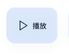 | C60 | 播放开关 | 无独立功能绑定；可能由组合组件承载 | 待按组合/场景补齐关联 | 场景实现；注册表缺 props/actions | GAP-11 |
| 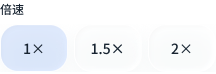 | C61 | 播放倍速 | 无独立功能绑定；可能由组合组件承载 | 待按组合/场景补齐关联 | 场景实现；注册表缺 props/actions | GAP-11 |
| 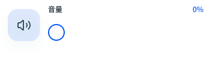 | C62 | 播放音量 | 无独立功能绑定；可能由组合组件承载 | 待按组合/场景补齐关联 | 场景实现 | GAP-01 / GAP-02 |
| 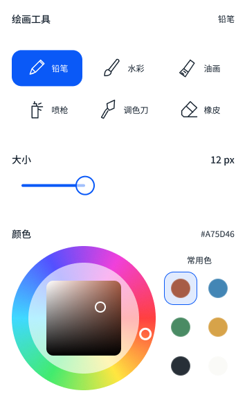 | C63 | 绘画画笔控制台 | 选择画笔 [paint.tool]；画笔大小 [paint.size]；绘画颜色 [paint.color]；不透明度 [paint.opacity]；选择图层 [paint.layer]；显隐图层 [paint.visibility]；画笔笔迹 [paint.stroke]；绘画命令 [paint.command]；撤销/重做绘画 [paint.undo] | paint.tool：GoPaint 本地副本 → paint-parameter；paint.size：GoPaint 本地副本 → paint-parameter；paint.color：GoPaint 本地副本 → paint-parameter；paint.opacity：GoPaint 本地副本 → paint-parameter；paint.layer：GoPaint 本地副本 → paint-select；paint.visibility：GoPaint 本地副本 → paint-visible；paint.stroke：GoPaint 本地副本 → paint-stroke；paint.command：GoPaint 本地副本 → paint-command；paint.undo：GoPaint 本地副本 → paint-history | 本地绘画场景实现 | GAP-01 / GAP-02 / GAP-08 / GAP-10 / GAP-11 |
| 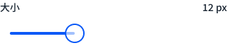 | C64 | 绘画笔宽滑杆 | 无独立功能绑定；可能由组合组件承载 | 待按组合/场景补齐关联 | 本地绘画场景实现 | GAP-01 / GAP-02 / GAP-10 / GAP-11 |
| 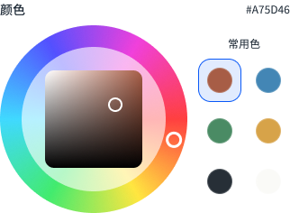 | C65 | 色轮与预设 | 无独立功能绑定；可能由组合组件承载 | 待按组合/场景补齐关联 | 本地绘画场景实现 | GAP-01 / GAP-02 / GAP-10 / GAP-11 |
| 预览待补 | C66 | 绘画语音底栏 | 无独立功能绑定；可能由组合组件承载 | 待按组合/场景补齐关联 | 场景实现；固定几何由共享 InputDock 负责 | GAP-05 / GAP-10 |
| 预览待补 | C67 | 意图标签 | 无独立功能绑定；可能由组合组件承载 | 待按组合/场景补齐关联 | 有对应场景；旧母版需按句内参数规则迁移 | GAP-01 / GAP-05 |
| 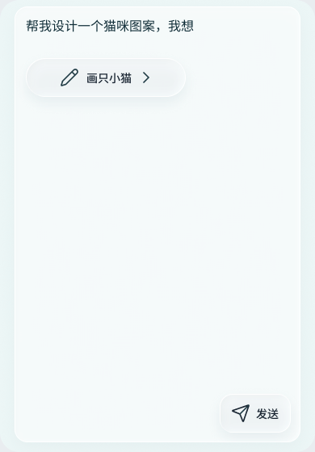 | C68 | 意图标签编辑器 | 无独立功能绑定；可能由组合组件承载 | 待按组合/场景补齐关联 | 有对应场景；旧母版需按句内参数规则迁移 | GAP-01 / GAP-05 |
| 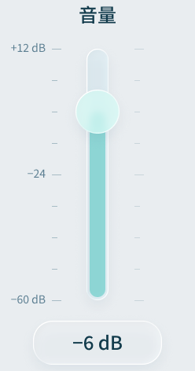 | C69 | 专业精密推杆 | 专业参数推杆 [professional.parameter] | professional.parameter：未来专业应用适配 → 未接入；禁止模型生成执行代码 | 设计已登记；专业适配未接入 | GAP-01 / GAP-02 / GAP-03 / GAP-07 / GAP-08 |
| 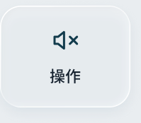 | C70 | 专业动作键 | 应用快捷操作 [shortcut.execute] | shortcut.execute：未来专业应用适配 → 未接入；禁止模型生成执行代码 | 设计已登记；专业适配未接入 | GAP-01 / GAP-02 / GAP-03 / GAP-07 / GAP-08 |
| 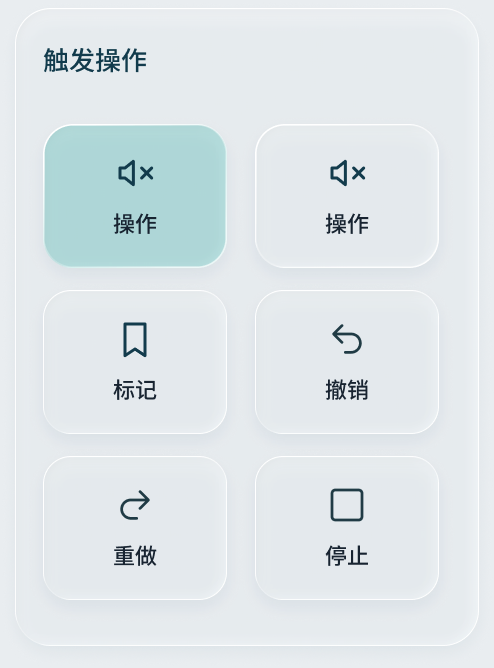 | C71 | 专业动作面板 | 无独立功能绑定；可能由组合组件承载 | 待按组合/场景补齐关联 | 设计已登记；专业适配未接入 | GAP-01 / GAP-07 / GAP-08 |
| 预览待补 | C72 | 专业意图输入 | 无独立功能绑定；可能由组合组件承载 | 待按组合/场景补齐关联 | 设计已登记；专业适配未接入 | GAP-01 / GAP-07 / GAP-08 |
| 预览待补 | C73 | 相对编码旋钮 | 相对旋钮 [professional.encoder] | professional.encoder：未来专业应用适配 → 未接入；禁止模型生成执行代码 | 设计已登记；专业适配未接入 | GAP-01 / GAP-02 / GAP-03 / GAP-07 / GAP-08 |
| 预览待补 | C74 | 修饰参数旋钮 | 按住切换旋钮 [professional.modifier] | professional.modifier：未来专业应用适配 → 未接入；禁止模型生成执行代码 | 设计已登记；专业适配未接入 | GAP-01 / GAP-02 / GAP-03 / GAP-07 / GAP-08 |
| 预览待补 | C75 | 时间线导航旋钮 | 时间线 Jog/Shuttle [professional.timeline] | professional.timeline：未来专业应用适配 → 未接入；禁止模型生成执行代码 | 设计已登记；专业适配未接入 | GAP-01 / GAP-02 / GAP-03 / GAP-07 / GAP-08 |
| 预览待补 | C76 | 任务提醒脉冲 | 无独立功能绑定；可能由组合组件承载 | 待按组合/场景补齐关联 | 有对应场景；旧母版需按句内参数规则迁移 | GAP-01 / GAP-05 |
| 预览待补 | C77 | 材料来源 | 添加材料 [material.add] | material.add：WorkBuddy → wb-material | 部分场景实现；能力取决于采集方式 | GAP-01 / GAP-02 / GAP-08 / GAP-10 |
| 预览待补 | C78 | 材料预览 | 无独立功能绑定；可能由组合组件承载 | 待按组合/场景补齐关联 | 部分场景实现；能力取决于采集方式 | GAP-01 / GAP-02 / GAP-10 |
| 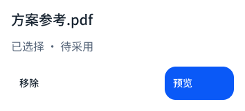 | C79 | 材料附件 | 采用采集结果 [capture.adopt] | capture.adopt：当前原任务 → capture-use / capture-photo-use | 部分场景实现；能力取决于采集方式 | GAP-01 / GAP-02 / GAP-08 / GAP-10 |
| 预览待补 | C80 | 动态辅助区 | 无独立功能绑定；可能由组合组件承载 | 待按组合/场景补齐关联 | 有对应场景；旧母版需按句内参数规则迁移 | GAP-01 / GAP-05 |
| 预览待补 | C81 | 旧版工具摘要 | 无独立功能绑定；可能由组合组件承载 | 待按组合/场景补齐关联 | 旧方案；常驻工具摘要被句内参数规则替代 | GAP-05 / GAP-06 |
| 预览待补 | C82 | 紧凑任务输入 | 无独立功能绑定；可能由组合组件承载 | 待按组合/场景补齐关联 | 有对应场景；旧母版需按句内参数规则迁移 | GAP-01 / GAP-05 |
| 预览待补 | C83 | Agent决策请求 | 批准请求 [task.approve] | task.approve：WorkBuddy 票据 → wb-approval | 本地任务/批准场景实现 | GAP-01 / GAP-02 / GAP-08 / GAP-10 |
| 预览待补 | C84 | 采集直接预览 | 打开采集 [capture.request] | capture.request：已适配场景 → capture-request | 部分场景实现；能力取决于采集方式 | GAP-01 / GAP-02 / GAP-08 / GAP-10 |
|  | C85 | 句内参数 | 修改句内参数 [parameter.inline] | parameter.inline：WorkBuddy 指令 → wb-input {action:inline-value} | 场景实现 | GAP-01 / GAP-02 / GAP-08 / GAP-10 |
| 预览待补 | C86 | 句内参数编辑器 | 发送任务指令 [task.submit] | task.submit：WorkBuddy → wb-submit | 场景实现 | GAP-01 / GAP-02 / GAP-08 / GAP-10 |
| 预览待补 | C87 | 选区格式工具栏 | 加粗 [format.bold]；斜体 [format.italic]；下划线 [format.underline]；删除线 [format.strike]；链接 [format.link]；段落对齐 [format.alignment] | format.bold：WorkBuddy 本地幻灯片标题/正文选区 → wb-object-style {style,revision}；format.italic：WorkBuddy 本地幻灯片标题/正文选区 → wb-object-style {style,revision}；format.underline：WorkBuddy 本地幻灯片标题/正文选区 → wb-object-style {style,revision}；format.strike：WorkBuddy 本地幻灯片标题/正文选区 → wb-object-style {style,revision}；format.link：WorkBuddy 本地幻灯片标题/正文选区 → wb-object-style {style,revision}；format.alignment：WorkBuddy 本地幻灯片标题/正文选区 → wb-object-style {style,revision} | 场景实现；本地选区格式 | GAP-01 / GAP-02 / GAP-08 |
| 预览待补 | C88 | 选区链接编辑器 | 无独立功能绑定；可能由组合组件承载 | 待按组合/场景补齐关联 | 场景实现；本地选区格式 | GAP-01 / GAP-02 / GAP-08 |
