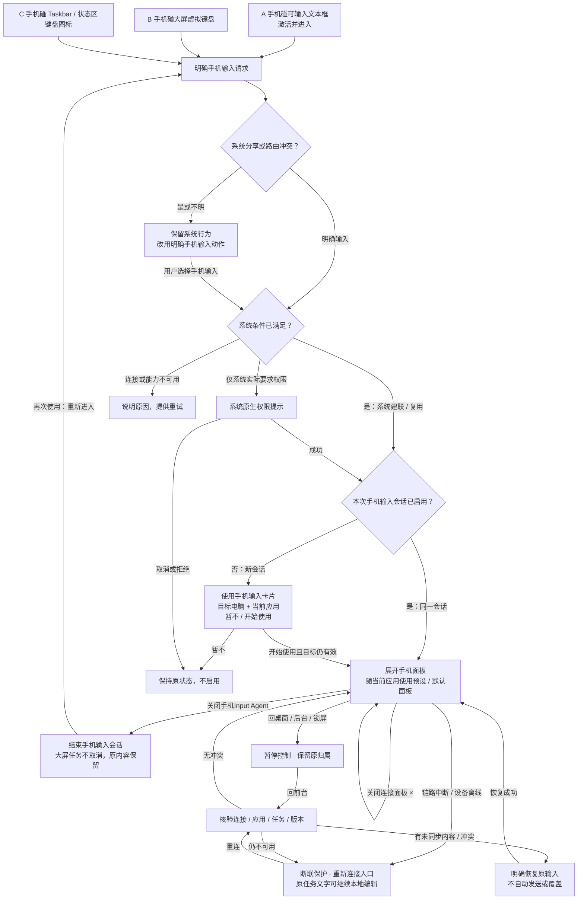
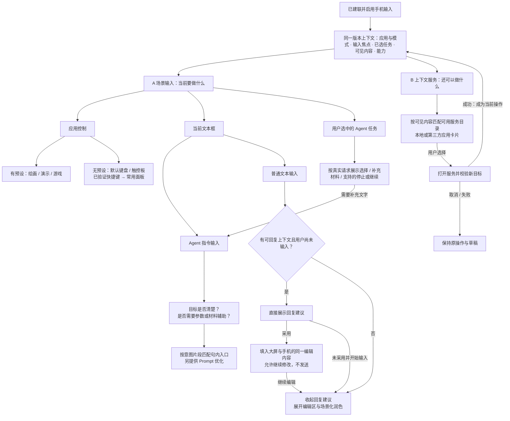
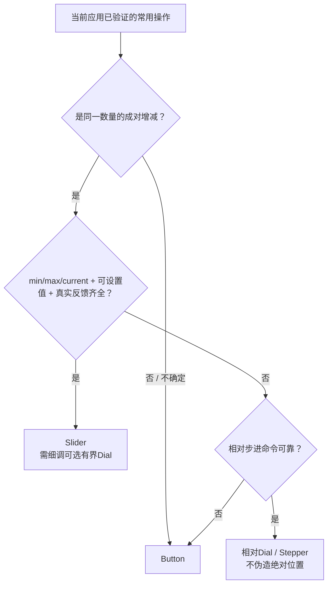

### 7.6 通用判定 Flow 与 Decision API 问题契约
**修订：2026-10-19。当前规则采用“明确入口 → 会话跟随 → 预设／默认面板 → 独立增强”。替代旧版以有效文本目标为唯一入口、无焦点仅显示任务概览，以及按颜色／手绘逐项提问的主流程。属于设计与接入准备；系统碰触仲裁、跨应用控制、Jev准确率、延迟和端侧部署尚未验收。本轮不修改运行代码。**
可编辑页面：[入口](https://www.figma.com/slides/ylIR7XjcoubXhUiTmEuNI6/Mobile-Input-Agent?node-id=148-882) → [总判定流程](https://www.figma.com/slides/ylIR7XjcoubXhUiTmEuNI6/Mobile-Input-Agent?node-id=137-882) → [面板与控件生成](https://www.figma.com/slides/ylIR7XjcoubXhUiTmEuNI6/Mobile-Input-Agent?node-id=148-883)。[总览与Demo](https://www.figma.com/slides/ylIR7XjcoubXhUiTmEuNI6/Mobile-Input-Agent?node-id=99-883)保留左侧演示空间。

#### 7.6.1 入口：连接与启用分开
1. **明确入口，按 A / B / C 分别展示**：
   - **A 碰文本框：激活并进入**。手机碰已适配的可输入文本框，在同一步完成目标激活与手机输入请求，不要求用户先用手指点出焦点。当前原型保留“已连接时点击大屏输入框，激活对应手机编辑器”的既有行为；它不证明系统碰触已实现。
   - **B 碰大屏虚拟键盘**。手机碰大屏已显示的虚拟键盘，发起手机输入。大屏虚拟触控板仅在实际存在且适配时归入同类，不把手机触控板截图当作大屏入口。普通手指按键保持本机输入语义。
   - **C 碰 Taskbar / 系统状态区键盘入口**。手机碰已适配的键盘图标，发起手机输入；普通手指点击现有键盘图标仍打开本机虚拟键盘。明确的“手机输入”动作可作为无碰触或路由冲突时的备选，属于入口适配设计。右上角连接按钮用于配对与连接管理，不能当作已经启用手机输入。
   - 三条入口共同经过输入路由与系统条件检查；鸿蒙系统发现设备并建立或复用连接。新会话显示一张“使用手机输入”卡片，用户确认后展开手机面板；同一会话内切应用不再确认。仅系统实际要求权限时显示原生提示。截图只证明文本框、键盘与托盘元素存在，不证明碰触定位与跨设备接管已经实现。
2. **系统分享边界**：鸿蒙一碰传可双向传输。手机没有选中内容，不等于要启用输入。系统正在分享／接收时保留原流程；路由不明时不抢占，用明确的“手机输入”入口进入。用户曾提出光标入口；本版暂不采纳普通鼠标指针作为入口。游戏画面任意位置也不默认触发接管；非入口区域保持系统原行为。
3. **启用过程（最新确认卡片方案）**：入口请求 → 鸿蒙系统发现设备、建立或复用连接并检查能力 → 新会话显示一张“使用手机输入”卡片 → 点击“开始使用”后展开当前应用的手机面板。卡片展示折叠PC与手机碰触的概念插图、说明“根据当前场景，提供最顺手的输入方式”、实际目标电脑名称、当前应用与“暂不 / 开始使用”，不显示 IP、PIN、扫码或连接方式选择。它确认本次输入会话，不代表操作系统权限授权。系统确需权限时沿用原生提示，卡片与原生提示能否合并由接入能力决定，不假设可以替代。已启用会话内切应用或重新定位目标不重复确认；切换到另一设备或结束后新开会话需重新确认。取消不启用且保留原内容；连接或目标变化须重新核验卡片目标，失败不可显示已启用。扫码／PIN只保留在开发原型的LAN备用能力中，不进入真实鸿蒙产品入口流程。启用不录音、不发送、不执行任务。
4. **会话跟随**：启用后跟随用户主动切换的当前应用／操作，无需每个应用重新碰触。切换前释放旧按键、拖动和连续控制；原草稿／材料仍属原任务。新应用绑定与能力经本地重验后更新面板，后台请求不抢占。
5. **主动退出**：用户关闭手机 Input Agent 应用，结束本次手机输入会话；再次使用须重新进入。退出不删除配对关系、不清空原任务内容，也不取消大屏正在运行的 Agent 任务。关闭连接面板的“×”仅收起设置，不结束输入。
6. **临时离开**：返回桌面、切到后台或锁屏立即暂停手机控制；回前台后重新核验连接、当前应用与原输入归属。有未同步内容或版本冲突时进入明确恢复，不能静默覆盖。
7. **意外断联**：链路中断或目标设备离线时停止远端写入，保留原界面、原任务内容与“重新连接”入口；已归属的本地文字可继续编辑。重连后先核验，有未同步内容时按“恢复到当前目标”处理，不自动提交或重复执行。
8. **共同约束**：释放按键、拖动与连续控制，停止当前录音；不补发最后动作、不重放历史操作。无法识别是否主动关闭时按实际观测到的断联保护，不伪造退出回执；系统级退出通知、后台和全局碰触能力须单独验证。

**入口页UI来源**：键盘使用中、断联和重连恢复均为现有本地浏览器原型实截，使用独立虚构任务，未提交。断联通过关闭测试连接触发；不证明原生进程退出或系统碰触接管已经完成。原图与出处见artifacts/decision-rules-2026-10-19/entry-ui/manifest.json。三入口补图使用同目录06-system-keyboard-entry.png与07-large-screen-keyboard.png，来源见entry-targets-manifest.json。

**碰触确认核实（2026-10-19）**：[华为同账号手机与鸿蒙电脑屏幕碰传说明](https://consumer.huawei.com/cn/support/content/zh-cn16073771/)列出前置账号与开关条件；手机传电脑需碰触后上滑，电脑传手机需点击接收。文档没有将扫码／PIN设置列为每次碰触步骤，也没有证明首次持续输入控制无需权限。最新设计移除扫码配对页，采用“系统建联后，新会话通过单张启用卡片确认；同会话直接跟随，系统权限按需原生提示”；输入控制首次权限与真实系统页面仍待实机/接入核实，不能以分享的接收提示替代输入授权设计。

#### 7.6.2 总流程：场景输入与上下文服务并行
2026-10-19 用户确认：建联并启用后并行处理 A 场景输入（完成当前操作）与 B 上下文服务（发现下一步）。应用控制、文本用途、已选任务是不同维度，可以关联存在，不使用一个互斥的 input_context 单选代替三者。应用、模式、已注册字段用途、真实任务请求优先由系统确认，语义未知才由 Jev 辅助判断。

有已注册且可用的场景预设就使用预设；否则使用默认键盘／触控板与当前应用已验证的常用操作。Desktop无文本目标默认触控板；其他场景沿用既有预设／输入模式，保留用户选择的键盘／触控板／收起状态。新焦点不全局强开键盘。绘画预设内编辑图层名时，临时提供唯一同步编辑区，结束后回到原控制状态；文字输入可让出中部空间，不叠满全部控件。快捷操作绑定应用／模式，文字写入绑定有效字段；无文本焦点仍可控制应用，但不新增无归属文本框。

**回复建议与润色的切换规则**
- 当前会话有可回复来信／邮件，且用户尚未输入：在已授权范围内生成并显示具体回复建议。只是有文字上下文，不代表有回复关系；新建邮件、文档、搜索框不据此自动生成回复。
- 采用：将选中回复写入绑定的大屏字段并同步手机唯一编辑区，两端属于同一编辑会话，不复制成两个独立草稿。采用后收起建议，允许修改并提供场景润色；发送独立。
- 未采用而开始自行输入（键入、粘贴或语音草稿开始变化）：立即关闭回复建议，展开编辑区，显示适合当前文字的润色入口。晚到生成结果不覆盖草稿、不重新弹出推荐。
- 建议绑定来源消息、会话、目标、编辑版本与本次输入状态；切换来源／目标或已有正文时不采用旧建议。清空正文不自动重开本次已关闭的建议；进入新的回复目标才重新判断。
- 询问是否参加、是否接受报价等内容，提供由用户选择的立场，不凭来信认定用户已同意。建议采用不代表执行或发送。
- 回复正文与改写正文由独立生成能力产出；Jev 判断是否适合及推荐方向，不返回任意回复正文。本规则为产品目标，现有微信规则演示及仅显式调用的 Gemini 润色不因此变成已接入的自动生成能力。

**其他场景约束**：目标清楚仍可能需要参数／材料辅助；“说到位”不等同于必须填写所有可想象的参数。只有真实任务或表单字段要求才构成必填判断。后台任务仅提示，用户选择后显示真实请求；补充文本沿用 Agent 输入规则。服务推荐不抢占当前输入；成功打开并校验后才转为当前操作，普通和 Agent 应用都可推荐。断连、未知焦点、过期结果按原保护规则处理。

#### 7.6.3 生成规则：预设优先，默认面板按操作语义组合
**生成契约补充（联合评审工作稿）**：ContextSnapshot记录当前应用／模式／对象／焦点／任务及版本；CapabilityManifest由适配方维护真实命令、作用域、数值能力和回执；DecisionResults只回答语义和候选相关性；本地编译成PanelSpec后交给注册控件与稳定模板。
三条路径明确区分：有可用预设→保留；无预设有可信能力→组合面板；应用未适配或模型失败→保留平台可用的通用输入。快捷键声明也属于需要验证和维护的适配，不能声称零适配。
布局仍固定上部应用／任务与连接入口、底部模式／语音／编辑操作。中部依次保障用户当前操作、选中请求、编辑必要工具、场景常用操作、服务建议。建议从四个主操作槽位起验证，更多项进入二级区；这是可用性测试起点，不是所有场景统一上限。保留用户固定项和顺序，连续操作中不重排。
完整流程、能力字段、PanelSpec、具体Decision请求、缓存／延迟预算及商业验证见 <mention-page url="https://app.notion.com/p/3fe194db24c3815592b8cd44240a6ff8">生成键盘｜商业假设与决策到面板（Claude × Codex 联合评审）</mention-page>。这些新增策略为研究工作稿；已确认的交互约定继续有效。
控件集合仍按 **原子控件 → 输入组合 → 场景组合** 组织。默认面板从适配器确认的快捷命令／能力中选常用操作，不凭截图发明快捷键。预设是已设计且适配的场景组合；默认面板也使用注册库，不生成任意UI代码。

<table header-row="true">
<tr><td>已知能力与操作语义</td><td>控件</td><td>例子与限制</td></tr>
<tr><td>独立动作、切换动作，或无法确认成对语义</td><td>Button</td><td>播放/暂停、分割、撤销、重做。撤销/重做改变历史状态，不当成同一数值的增减。</td></tr>
<tr><td>两个命令增减同一数量；仅相对步进可用</td><td>相对Dial或Stepper</td><td>上一帧/下一帧、放大/缩小。每个步进映射真实命令；不伪造绝对刻度、当前值或位置。</td></tr>
<tr><td>min、max、current可读，且可设置指定值并得到真实反馈</td><td>Slider；需要细调可用有界Dial</td><td>已接入的音量、时间位置或参数值。明确两端，不循环；只有真实循环量才允许环绕。</td></tr>
<tr><td>只有上下限，没有当前值或没有设置值能力</td><td>保留相对Dial/Stepper或原按钮</td><td>不能显示已知绝对位置；未获当前值时不能假装已到终点。由应用钳制，反馈到达端点时停止相应方向。</td></tr>
<tr><td>命令不可靠、权限/能力不可用、语义证据不足</td><td>保留已验证按钮；不可执行项不伪装可用</td><td>模型none/uncertain不会让基础输入消失；无能力时提供可达的连接/恢复入口。</td></tr>
</table>

生成时绑定command、quantity、scope、unit、step、bounds、current、setValue与feedback能力。上述为产品数据契约，字段名可工程调整，不是Jev新增API字段。已知映射本地直达；Jev只能在已验证的候选中帮助判断相关性或表示方式。生成后按确定映射直接执行，不逐个按键等待模型。连续操作中不切换控件形态或重排，松开后再更新；断连、后台、切App立即释放且不补发。

#### 7.6.4 Jev：七类通用问题，同一 state 批量评估
state包含输入会话、应用及模式、焦点用途／归属／版本、确认正文、用户是否已开始输入或采纳回复、可见且授权的来源、用户选中任务及真实请求、能力与服务目录、预设／控件候选、交互锁。应用控制、文本用途、已选任务分别记录；已知状态直接使用，不要求模型重新证明。源内容不覆盖产品规则，不传无关历史。

<table header-row="true">
<tr><td>通用问题／ID</td><td>预期答案示例</td><td>使用规则</td></tr>
<tr><td>当前文本用途？ field_purpose</td><td>agent_prompt / chat_reply / email_body / document_text / short_label / other / unknown</td><td>补足未注册字段用途；已注册用途本地直达。预设和任务请求不塞入该单选。</td></tr>
<tr><td>目标是否清楚？ intent_clarity</td><td>clear / unclear / conflicting / not_applicable</td><td>清楚仍可缺精确参数或材料；目标不清时提供澄清，不封锁已明确的局部工具。</td></tr>
<tr><td>需要哪类辅助？ input_assistance</td><td>none / parameter / material / both / not_applicable</td><td>根据 Agent 正文或真实补充要求判断；随后匹配具体控件，不固定问颜色／手绘。</td></tr>
<tr><td>可用操作是否帮助当前任务？ action_relevance_*</td><td>各合法候选独立的Noul／Score</td><td>根据当前对象、模式、任务与操作语义筛选小集合；已知能力不重问，不凭模型新增命令。</td></tr>
<tr><td>文字适合哪些润色？ polish_* </td><td>Prompt更明确 / 邮件更礼貌 / 聊天更简洁</td><td>按注册候选分别评估 Noul，可推荐多项；空正文不提供可执行改写。</td></tr>
<tr><td>来信适合哪种回复建议？ reply_mode</td><td>none / acknowledge / user_decision / uncertain</td><td>仅可回复来源＋用户尚未输入；立场由用户选。展示时再校验输入状态。</td></tr>
<tr><td>上下文与哪些服务相关？ service_*</td><td>calendar / map 等候选各自的相关性</td><td>按真实可用目录展开 Noul／Score；支持多个卡片，不把一个 Choice 当多选。</td></tr>
</table>

每题独立读同一 state，不能引用同批其他题的答案；题目写明完整条件。具体控件匹配是第二层，可用已确认意图片段本地匹配；需要模型且候选已齐时也可同批问。返回不直接给任意参数值、原文范围或附件，这些分别由识别器及输入工具提供和校验。

本地重验能力、来源、目标及版本；过期结果丢弃，单题未知只取消对应增强，不撤掉基础输入。批量评估不代表已验证本地离线部署或端到端加速。请求、答案示例见 `docs/jev-decision-api-examples.md` 与三个 `samples/jev-decision-*-request.json`。

**调用门控与失败规则**：仅在切应用／模式／对象／任务、稳定正文或真实请求变化时重评；不逐按键、逐帧或拖动采样调用。已注册字段用途直接使用；已确认目标与辅助类别可同时判断，clear仍可需参数／材料。非空正文才问润色；有可回复来源、空草稿且用户未输入才问回复；服务只问可用目录。每批使用同一快照，回传重验目标、来源、版本与能力。缺失／失败／低置信只撤对应增强，保留基础输入；交互锁释放后仍需重验。
**API与部署边界**：Choice单选，候选各自Noul／Score；Choice／Score有官方confidence，Noul为概率，不另造confidence。阈值按问题与中文场景校准，不用推荐分数代替执行授权。Jev公开的是托管API；规则／缓存／编译／渲染在本地不等于推理离线。真实内容出端需明确授权，默认保留设备侧，托管评测优先用虚构或脱敏state，不静默回退云端。
#### 7.6.5 从判定到 UI：四组设计实例
<table header-row="true">
<tr><td>依据</td><td>判定</td><td>具体界面与行为</td></tr>
<tr><td>绘画／演示／游戏预设；或其他应用已验证快捷键</td><td>预设优先，否则默认生成</td><td>专用面板；默认键盘／触控板＋Button、Dial、Slider。绘画中改图层名仍保留场景归属。</td></tr>
<tr><td>WorkBuddy：做产品介绍，主题用红色，布局我画给你</td><td>clear + both</td><td>句内参数与材料入口＋Prompt优化；颜色和手绘由原句证据匹配，打开工具不提交。</td></tr>
<tr><td>微信／邮件可回复来信，草稿为空且尚未输入</td><td>可推荐回复；已有草稿则润色</td><td>预先推荐具体回复→采用→两端同一编辑会话；未采用而开始输入→关闭建议、展开文本及场景润色。</td></tr>
<tr><td>可见会议安排；或已选待补材料任务</td><td>服务机会；或真实任务请求</td><td>日程服务卡与原回复并存；任务面板显示真实材料入口。来源／归属不同，不互相替代。</td></tr>
</table>

邮件示例“你们还没给报价，今天赶紧发过来”→email_body、clear、not_applicable、email_tone相关、reply_mode=none；点击才改写，不发送。微信会议来信可同时得到reply_mode=acknowledge和calendar相关，空草稿无需润色。以上为预期结果，不是模型实测。Slides第4页用两条并行流程，第5页复用已有UI并列四组，链接可编辑源设计；UI中的既有示例文案不伪装为新任务实测结果。

#### 7.6.6 保护、验收与分歧处理
- Suggested/Default只用于句内参数视觉状态。参数与材料保留最新既有数据契约：原表达、结构化值、真实附件及任务归属，不统一转正文，不新增独立确认页。
- 不使用“全部操作都要确认”的笼统规则；发送、提交、批准与材料采用分别显式；既定实时控制按原契约执行。无有效文本字段时不新造无归属手机草稿；已有异常未同步输入继续受保护。
- 录音/拖动/绘制中稳定布局；中间语音结果不触发重排。来源与目标分开校验，手改优先，过期结果丢弃；后台Agent任务不抢输入，真实选项只来自真实请求。
- 重点验收：回复采用后两端一致；自行输入立即关闭回复建议；晚到结果不覆盖正文；清空不自动重开；服务打开成功才转当前操作；clear与辅助需求可并存；已连接未启用；系统传/收冲突；虚拟键盘明确入口；无焦点默认控制；预设内临时文本；切App释放；同数量/历史动作区分；缺current/仅步进降级；边界与环绕；模型单题失败；推荐打开失败；旧结果不串任务。
- 本轮 Claude CLI Opus 5.5审阅：采纳应用控制／文本用途／任务状态分层与已知状态本地直达；按用户最终确认，开始输入即收起回复建议。不采纳逐一颜色／手绘问题作为总分类，保留通用辅助类型后再匹配。
- 先前 Claude Opus 5.5独立审阅后采纳：预设保留并提供临时文本能力、Slider必须有范围/当前值/设置反馈、动作目标与文字目标分开、成功打开推荐才转为当前操作。不采纳“无焦点新增手机草稿”作为常态：这会违背唯一同步编辑区与当前目标归属。未知目标时保护既有内容即可。
- 当前微信原型继续遵循显式激活、当前可见消息读取、480ms/2000ms协议和本地Hover服务；本轮未改代码或接入系统级入口。

**依据**：[鸿蒙6一碰传](https://consumer.huawei.com/cn/harmonyos-6/)、[屏幕碰传支持说明](https://consumer.huawei.com/cn/support/content/zh-cn16074570/)、[折叠态虚拟键盘说明](https://consumer.huawei.com/cn/support/content/zh-cn16050601/)、[Choice](https://docs.typesafe.ai/primitives/choice)、[并行问题](https://docs.typesafe.ai/cookbooks/parallel_questions)、[API](https://docs.typesafe.ai/api)。官方折叠态键盘行为不能外推为展开立放时已存在相同系统入口；端侧离线部署与全局接入仍需验证。

#### 启用确认卡片可编辑 View（2026-10-19）

完整手机视图：[1834:82863](https://www.figma.com/design/ApFLno64NcMoA17MiPFfZh?node-id=1834-82863)；共享母版：[1833:82860](https://www.figma.com/design/ApFLno64NcMoA17MiPFfZh?node-id=1833-82860)。复用 Liquid Glass 按钮、既有折叠 PC 与手机插图，展示设备／应用、暂不／开始使用；确认只启用本次输入会话。入口 Slides 的 S1 标题链接至该 View。卡片文字、布局、按钮均可编辑；插图为既有概念素材，系统接入与按钮实际行为仍待实现。

**系统入口配色修订（2026-10-19）**：连接／启用入口和本卡片使用独立的系统蓝白主题，不提前继承目标应用色。主操作强调色取 `#0A59F7`，保留浅色透明玻璃、白色细边与低饱和蓝色环境光；正文保持深色。连接有效并确认启用、进入具体场景后，输入控件再按应用适配主题色。同一会话切应用不重新确认。连接成功与用户启用仍是两个独立状态，不用配色表示未经验证的连接成功。卡片采用用户更新的单行文案“根据当前场景，提供您最便捷的输入方式。”，保留当前排版。

**桌面默认面板（2026-10-19）**：已建联并启用、大屏处于桌面且没有文本目标时，默认展开触控板，作为桌面场景的明确默认状态；保持鸿蒙蓝白主题。顶部保留电脑／桌面、应用切换与连接入口；其下是一行系统操作设计候选（搜索、多任务、Esc）和一行常用应用。首版展示微信、邮件、WorkBuddy、WPS，使用已有真实应用图标和稳定顺序，不自动重排，也不恢复纵向应用列表。触控板弹性占据剩余空间，固定编辑工具与最底操作行继续复用。没有有效文本目标不生成文本框；编辑工具按实际目标能力决定可用状态。智慧语音仅使用已验证系统命令能力，不建立无归属听写草稿。系统操作候选及应用启动须完成系统适配验证，Figma 只展示设计。

大屏回桌面保持手机默认控制；手机退后台／锁屏才暂停控制，恢复时重新核验连接与目标。打开应用后跟随应用主题与场景，操作进行中延后布局切换。

配色依据：[华为 HarmonyOS 设计理念的蓝白色彩](https://developer.huawei.com/consumer/cn/design/concept/)、[ArkUI 官方选中态示例中的 #0A59F7](https://developer.huawei.com/consumer/cn/doc/doccenter-dev-faq/faqs-arkui-879)。该数值是本设计采用的官方示例参考值，不声称所有系统版本和主题都使用固定色值；实际接入时应映射目标系统的语义颜色资源。
