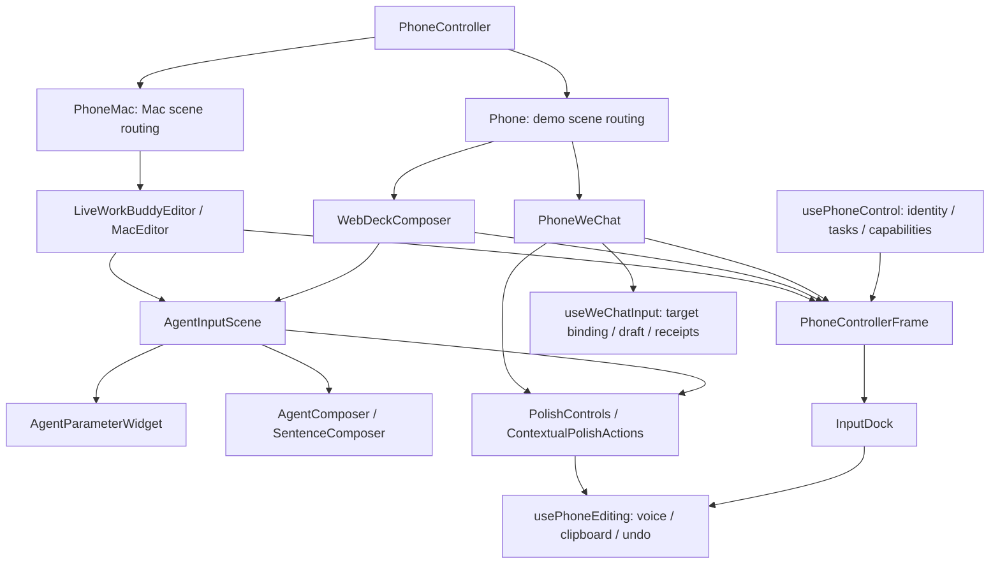

# Phone controller architecture audit and WeChat update · 2026-11-04

## Scope and conclusion

The audit found partial sharing, not a completely destination-independent phone UI. `PhoneController` still chooses a demo or Mac state container; `usePhoneControl` normalizes identity, task navigation and capabilities, but does not implement a universal text/material transport. Before this revision, the modern demo and Mac WorkBuddy containers independently arranged the same widgets.

This revision shares the modern Agent scene composition through `AgentInputScene`, and parameter panel dispatch through `AgentParameterWidget`. Demo WorkBuddy, Mac WorkBuddy and Codex reuse the common composition, Composer, polish and dock; state ownership, native selection, transfer, receipts and submission remain in the destination adapters. WeChat now uses the common frame, editing lifecycle, contextual polish and dock, with its demo input synchronization extracted into `wechat-input-adapter.ts`.

This is not evidence of real Harmony app control or real Mac WeChat support. Those adapters are unavailable. Legacy adaptive task/approval branches and dedicated presentation/game/painting scenes remain separate scene components; the change does not claim that every app has been reduced to one generic screen.

## Current code structure

`AgentInputScene` receives auxiliary content rendered with `AgentParameterWidget`; it does not own transport. `PhoneControllerFrame` owns identity/task chrome and placement of the supplied shared dock. Scene containers supply business content and callbacks. `mac-agent-layout.tsx` was an unreferenced duplicate layout and was removed after import searches.

## WeChat behavior

- Entering a conversation shows one editor immediately. The tablet selects a meaningful visible incoming message and starts the existing 2-second scan independently of reply-field focus.
- `chat-read` and read completion are scoped to the current conversation, source and epoch. Repeated reads are idempotent; stale completion is rejected.
- Suggestions and Hover actions appear after the authoritative scan completes. Reply adoption fills the same draft and never sends. Starting input dismisses reply suggestions; service actions retain their source context.
- Starting voice uses the shared gesture/session lifecycle. `beforeVoice` initiates a guarded reply-field bind; transcript writes wait for that bind. A focus acknowledgment or ordinary draft revision does not cancel speech. A real conversation/source change does.
- `useWeChatInput` serializes edits, retains recovery text on failure and validates conversation/generation before applying receipts. Explicit Send flushes edits and sends once. Failed synchronization does not clear input.
- Removed duplicate local voice/clipboard/history state and duplicate toast rendering from the WeChat scene. Existing continuous native dictation and haptic implementation is unchanged.

## Contextual polish

The shared WorkBuddy polish visual and request lifecycle are reused. There is no new API or automatic model call. Actions are selected from actual editable text, at most three, rather than filling a fixed menu:

| Content | Action |
| --- | --- |
| Short, already clear reply | No unnecessary action |
| Long / repetitive reply | 更简洁 |
| Formal or bookish expression | 更自然 |
| Harsh phrasing | 更礼貌 |
| Repeated fillers / disfluency | 修正语病 |

Natural and polite tone actions are mutually exclusive. Explicit requests to keep tone suppress tone transformations. Existing Gemini instructions preserve facts, dates, negations and constraints. Request target/version checks, direct fill-back and undo remain shared; no action sends a message.

## Read-only Claude review

Used Claude CLI with safe mode, no tools, strict empty MCP configuration and no persisted session. Input was limited to relevant source snippets. The useful findings were duplicate WeChat editing state, default-focus gating, and the need for content-dependent actions. One suggested issue—quick reply sending immediately—was incorrect for the current core; local source confirmed it already adopted into a draft. That suggestion was not applied. Review is advisory, not runtime acceptance.

Private local evidence: `artifacts/wechat-shared-controller/claude-review-prompt.txt` and `claude-review.json`. These artifacts are ignored and are not required at runtime.

## Validation

- TypeScript check passed.
- Core tests: 223 passed, including read/focus independence, epoch checks, reply adoption without sending and contextual action gates.
- Production Web build passed; Vite retains its existing large-chunk warning.
- Focused browser/native-mock regression: 14/14 passed (no retries), recorded in `artifacts/wechat-shared-controller/acceptance-final.log`. Covers shared demo/Mac structure and geometry, task/parameter ownership, image selection staging, continuous voice lifecycle, WorkBuddy prompt/selected artifact, WeChat read/adopt/send/service return, polish/undo/stale rejection, and both phone viewport heights.
- Screenshots for 390×844 and 390×700, collapsed/keyboard/trackpad: `artifacts/wechat-shared-controller/wechat-<height>-<mode>.png`. Verified one editor, visible voice control and 8 px gaps around the polish row.
- During development an obsolete bare Vite runtime import in the artifact test loaded a second module instance. The test now imports the runtime resource already loaded by the page. A transient disabled-polish assertion was observed in an earlier batch; focused repetitions passed, followed by a clean final batch. No retries mask the final test result.

Browser speech and Gemini responses are mocks. At the initial source-validation checkpoint this revision had not been installed or tested on physical devices, has not called the real polish model, and has not submitted a real Mac Agent task. No Figma edit, Git commit/push or device operation was performed at that initial checkpoint. Canonical Notion APP-WX-02 was updated; this document is an engineering audit, not a Design mirror.

## Second review and maintenance release

The user subsequently authorized paired installation with existing data retained, and requested another Claude CLI review of the Mac WorkBuddy/Codex input architecture. The same no-tools, read-only review was rerun against the current shared scene, adapters, editing hook, styles and tests. Raw output is in ignored `claude-review-2.json`.

Source reconciliation and fixes:

1. WeChat voice identity now follows the conversation reply field, not the incoming recommendation source. Changing the read source within the same conversation no longer interrupts recording; changing conversation still cancels it. Polish keeps its source/version stamp.
2. Mac insert/shortcut receipts are guarded by the owning editor generation. Mac editor identity includes session and application. An old receipt's embedded snapshot cannot replace a newly focused target in the shared Mac link. The regression supplies an old-target success receipt after a new target becomes authoritative.
3. Codex declares `app: codex` to the existing polish catalog. Its two generic prompt actions remain the same as WorkBuddy; no file/task capabilities are added.
4. Codex explicitly cancels speech before invoking the Mac app switcher, and cannot submit while dictation is active.
5. Removed the shared frame's dependence on `.mac-phone` and moved its base layout to the shared stylesheet. Mac-specific styles are scoped to Mac business controls; Composer geometry is shared. WorkBuddy retains registered teal and Codex neutral monochrome, including its existing black/white Send appearance.

The review's other concerns were checked: `chat-edit` does not change the target identity revision; reply adoption does not send; initial conversation drafts are present. Broader consolidation of legacy scenes and of the two Mac data synchronization hooks remains a follow-up, not a claim of completed universal adapters.

Additional validation: 223 core tests and 19 Mac bridge tests passed. The focused browser batch passed 15 tests with one new test expectation error (it expected black text on Codex's black Send button). Corrected the assertion to the existing white-text/black-background theme; all three unified-controller tests then passed, including the new Mac theme/geometry/speech comparison and late receipt check. TypeScript, Web production build and both signed HAP builds passed. Existing Vite chunk-size and ArkTS warnings remain; no compile/signing error.

Release uses `python3 scripts/build-hap.py --preserve-demo tablet phone`. Both packages preserve generation `1793741702534`, with build timestamp `1793813777990`; bundled Web assets match byte-for-byte. Before installation, device bundle metadata was checked against the prior successful release record and preserved local HAP hashes. Direct extraction of the installed HAP was denied by the OS; the prior generation is established from those installation records, not a claimed direct runtime-state read.

| Role | SHA-256 |
| --- | --- |
| Phone | `2e8c183ec5ce713d7f6b0387208cda24bfe86703268d96f0e937b087d297fb99` |
| Tablet | `9687ec94c1ddf27a5b69657d170ea585f05ed819593c9c53a53f2a53fe1d7b40` |

Installation/launch evidence and before/after bundle metadata are retained in ignored `artifacts/wechat-shared-controller/`. No uninstall, storage clear, demo reset, message/task submission, real Gemini request or Git publication is part of this maintenance validation. Native WeChat recommendations, speech sync and actual polish acceptance are left to the user.

Physical installation result: HDC reported `install bundle successfully` for both roles and `start ability successfully` for both EntryAbilities. Bundle `installTime` stayed unchanged, while `updateTime` advanced (tablet `1793813812132`, phone `1793813826434`), confirming in-place upgrades rather than reinstallations. UI dumps and screenshots show Input Agent on both devices; the tablet retains its WorkBuddy task list. Phone launch is at Settings with distributed mode selected and not yet connected. No reconnection or interaction success is asserted; select the tablet in phone Settings before user acceptance testing. Screenshot files are private and ignored.
