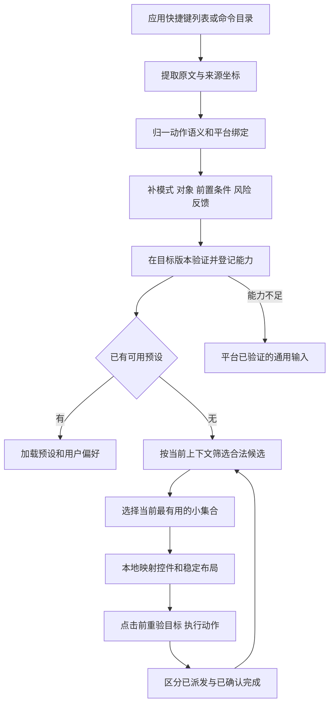

# 从应用快捷键生成手机操作面板

研究日期：2026-10-20。范围：两份指定材料、项目已有面板定义，以及少量官方文档与交互研究交叉核查。本文是研究结论与设计建议，没有修改运行代码、Figma、原始 Word 或 Excel，也没有验证真实应用的快捷键执行。

后续补充：[新 PC 全量清单与自适应区规则](new-pc-shortcut-inventory.md)按用户新要求将需求单与计划纳入分析，逐一覆盖全部应用，补充当前官方鸿蒙 PC 键位和面板键数建议。本文的“表中支持”统计仅对应 H 列；未来补齐范围请看补充报告，例如哔哩哔哩前后跳转已有单号，现纳入规划候选。

## 1 结论

**快捷键列表可以作为无预设应用的面板生成原料。仅凭列表，可以形成有来源的操作目录与面板草案；要形成可靠可用的面板，还需要应用版本、当前模式与对象、真实键位、执行通道及反馈。**

这与现有定义一致：有已验证预设就保留；没有预设但有可信能力目录时，使用注册控件与稳定模板组合；能力不足时，保留平台已经验证可用的通用输入。研究价值在于把原先抽象的“已验证快捷键”补成一套可以提取、筛选、分组和验证的数据流程。

两份材料能支持三个判断：

1. **通用操作有明显复用规律。** 文本编辑、文件操作、导航与检索可以复用输入组合，应用特有动作决定面板的主要价值。
2. **当前模式与目标对象比应用名称更能决定面板。** 同一个 WPS 的文字、表格、演示播放需要不同操作；同一应用中的文本撤销与文件撤销也可能具有不同支持情况。
3. **多数列表项首先适合按钮；部分适合相对调节。** 仅凭这两份材料，尚不足以把任何绝对滑杆作为可执行能力放行。范围、当前值和直接设置接口并未被这些表完整描述。

建议对外使用的范围表述：

> 对具备可验证快捷键或命令接口的应用，系统可以在无需另做整页手机 UI 的情况下，根据当前模式与对象组合操作面板；未覆盖的能力保留通用输入。

“任意应用”适合作为统一接入格式的目标，不宜成为“所有应用都零适配、自动得到完整专业面板”的承诺。

可分三层推进：**列表生成草案 → 经验证的快捷按钮／相对调节 → 带当前状态和直接设值的完整控制**。第二层不要求每个应用都提供完整插件 API；可用经过验证的键盘通道执行，并让用户在大屏观察结果。按钮回执只能显示实际获得的状态；只有输入已派发时，不能写成业务已完成。第三层才需要足够的状态回读与参数接口。

## 2 与之前定义的衔接

本轮按“预设面板”理解提问中的“预知面板”。已对照以下当前工作稿：

- [生成面板联合评审](adaptive-panel-generation-review.md)：§3 三条路径、§5 四份数据契约、§7 控件映射、§10 验证顺序。
- [Jev 决策流程](jev-decision-flow.md)：§7.6.2 应用控制、文本用途、任务状态分开；§7.6.3 预设优先。
- [控件设计系统](adaptive-input-design-system.md)：2026-10-19 入口与生成规则；原子控件 → 输入组合 → 场景组合。
- [项目规则](../AGENTS.md)：连接与启用分开，启用后跟随已核验目标，断连／后台暂停并保护内容。

本轮增加“快捷键目录如何变成能力声明”的研究，不改变已有专业预设，也不为项目增加真实 CAD、视频编辑器或跨应用控制集成。已有演示／绘画／游戏面板仍优先；后文以 WPS 为例只是验证生成规则，不建议用生成草案替换已确认的 WPS 控制器。

## 3 两份材料分别能证明什么

### 3.1 TMG 纪要提供设计语义与约束

[原始纪要](../survey/快捷键%20TMG%20纪要.docx)记载日期为 **2022-06-06**。

| 纪要内容 | 对生成面板的价值 | 使用边界 |
| --- | --- | --- |
| 使用常见英文首字母、遵循 Windows 用户习惯、组合至多三个键 | 支持对命令名称做语义归一化，并减少用户记忆多键组合的负担 | 这些是当时的键位设计原则，不能由首字母反推真实命令 |
| 含系统键的组合由系统独占 | 系统能力与应用能力需要分开登记、路由 | 需核验目标系统当前版本，不能把旧规范直接当作现有权限 |
| 只给常用命令与系统功能分配快捷键 | 可以作为默认候选的设计先验 | 没有用户样本、频次或任务日志，不能当作实测高频榜 |
| 按键盘类型动态显示快捷键提示 | 语义操作与键盘／平台绑定应分离 | 提示框是帮助界面，不等于可执行控制面板 |
| 全屏、分屏、悬浮窗、焦点循环的详细条件 | 快捷键行为依赖窗口状态与设备类型 | 不能把所有左右箭头都归为一个通用“上一项／下一项” |
| 按住系统键并逐次选择，松手确定焦点窗口 | 一部分操作包含按下、重复、释放与提交时机 | 不宜无条件压成一次点击，需专门适配生命周期 |

已检查文内 15 个图像资源。提示框图与多窗示意图说明的是帮助展示和状态迁移，没有提供真实使用频率。Word 的底层 XML 含重复展示内容，提取段落数不作为命令数量。

### 3.2 Excel 是跨平台能力盘点与适配跟踪

[原始工作簿](../survey/快捷键梳理%20%287%29.xlsx)共有 **11 个工作表：3 个可见、8 个隐藏**。

主分析取两个可见业务表，按原合并单元格恢复应用与分类；不把隐藏历史表重复累计。`数据验证字段`是组织与责任映射，不属于快捷键研究样本。

| 范围 | 可定位操作场景记录 | 范围说明 | 新 PC 栏原始标记 |
| --- | ---: | --- | --- |
| `快捷键` | 429 | 31 个应用／系统／框架分组，不能称为 31 个应用 | √ 260；× 142；`/` 11；空白 16 |
| `三方应用快捷键` | 222 | 15 个应用有操作明细 | √ 170；╳ 51；空白 1 |
| 两表合计 | 651 | 行级场景记录，包含替代键位、不同对象、鼠标组合与重复语义 | 不作为 651 个不同命令或使用事件 |

计数口径：C 列必须为文字场景，A 列必须能由真实合并区域确定归属。排除 `快捷键!C438` 的孤立数字 `7`。保留删除线与原始异常记录作历史清单，不把它们自动投入能力库。

第三方表共列出 **51 个应用名，其中 36 个没有操作明细**。例如 QQ、剪映、企业微信、微信、腾讯会议、飞书等仅列名／开发状态，不能推断其快捷键不存在，也无法从这份表生成其专业控制。`三方应用快捷键!A2:C4`、`A248:C250`是明确例子。

这里的 √ 只表示文件当时的记录；本轮没有将任何一项升级为 2026-10-20 实机通过。

### 3.3 “常用”可以形成候选，暂不能形成真实频率排名

隐藏的 `新PC快捷键支持（B032）`、`Mac快捷键支持（15）`确实有“高频总数量／高频支持率”；第三方表也明确列了“WPS表格常用快捷键”“WPS演示常用快捷键”。但材料未提供可逐命令追溯的使用次数、用户样本、观察时长或高频判定方法。

因此保留三类不同证据：

- **材料标为常用**：可用于初始候选与领域先验。
- **跨应用反复出现**：证明可复用性；重复测试模板也会抬高出现次数。
- **真实使用高频**：需要按用户、任务、模式统计。当前材料不具备。

例如在 15 个有明细的第三方应用中，复制出现于 13 个，粘贴／剪切／撤销各出现于 12 个，新建／打开／保存／查找／打印各出现于 5 个。按应用去重，包含原表标记不支持的条目。这是清单覆盖情况，不是用户最爱用的快捷键排行。WPS 明细甚至没有单独列出粘贴、剪切、撤销，进一步表明该样本不能当作完整功能目录。

## 4 对应哪些应用 能生成什么

下表列出全部 15 个有明细的第三方应用。“候选”只描述研究可提取项；是否可启用仍需版本与执行验证。主槽位选择是设计建议，不是源表提供的使用排名。

| 应用 | 记录数／PC 标 √ 数 | 主要可提取操作 | 面板研究判断 |
| --- | ---: | --- | --- |
| WPS Office | 73／60 | 文件、查找、字符格式、字号增减、表格导航、演示步骤 | 最适合测试“同应用按模式组合”；首屏可用文字格式＋字号步进 |
| 石墨文档 | 21／17 | 文件、查找替换、文字导航、粗体／斜体／下划线 | 可复用文档输入组合，不能据此推断完整协作能力 |
| 福昕鲲鹏 OFD | 7／0 | 仅通用文本操作 | PC 栏注明当时搜不到应用；属于待接入，不能判为永久无能力 |
| Coremail | 7／7 | 仅通用文本操作 | 能形成基础编辑候选，缺回复／转发／发送等邮件专用证据 |
| 中望 CAD | 10／10 | 新建、打开、保存、另存、打印、复制粘贴剪切、撤销、删除 | 不能从“10 项全支持”推导专业绘图面板；缺画线、标注、约束等清单 |
| MindMaster | 15／12 | 文本编辑、添加分支、添加子分支、删除分支、查找 | 最适合测试无专用页面的新应用：节点动作组成三键组合 |
| 迅雷 | 4／0 | 文本操作，备注当时没有搜索输入功能 | 缺下载任务动作；不应自动生成暂停／恢复下载 |
| 悟空图像 | 13／12 | 文本编辑、新建、打开、保存、另存、打印 | 缺画笔、颜色、图层操作；尚不足以生成绘画工具面板 |
| 红莲花安全浏览器 | 23／14 | 查找、缩放、历史、打印、书签，以及未支持的导航项 | 可形成浏览候选；不能把另一浏览器的支持状态直接移植过来 |
| 向日葵 | 7／6 | 文本复制粘贴剪切撤销、全选、删除 | 缺本机／远端路由说明；不能据此生成远端系统动作 |
| 网易有道词典 | 7／6 | 通用文本编辑 | 缺翻译、发音等专用动作；不应发明按钮 |
| 讯飞输入法 | 4／4 | 语言、输入法、标点切换、候选词翻页 | 适合作为输入法状态相关组合，需防抢占应用快捷键 |
| 哔哩哔哩 | 10／6 | 6 项文本编辑；播放暂停和方向动作标不支持 | 视频播放时不能把文本快捷键当作播放器面板；真实能力不足应退回通用控制 |
| 酷狗音乐 | 11／9 | 文本编辑、上一首／下一首、播放暂停 | 可提取媒体组合；上一首／下一首方向标注需核验 |
| 咪咕视频 | 10／7 | 文本编辑与 Esc；播放暂停和方向动作标不支持 | 需要补播放器能力，不能凭“视频应用”补齐控制 |

主表还能补充以下领域规律：

| 主表分组 | 记录范围 | 可研究的语义组 | 关键限制 |
| --- | --- | --- | --- |
| 文管 | 134–180 | 文件剪贴板、选择、目录导航、详情、视图 | 文本撤销标支持，文件撤销标不支持；目标对象必须区分 |
| 图库 | 86–133 | 图片选择、编辑历史、缩放、媒体播放 | 编辑撤销与删除撤销支持不同；对象与历史类型不能合并 |
| 浏览器 | 276–309 | 页内查找、标签、浏览历史、缩放 | 多条 √ 与旧问题描述并存，应结合计划及回归证据 |
| 邮件 | 310–329 | 新建、回复、转发、显式发送、正文／附件编辑 | 发送是业务动作；不能把录音结束、回车或面板生成当作发送授权 |
| 备忘录／华为笔记 | 181–226 | 文字编辑、格式、新建、查找 | 部分字段缺真实键位或历史说明混杂 |
| 音乐／华为阅读 | 47–85 | 播放、曲目、翻页、查找、缩放候选 | Windows、Mac、新 PC 支持不同；不可自动搬用 |

## 5 六条能指导设计的规律

### 5.1 操作语义可复用 键位必须按目标绑定

可以统一“复制”“保存”“添加子分支”的语义 ID；具体键位绑定应用、平台、版本与用户配置。MindMaster 的“添加分支”在源表 Win 列是 `Alt+Enter`，新 PC 列是 `Enter`；“添加子分支”分别为 `Ctrl+Enter` 与 `Tab`（第三方表 134、136 行）。

所以面板上写用户目标“添加子分支”，执行层使用该目标当前真实绑定。不能普遍做 Ctrl → Command 替换，也不能仅凭应用类别猜键位。

### 5.2 应用内部也有多种操作对象

`快捷键!C137:I146`：同一个文管里的“文本撤销”与“文件撤销”支持情况不同。`C96:I101`：图库的“撤销编辑”与“撤销删除”也不同。

最小上下文至少包含：**应用实例、版本、模式、当前焦点角色、选择对象类型、是否有弹窗／菜单、当前输入法组合状态**。没有文本焦点可以有合法应用操作；没有已绑定文本目标则不新建手机输入框。

### 5.3 多个键位可以只对应一个按钮

WPS 演示中的前后步骤分散在 7 行：68、69、72–76。它们可以按语义归为“上一步”“下一步”两个操作，键位作为候选绑定保留。

按钮名称应保留“动画或页面”的语义。将“下一步”直接命名成“下一页”，会在有动画的演示里误导用户。按语义与作用域去重，比按快捷键字符串去重可靠。

### 5.4 成对不代表同一种控件

| 操作关系 | 建议原子控件 | 原因 |
| --- | --- | --- |
| 撤销／重做 | 两个 Button | 两条历史动作，无统一可设定数量 |
| 添加分支／添加子分支 | 两个 Button | 创建不同结构，不是增减同一数值 |
| 上一首／下一首，上一标签／下一标签 | 导航按钮组 | 离散对象切换，可能有边界、循环、随机播放；不显示伪造数值 |
| 缩小／放大字号 | Stepper；验证后可选相对 Dial | 增减同一数量；列表没有步长与当前值时，只表示相对动作，不标 `±1pt` |
| 上一帧／下一帧 | 验证后的相对 Stepper／Dial | 同一时间轴的离散单位；需确认帧语义和稳定焦点 |
| 加粗／斜体／下划线，播放暂停 | 状态未知时用动作按钮 | 只有状态回读后，才显示已选／未选或播放／暂停状态；选区可能 mixed |
| 音量、字号或进度绝对设置 | Slider，满足完整能力后启用 | 必须有单位、范围、当前值、指定值设置与真实反馈 |
| 按住预览原图、修饰键配合拖动 | 持续按住控件／组合手势 | 要保证释放、取消、后台／断连清理，不能只发 keydown |

“字号有增减”只支持相对控制候选，不证明支持输入 18pt；“下一首”也不证明能做一条播放进度条。

### 5.5 相同快捷键的含义会冲突

| 键位 | 材料中的不同语义 | 面板后果 |
| --- | --- | --- |
| `Ctrl+F` | WPS 查找；邮件转发；小艺输入法切换繁简体候选 | 不能生成全局固定“查找”并直接发送该键 |
| `Ctrl+D` | WPS 字体对话框；浏览器书签；图库删除／添加到相册的不同记录 | 作用域与对象不明时需要阻断，尤其不能误删 |
| `Ctrl+R` | WPS 右对齐；邮件回复；图库旋转／删除相册记录 | 必须结合模式；源内同作用域冲突也需复验 |
| `Enter` | 默认按钮；WPS 下一演示步骤；MindMaster 添加分支；聊天发送候选 | “确认”不是一个可跨应用盲发的业务动作 |
| `Space` | 激活焦点控件、视频播放暂停、演示下一步、文字空格 | 编辑器与播放器焦点必须区分 |

由此形成设计原则：**先确定动作身份，再查合法绑定；执行前重新核对目标。** 点击后如果目标已经改变，取消这次动作，不自动切回旧应用去执行。

### 5.6 清单支持率高 不保证生成面板有价值

Coremail 的 7 项都是基础文本操作；中望 CAD 的 10 项大多是文件与编辑通用能力。两者都标全支持，但没有提供足够领域操作。

建议另算“任务关键能力覆盖”：给定用户要完成的任务，必需操作中有多少具有可信绑定、可确认的前置条件与执行反馈。该指标比按行计算总支持率更接近面板价值。分母需要真实任务研究，当前不填造出来的比例。

## 6 清单进入生成器前需要处理的问题

| 问题 | 已观察证据 | 处理建议 |
| --- | --- | --- |
| 标支持却未填写实现键位 | 主表有 45 行 H=√、I 为空，例如 296–298、342–351 | 不自动从 Win／Mac 列补齐；标题中若有键位也只作待核验候选 |
| 支持标记与问题描述存在时间混杂 | 主表 30 行 H=√，J 仍含“不支持／不能”；其中一些 L 已写“已支持” | 保留支持、旧问题、计划三者；“已支持”可能解释旧备注，但仍需实际版本／测试日期 |
| 键名与语义方向异常 | 第三方表 218–219、242–243 写“前进←／后退→”；228–229 的上下曲方向也需确认 | 标记疑点，不静默纠正，不编译执行绑定 |
| 文档间快捷键不同 | 第三方表 55、65 行与 WPS 官方演示快捷键帮助存在差异 | 保留来源差异，先明确平台和版本再验证 |
| 相同应用名没有实例／版本 | 多数记录未提供被测应用 build；主表还使用不同平台对标产品 | 增加 appId、版本、平台、用户键位配置与测试快照 |
| 有鼠标组合、菜单序列、单键与按住混在一起 | WPS 24–25 行的修饰键＋拖动；5–10 行的 Alt 菜单访问写法；纪要多窗按住操作 | 建结构化输入类型，不把所有 `+` 都当同时按下 |
| 分类名称不能直接作操作作用域 | 第三方表把部分纯文本编辑、播放暂停都放在“系统快捷键” | 原分类保留；另建 system／application／document／selection／text／modal 作用域 |
| 样式缺少明确图例 | 原表有黄色填充、红色不支持标记和删除线，但未找到高频样式定义 | 不把黄色自动解释为高频；保留样式与来源供人工核查 |

官方交叉核查也有边界。WPS 的公开帮助列 `Shift+F5` 为从当前页播放，与表中 `F5` 的对应关系不同；同一公开帮助还把 `Ctrl+U` 写成 Paste，与本地表的下划线定义冲突。因此外部文档用于发现问题和补充候选，不能覆盖目标鸿蒙版本的实测结果。[WPS 演示快捷键](https://help.wps.com/articles/list-of-keyboard-shortcuts-for-presentation)

## 7 建议的生成流程

### 7.1 慢路径与快路径分开

**接入时**读取列表、菜单导出、用户键位配置或插件命令。模型可以辅助理解自然语言、合并同义动作、提出作用域和分组候选。每项保留原句与出处；推断的范围、单位和前置条件不得冒充应用已声明事实。一次核验后保存版本化目录。

**运行时**使用已核验应用／模式／选区筛选目录；确定规则直接执行。任务表述不明确或多个操作都相关时，模型只在合法 actionId 中推荐。输入、拖动、按住和每次按键不逐次等待模型。

**编译时**由本地规则决定 Button、Stepper、Dial 等控件及布局，不允许模型直接生成任意执行代码。这样可以保证命令与控件能力一致，也便于缓存和测试。

VS Code 官方键位配置本身就把 `key`、`command`、`when` 分开，并允许用户覆盖、同键冲突和多段组合。它提供了一个真实参照：运行时有效的键位，必须连同上下文与优先级一起解析。这里只作为能力数据设计的参照，未声称 VS Code 已接入本项目。[官方键位配置](https://code.visualstudio.com/docs/configure/keybindings)

### 7.2 从原表到能力声明 最少补这些信息

| 数据层 | 必要信息 | 直接影响 |
| --- | --- | --- |
| 来源 | 文件／表／单元格或官方链接、核验日期、原始文字 | 发现异常时能追溯 |
| 身份 | 应用与实例、平台、版本、语义 actionId、用户配置版本 | 不串应用、不用过期键位 |
| 条件 | 模式、选择对象、文本焦点、可编辑性、弹窗、输入法状态 | 防止 Space／Enter 改变含义 |
| 绑定 | 单次组合／多段序列／按住／修饰键＋指针，按下和释放规则 | 正确执行并处理打断 |
| 控件能力 | 动作、相对数量、单位、步长、上下界、当前值、能否指定值、mixed | 决定控件能否显示真实状态 |
| 执行 | 适配器、所需权限、可观察结果、超时、失败处理、可撤销性 | 不把“键已发出”显示成“已保存” |
| 排序 | 常用依据、任务相关性、用户固定项、个人成功使用统计 | 冷启动有用，后续可个性化 |

以“WPS 增大字号”为例，第三方表 `C35:I35` 可提取：名称、`Ctrl+]`、当时支持标记，以及与 36 行的候选成对关系。它**不能**提供当前字号、每次增加多少、min/max、直接设置 18pt、当前文本选区或执行完成回执。应先登记为相对动作候选，未知字段保持 unknown。

建议用不同内部状态记录：

`source-listed → binding-resolved → target-tested → runtime-eligible`

源材料的 √ 属于来源声明。运行时还要核对会话、权限、目标和当前状态。不能凭模型置信度跳过中间步骤。

**执行通道与上下文通道分开建设。** 快捷键可以走已验证的 HID／系统输入接口；应用身份、模式、选择对象和结果可来自主机伴随组件、应用插件或获授权的系统语义接口。仅有 HID 且无法确认前台目标时，可以研究用户手动选定配置的基础遥控，但不能宣称已完成自动跟随和防错目标执行。

项目[2026-10-16 HID 探针记录](hid-probe-validation.md)记载手机到 Mac 的 R/E/A 按下与释放接收成功，同时明确 HID 不提供屏幕语义、应用状态或完成回执。这是已有的基础通道证据，本轮未重跑；它尚不能证明本表的组合键、目标守卫或任意应用操作已经可用。

### 7.3 常用操作如何选

先做硬性筛选：可用能力、目标匹配、模式匹配、前置条件满足；再排序。用户固定项与正在操作的控件优先；任务必要动作、当前选区格式或节点结构动作在前；跨应用基础编辑优先复用现有底部编辑区。

没有用户历史时，采用“材料标为常用＋领域任务先验＋当前状态”的小集合，明确这是冷启动建议。已有历史后，用成功完成的操作而非单纯点击数更新偏好，并按模式分开统计。推荐造成的曝光偏差要单独记录，不把因首屏可见而被多点的按钮自动判为最重要。

固定项、顺序与布局缓存应保持稳定。变化主要发生在模式／对象明确改变后；按住、录音、绘制、拖动时锁定相关区域，旧目标失效则先释放。默认从四个主槽位验证，不强行凑满四项，也不把所有应用固定成四键。

支持稳定布局的外部研究线索：Findlater 与 McGrenere 的 CHI 2004 研究比较了 27 人使用的三类菜单，最优固定菜单在该实验中快于自动适应菜单，多数人偏好可自行调整的菜单。它不能证明今天的生成面板一定更慢，但足以提醒我们必须测量重排成本与用户控制。[原论文](https://www.cs.ubc.ca/labs/edapt/papers/findlater2004.pdf)

## 8 五个具体生成推演

以下均为设计推演，候选来源于表中；所有应用真实执行仍待验证。共同外壳复用现有顶部应用／连接区及底部输入控件，中部组合，不额外添加第二套工具条。

### WPS 选中文字

主区：**加粗｜斜体｜下划线｜字号缩小／增大**。更多操作放查找、保存、上标下标等；复制等已存在于共享编辑区时不重复。

来源：第三方表 32–38 行。字号用相对 Stepper；不显示假定的 12pt，不默认一次改变 1pt。没有格式回读时，三个格式动作不伪装成已选状态。文字框有明确绑定才显示唯一同步编辑区。

### WPS 演示播放

生成的语义组是 **上一步｜下一步｜退出播放**。以 68–76、70 行为依据，将多个键位压缩到两个步骤动作，退出单列。编辑模式中的粗体和字号不应继续占据主区。

启动播放的 55／65 行先处理与官方文档的差异，不在研究中直接放行。实际项目继续采用既有演示预设。

### MindMaster 选中节点

主区：**添加分支｜添加子分支｜查找分支**；删除分支放独立次级入口，保留撤销。来源：第三方表 124–138 行。

进入节点文字编辑时，中部优先保障同步文字输入与已验证文字操作。`Enter`／`Tab` 是否仍触发结构修改必须由真实模式确认；模式未知时不派发结构动作。这里的降级条件由研究提出，尚非已观察的 MindMaster 运行行为。

这个案例最能验证“换一个无专用手机页面的应用，只补数据和适配，是否就能复用现有控件组合”。

### 红莲花浏览网页

源表已标支持的候选包括 **页内查找｜历史记录｜书签｜打印**（176、182–184 行），缩放进入相对调节候选，先澄清 `Ctrl+,Ctrl-` 的写法和实际绑定。

导航／标签操作在该表 169–175 行标不支持，不能从主表另一个“浏览器”分组借用。没有文本焦点时，不出现无归属输入框；点页内查找后，须等目标应用确实打开并绑定查找字段，再进入文本编辑。

### 哔哩哔哩 播放与输入两种状态

第三方表 210–219 行中，6 项已标支持动作全是基础文本编辑；播放暂停及方向动作标不支持。

所以从**这份表本身**出发：播放状态无法生成可靠播放器专用区；进入已确认的评论／搜索文本字段后，可以复用基础编辑候选。它不否定项目当前本地 Bilibili 演示控制，也不代表今日真实客户端仍不支持，只说明两个证据来源不能混用。

## 9 下一轮怎样验证 可否推广到未知应用

建议先做三个切片：WPS 文字格式、MindMaster 节点结构、浏览器页面查找。前两者检验复用与模式变化，后者检验从应用动作到真实文本目标的转换。Bilibili 与只列名的剪映用作能力不足时的负例。

| 验证问题 | 具体方法 | 通过条件 |
| --- | --- | --- |
| 能否准确读取列表 | 抽查原表坐标、合并单元格、替代键位、空白／不支持项 | 不把未列出当不支持，不跨平台补键，不累计历史表 |
| 能否得到稳定语义 | 人工标注一小组含同义、冲突、按住和模式变化的样本 | 操作与目标不混淆；不把导航、历史或结构操作误成绝对参数 |
| 是否真的在目标应用生效 | 固定版本，分别在正确焦点、文本焦点、弹窗和未知焦点下测试 | 正确目标完成；条件不符时不误操作；发送／删除等动作保持明确 |
| 面板是否比通用输入有用 | 同任务比较通用键盘触控板、固定手机面板、生成面板 | 报完整任务时间、误操作与恢复、视线切换、学习成本；不只报按钮点击次数 |
| 是否可推广到新应用 | 留一个未写专用页面的应用，仅增加能力清单与适配 | 不另写整页 UI 也能形成可用组合；记录新增规则、人工纠错与适配工时 |
| 模型是否带来增益 | 同一能力库比较规则版本与规则＋模型版本 | 任务相关操作更准确，收益覆盖等待和错误推荐成本 |

设备侧验收还必须覆盖：输入会话启用、切应用释放、后台暂停、重连不重放、中文输入法组合、用户改键、不同键盘布局、按住键释放以及派发无回执的失败状态。不要把模型生成了 PanelSpec 或浏览器预览通过当作这些能力已经实现。

## 10 本轮交付与证据边界

- 已完成两份源文件的正文、图像、工作表、隐藏状态、合并单元格、注释与关键样式检查。
- 已整理 651 条行级操作场景，统计全部有明细的第三方应用，并检查能力空白与源内歧义。
- 已做 WPS 官方文档、VS Code 键位条件及菜单交互研究的针对性交叉核查；未逐项验证全部快捷键。
- 已生成一个可切换场景的[研究预览](../artifacts/shortcut-panel-research-2026-10-20/panel-research-preview.html)，用于比较同一控件库如何随应用与模式组合。预览采用人工筛选的来源记录和情境，尚未实现自动目录导入或生成器；没有任何键盘注入、远端连接或业务执行。
- 研究预览已检查桌面与手机两种宽度下的 8 个情境，共 16 组；无脚本错误或页面横向溢出，能力不足案例没有专用动作按钮。此检查只验证研究页面，不证明设备或应用接入。
- 可复核中间数据：[分析摘要](../artifacts/shortcut-panel-research-2026-10-20/analysis-summary.json)、[行级记录](../artifacts/shortcut-panel-research-2026-10-20/operation-records.csv)、[源文件校验值](../artifacts/shortcut-panel-research-2026-10-20/source-manifest.json)。它们位于被忽略的 artifacts 目录，正式结论以本文为准。
- 两份原件校验值未变。没有向外部模型发送原文件，没有上传或 Git push。

后续最值得验证的假设是：**在可信能力目录已经建立的前提下，按当前模式和对象组合少量控件，能否让无物理键盘的大屏任务比通用手机键盘／触控板更省力，并显著降低为新应用设计专用页面的成本。**
