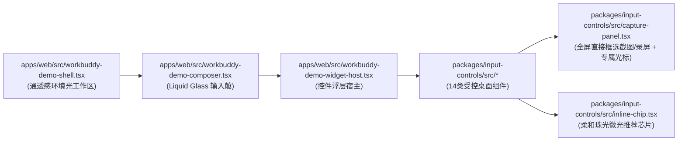
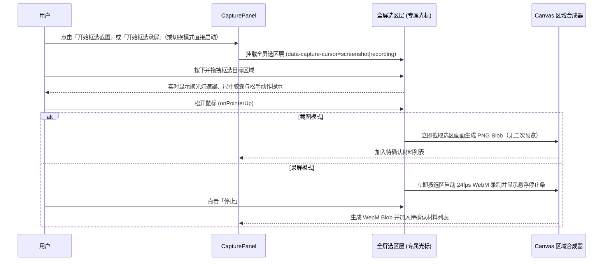
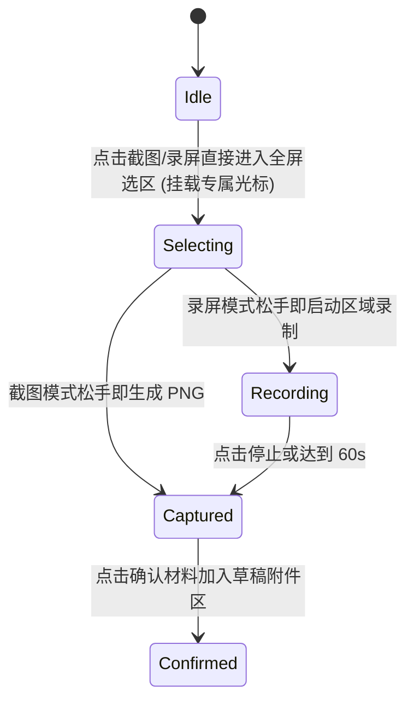

# 小艺Work Web精简版 · Implementation Specification

记录日期：2026-11-11。本页描述当前独立Web实现，不替代Figma/Notion通用设计规范，也不说明手机或原生端已实现同样行为。

## 目标与范围

在桌面Chrome完成“自然输入→显式参数与相关建议→用户调整和补充材料→发送冻结快照→查看/编辑成果”。独立入口不加载手机配对、设备发现、Mac桥接或原生执行器。生产地址：https://xiaoyi-work.vercel.app。源码只维护在purryc/mobile-input的codex/workbuddy-web-demo分支；main独立保留。

## 界面与14类控件

小艺品牌、浅灰侧栏、白色工作区、居中标题、创作入口、黑色圆形发送按钮。中英文设置只切换界面文案，不翻译用户正文、文件名或已生成结果。调试控件面板默认关闭，可在设置开启；示例创建独立草稿。

|类别|控件|实际能力与边界|
|---|---|---|
|参数|时间|演讲类明确分钟值；简短培训/演讲等可推荐10分钟；不是日期日历。|
|参数|颜色|主题、背景、文字、页面独立绑定；桌面预设跟随实际颜色；黑白灰使用中性色。|
|参数|字体|具体字体选择或相关可读性建议；选择参数不意味着所有环境已安装该字体。|
|参数|配色方案|提供8组高阶精选四色配色方案（温暖自然、沉静专业、清新简洁、极光流体、极简曜石、暮光琥珀、北欧冰川、雅致莫兰迪），支持滚动挑选；明确单色和手动值优先。|
|上下文材料|参考文件|实际本地文件或已有内置示例文件字节；未解析文件名不等于附件。|
|上下文材料|图片|本地选择/浏览器摄像头预览，明确确认后采用。|
|上下文材料|文档扫描|摄像头捕获、裁剪/复拍与确认；不是自动OCR承诺。|
|上下文材料|手绘画板|画笔、橡皮、撤销、清空、确认；新草稿初始为空。|
|上下文材料|截图/录屏|点击「截图」或「录屏」后自动收起原浮层，切换为屏幕顶部居中常驻悬浮的系统级控制栏（`NSPanel` `NSStatusWindowLevel`，`hidesOnDeactivate=false`，切换任意 Chrome Tab 或桌面窗口均保持置顶可见），并且页面隐藏（`visibilitychange`）不中断截屏等待状态；支持切到其他 Chrome Tab 或窗口调整好画面后从顶部一键触发 macOS 原生系统级跨窗口截屏（`screencapture -i`）或录屏，完成后自动加入当前草稿。|
|Agent能力|专家|紧凑Grid卡片展示（含头像、名称与职责简介），单选已有候选，隐藏底栏「全部/演示」标签。|
|Agent能力|技能|参考技能市场内容与描述的紧凑Grid卡片展示（含图标、名称与功能描述），支持多选，隐藏底栏「全部/演示」标签。|
|Agent能力|连接器|紧凑Grid卡片展示（含图标、名称与数据源简介），如ima知识库，隐藏底栏「全部/演示」标签。|
|输出约束|输出格式|格式选择与参数快照；七种选择不等于七种已实现导出器。|
|表达整理|AI润色|用户点击后调用Gemini整理/精简；保护参数与材料，支持停止与恢复原文。|

## 输入、来源与推荐调度

- 打字、粘贴和语音转写走同一解析路径。普通chip替换具体值/材料名，保留句子语法；模糊需求保留原文，建议紧跟相关描述。推荐没有括号前缀，移除按钮位于chip内部。
- 原始文本、作用域与字符位置绑定；显式值与手动修改优先；否定与删除记录保留。连接器短语从原生文件识别的匹配文本中屏蔽，但保留原文长度和偏移，避免吞掉真正文件入口。
- 当前Web语义：具体建议显示时即采用，未删除则参与发送；温润珠光蓝紫粉描边和星芒表示推荐来源。准备与揭示阶段采用缓慢柔和的 Fade-in 渐显动画，避免生硬闪烁或粒子干扰。主页工作区背景采用纯白色（`#ffffff`）并与小艺吉祥物图标实现无边界自然融合。此语义与通用设计中“模糊候选待确认”存在差别，不能用本文反向改写设计源。
- 明确值实时显示。模糊推荐采用按候选独立计时的渐进式触发（Per-candidate progressive scheduling）：无论是语音连续口述还是打字输入，只要某一句中的推荐意图词组已识别且稳定满1000ms（无需等待整段话全部说完或点击停止录音），该句对应的推荐候选即刻进入400ms加载并按原文顺序每隔220ms依次渐显和采用；继续说出后续句子不会重置前一句已触发候选的计时。内置文件也只在其候选揭示时采用真实字节。
- 加载状态仅驻留Web内存，不写入原文/数据库。继续输入、重录、切换草稿、隐藏页面、卸载、发送会使未完成队列失效；已显示且仍有效的建议和手动值保留。重复回调/重绘/刷新不反复播放扫光，减少动态效果设置禁用扫光。
- 发送只冻结当时可见有效参数与确认附件，不夹带尚未显示建议。没有自动发送。

## 语音与材料生命周期

语音使用Chrome SpeechRecognition连续识别及中间结果；按结果索引替换，避免重复追加。普通话/英语随界面设置，在线识别不承诺离线。自然结束可恢复识别；显式停止不发送。开启语音输入期间，点击文本框、移动光标、通过键盘编辑文本或打开参数控件均不会中断语音输入（语音锚点自动重定位至最新文本与光标位置，仅再次点击麦克风按钮、发送任务、切换草稿或隐藏页面时停止采集，同时忽略重定位前的迟到识别事件）。拒绝权限/网络错误保留输入，允许重试或键入。

文件、图片、扫描、手绘、截图、录屏在同一个紧凑附件区显示，包含文件名、缩略图与右上角移除。录屏以缩略图/播放标识打开独立预览，不撑高Composer。大预览保留在采集面板中。各材料保留原有类型与确认状态，不合并数据模型；未确认图像/笔迹/采集材料阻止发送并提示处理。删除仅移除当前草稿引用，不删除源文件或其他草稿材料。摄像头/屏幕流关闭释放。

## 润色、生成与成果

润色是显式模型请求，加载chip内有“｜停止”。改写成功后只保留恢复原文图标；编辑、选区/草稿变化及重新录音取消过时响应。模型只能改允许的文字片段，参数、否定与附件保持；没有自动调用模型来展示推荐。

发送冻结原文/参数/确认材料至请求记录（`requests`），同时立即清空底部输入框（正文、内联参数、控件及待发附件归零），侧栏任务标题与搜索自动回退读取已发送请求文本。生成通过服务端Gemini调用和事件流返回成果；可停止、重试并编辑结果。当前实际下载能力为Web演示HTML、Markdown文档和返回格式的图片；没有原生PPTX/DOCX导出承诺。刷新不会自动重发任务。

屏幕录制UI可产生确认附件，但当前生成器不处理视频：发送真实生成前须移除录屏。连接器/专家/技能选择只属于演示参数，不实际执行外部服务。

## 架构和存储

|层|入口|
|---|---|
|Web入口/草稿操作|apps/web/src/workbuddy-demo-main.tsx|
|Web推荐调度|apps/web/src/workbuddy-demo-recommendations.ts|
|参数规则/绑定/投影|packages/core/workbuddy-demo-controls.ts、workbuddy-demo-state.ts|
|附件采集与紧凑展示|apps/web/src/workbuddy-demo-capture.tsx|
|桌面颜色变体|apps/web/src/agent-widget-color.tsx；默认legacy路径保持不变|
|本地API/Gemini|scripts/workbuddy-demo-service.ts|
|Vercel适配|api/workbuddy-demo/[action].ts|
|独立打包|scripts/workbuddy-demo-release.mjs|

保留IndexedDB workbuddy-standalone-demo-v1、语言偏好workbuddy-standalone-demo:language与原API路径。数据仅属于当前浏览器origin，不跨设备同步；切换域名会显示独立存储空间，并不迁移或清除旧域名数据。密钥只在服务端环境/私有文件中读取，status不返回密钥；同源Host/Origin校验保持。

## 验证与演示证据

已有验证：核心268项、服务3项、独立构建；浏览器67个场景中66首次通过，1项布局测量时序改为等待后，3组相关场景全部复测通过。重新打包时需另记录解压包的实际测试数量，不能拿仓库全量数量替代。Claude CLI完成只读审核，修正与Codex复测记录位于忽略的artifacts/workbuddy-demo/walkthrough-2026-11-11/review/。

最终PPT视频39.83秒，工作台54.07秒：白底、四条原生双语字幕轨，连续口述后逐项操作。用户要求删除PPT末句及润色操作，因此最终两段展示13类控件；应用仍有14类。声音为本地Kokoro、转写为录制脚本模拟，扫描/选屏源为虚构画布，片尾成果为静态示意；旧版润色演示使用测试服务，最终版已删除该操作；不作为真实麦克风、OS权限或实时模型生成验收。真实运行的控件操作、Blob、完整视频播放与云端匿名访问分别记录。

- 首句语音口语泛化匹配：支持「介绍今年的产品」「介绍今年的发布的产品」「介绍今年要发布的产品」等口语表达在首句说完后立即触发「演示文稿制作」与「演示设计专家」推荐芯片；同时支持「这题有黑色」（字体用黑色同音）与「有些本地的文档」等语音识别变体。
- 避免残留分离式截图/扫描芯片：从「+」菜单打开「截图／录屏」或「扫描文档」仅打开对应辅助面板，不在输入框末尾插入持久化分离芯片（`detached`），避免清空文本重新语音输入时一开始就出现「截图／录屏」芯片。
- 文本框内容驱动识别（兼容 macOS 苹果系统语音输入与复制粘贴）：`SentenceComposer` 对 `compositionstart` 期间无未提交拼音字母的中文输入（如 macOS 系统级苹果语音输入保持组合态时）在 180ms 停顿后自动同步 DOM 文本并渲染内联芯片；`onPaste`/`onCut`/`onBlur` 立即解除组合态锁定并以实时 DOM 源文本为准；新插入的触发短语自动解除历史 `dismissedControls` 屏蔽。

[新品培训视频](https://drive.google.com/file/d/14mm66l1TRkjKeussSlXeK5Y_53nLoyeW/view)
[工作台视频](https://drive.google.com/file/d/1_XV7oZA6998LsKyEeQfYAk7cVCpHnmJ4/view)

设计参照：[桌面场景](https://www.figma.com/design/ApFLno64NcMoA17MiPFfZh?node-id=2609-121577)。本次不修改Figma、手机、main或原生实现。

## 视觉升级与直接选区截屏/录屏架构图（2026-11-12）

### 1. 模块关系图

### 2. 直接框选截图/录屏关键流程

### 3. 推荐芯片与选区采集状态图

