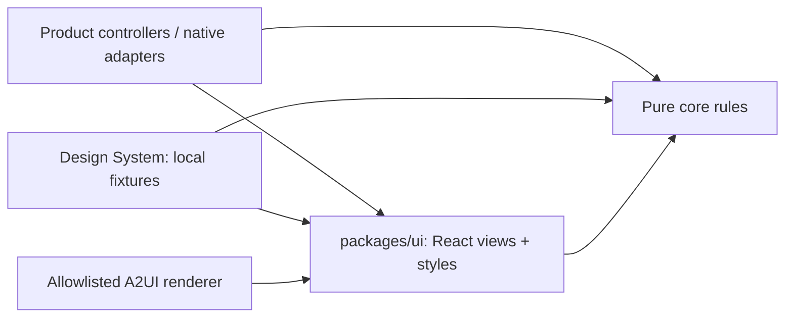

# Mobile Input shared UI

The product and Design System import the **same presentation code**. This is a source package in this repository, not a separately published npm package.



`src/index.ts` is the public API. Product compatibility files preserve existing import paths and inject their language translator through `withProductUI`. Docs supply a memory-only translator through `UIProvider`. Shared views never import the website or product runtime. They receive data and callbacks; permission checks, target identity, attachment synchronization, voice and pointer lifecycles stay in product controllers.

```tsx
import {UIProvider, DurationInput} from './packages/ui/src';

<UIProvider translate={translateUiLabel}>
  <DurationInput value={minutes} onChange={setMinutes}/>
</UIProvider>
```

Use the application's existing theme/layout scope; styles retain the original class names. Device panels require their context classes (`input-dock`, `presentation-glass`, `fc-stage`, etc.). `apps/design-system/src/control-specimens.tsx` demonstrates these contexts without native services. UI text is translated, authored content is preserved.

## Boundaries and registry

- Small controls, composite controls and display helpers share an implementation. A keyboard key or playback button is a part of its shared panel, not a fabricated second implementation.
- `apps/design-system/content/component-bindings.json` binds stable IDs to shared exports and actual source. `extraction-coverage.json` records the review disposition of every registry ID, including embedded variants, host scenes, unmapped designs and retired designs.
- Registered professional faders/encoders and historical Fold layouts are not implemented capabilities. A system camera/picker is a host service, never a website camera or a newly drawn picker.
- React availability and A2UI availability are distinct. The existing seven custom A2UI components remain allowlisted; new React specimens do not silently gain model-callable permissions.

## Updating a control

Change its shared view and fixtures together. Keep product wrappers stable. If an API must change, update both host adapters in the same reviewed change. Run site contracts/build, product typecheck/build and affected interaction tests. New registry IDs without an extraction disposition fail generation.

## Merge preparation

This cleanup lives on `codex/design-system-components`, extracted from `9772a5f`. It has not been merged, pushed or deployed. The original main worktree has unrelated, uncommitted runtime changes, including input-dock gestures and edit review. Do **not** overwrite those files with this checkout. Commit/resolve the product work independently, then three-way merge and reapply only the presentation extraction around the latest controller callbacks. Re-run the affected tests after resolving conflicts; current results establish this branch's baseline, not uncommitted main or real devices.

Ordinary commands (no unlazy executor):

```sh
npm test
npm run build
npm --prefix apps/design-system test
npm --prefix apps/design-system run build
# Start the site preview on port 5281 before the browser suite:
(cd apps/design-system && npm exec -- vite preview --host 127.0.0.1 --port 5281 --strictPort)
npx playwright test -c apps/design-system/playwright.config.ts
```
